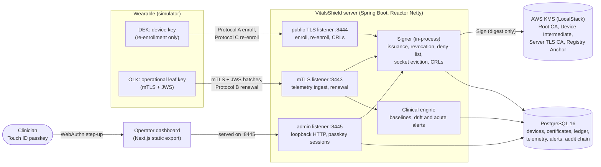

# VitalsShield

VitalsShield authenticates a patient's wearable and every vitals batch it sends. Clinicians act on those readings,
and anyone who copies a device's keys can forge them. So the device certificates are short-lived and issued by a
two-tier CA whose private keys never leave AWS KMS. Every telemetry batch is signed by the key of the mTLS
connection that carried it and checked against a replay window. A copied key used alongside the real device is
detected and cut off within about a second, without deleting any data. A clinician approves provisioning and every security action with a passkey (Touch ID).

The full design, as built, is in [`docs/vitalsshield_technical_architecture_specification_v2.md`](docs/vitalsshield_technical_architecture_specification_v2.md).

## Architecture



## What is live and what is designed

A three-column table in spec v2 Section 8 sorts every component into "Live (tested)", "Live (manual verification)"
and "Designed". In short:
- **Live:** the KMS-backed PKI, mTLS with per-request status and live socket eviction, JWS telemetry with a 64-bit
  replay window, Protocols A, B and C, three clone traps, passkey-approved provisioning and actions, the clinical
  engine with lineage-tracked retraction, and the hash-chained audit log.
- **Live, manually verified:** real Touch ID.
- **Designed, not built:** CA failover, Redis, S3 Object Lock anchoring, attestation verification, and HSM custody
  with IAM isolation.

[`docs/TRACEABILITY.md`](docs/TRACEABILITY.md) maps each live claim to the test or record that proves it.

## Quickstart

Prerequisites: Docker with Compose v2, JDK 21 (Gradle downloads a Java 21 toolchain if needed), Node.js 22 or newer
with npm, OpenSSL 3. Host ports 5433, 4566 and 8443 to 8445 must be free.

```sh
cp .env.example .env                       # then set LOCALSTACK_AUTH_TOKEN (LocalStack Pro, KMS)
docker compose up -d                       # Postgres 16 on 5433, LocalStack KMS on 4566
./gradlew :simulator:installDist           # simulator binary
(cd dashboard && npm ci && npm run build)  # dashboard, served by the server on :8445

caffeinate -dimsu ./gradlew :server:bootRun --args='--spring.profiles.active=demo'   # terminal A
scripts/stage/00-prestage.sh               # terminal B: every line must be PASS

./gradlew -q :server:seedDemoDevice --args="--device-id dev_quickstart_001 --patient-id patient-quickstart-001"
scripts/stage/02-enroll.sh dev_quickstart_001 <BOOTSTRAP_TOKEN from the line above>
simulator/build/install/simulator/bin/simulator run --device-id dev_quickstart_001 --count 5
```

Then open `http://localhost:8445` (use localhost, not 127.0.0.1: it is the passkey RP id). Register the first passkey
with the code in `var/admin/setup-code`.

Warnings:
- LocalStack keeps no state across restarts. `docker compose stop`, `down` or `restart`, and
  `scripts/kms-probe.sh --restart`, all wipe the KMS keys. The next boot then rebuilds the CA hierarchy and revokes
  every device.
- `scripts/stage/01-reset.sh` drops the Compose database volume. That is the only reset, because the audit log is
  append-only.
- On macOS, keep the lid open: with the demo profile's 3-minute leaves, a sleep longer than about a minute expires a
  streaming device's certificate (the simulator then recovers through Protocol C).

The `demo` profile (PT3M leaves, traps on) is for stage runs. `local` (PT4M leaves) is for development and tests, and
the default profile (12 h leaves, no hierarchy rebuild) is the production setting.

## Demo

- [`docs/DEMO_RUNBOOK.md`](docs/DEMO_RUNBOOK.md): T-60, T-15 and T-2 checklists, the 5-minute script, and the timed
  rehearsal record.
- [`docs/demo-fallback.md`](docs/demo-fallback.md): the same nine beats as a static walkthrough with real screenshots
  and outputs, for when the live stack is down (`scripts/stage/99-panic.sh`).
- [`docs/QA_DRILL.md`](docs/QA_DRILL.md): about 35 judge questions with answers and evidence.

## Tests

| Task | What it runs | Needs |
|---|---|---|
| `./gradlew test` | unit tests (untagged), including the demo-profile config check | nothing (passes with `DOCKER_HOST=unix:///nonexistent.sock`) |
| `./gradlew integrationTest` | `@Tag("integration")`: real listeners, Testcontainers Postgres, LocalStack KMS | Docker, the Compose LocalStack |
| `./gradlew e2eTest` | `@Tag("e2e")`: six end-to-end flows, including `NormalOperationNoAnomalyE2E` (traps on, zero false positives allowed) | Docker, the Compose LocalStack |
| `./gradlew drillTest` | `@Tag("drill")`: the LocalStack restart drill | Docker; it wipes the KMS keys, so never run it before a demo |

The regression gate before every commit is `./gradlew test e2eTest`. CI (`.github/workflows/ci.yml`) runs
`./gradlew test` on Java 21, then `npm ci`, typecheck, lint and build for the dashboard. It runs no integration or e2e
jobs, because those need a LocalStack token that must never be in CI.

## Security model

- **KMS custody:** the CA keys exist only in KMS, and every certificate and CRL signature is a KMS Sign call. A registry
  key (Key #4) signs the device and passkey registries, so a database edit cannot forge a device's key or a
  clinician's passkey.
- **Short-lived leaves:** device certificates last 12 hours (3 minutes in the demo) and renew themselves at two thirds
  of their life. Every serial the CA signs is recorded in a ledger or voided.
- **Revocation in three layers:** an in-memory deny-list at the handshake, a database status check on every request,
  and live socket eviction. A backstop poller re-enforces any revocation within 3 s. CRLs are the published record.
- **Signed telemetry:** each batch is a JWS signed by the key of the connection's certificate. The ingest CTE rejects
  replays with a 64-bit sliding window per device and boot epoch, and an idempotent retry is answered without being
  stored twice.
- **Clone detection without data loss:**
  - three traps: a re-enroll collision, sequence regression, and post-drain use;
  - any trap revokes every certificate and sets REAUTH_REQUIRED;
  - telemetry is untouched;
  - a clinician restores or quarantines.
- **Human approval:** provisioning, quarantine and restore each need a passkey step-up bound to the exact action.
  Every security event goes into a hash-chained, append-only audit log.

Residual risks (offline clone window, software device key, rooted firmware, unvalidated clinical thresholds,
plain-HTTP loopback admin plane, in-memory sessions) are listed in spec v2 "Residual risks".

## Docs map

| Document | What it is |
|---|---|
| [`docs/vitalsshield_technical_architecture_specification_v2.md`](docs/vitalsshield_technical_architecture_specification_v2.md) | The specification as built, with every deviation marked `[Dnn]` |
| [`docs/vitalsshield_technical_architecture_specification.md`](docs/vitalsshield_technical_architecture_specification.md) | Spec v1, kept unchanged for history |
| [`docs/DECISIONS.md`](docs/DECISIONS.md) | Every design decision and deviation, numbered |
| [`docs/TRACEABILITY.md`](docs/TRACEABILITY.md) | Each spec claim mapped to the test or record that proves it |
| [`docs/CLOCK_INVENTORY.md`](docs/CLOCK_INVENTORY.md) | Every timestamp comparison and which clock it uses |
| [`docs/QA_DRILL.md`](docs/QA_DRILL.md) | Judge questions, answers and evidence |
| [`docs/RELEASE_CHECK.md`](docs/RELEASE_CHECK.md) | History scan for secrets before publishing |
| [`docs/PRESTAGE_CHECKLIST.md`](docs/PRESTAGE_CHECKLIST.md) | Everything to check before a demo |
| [`docs/learning/README.md`](docs/learning/README.md) | Phase-by-phase learning notes, glossary |

## License

MIT, see [`LICENSE`](LICENSE).
