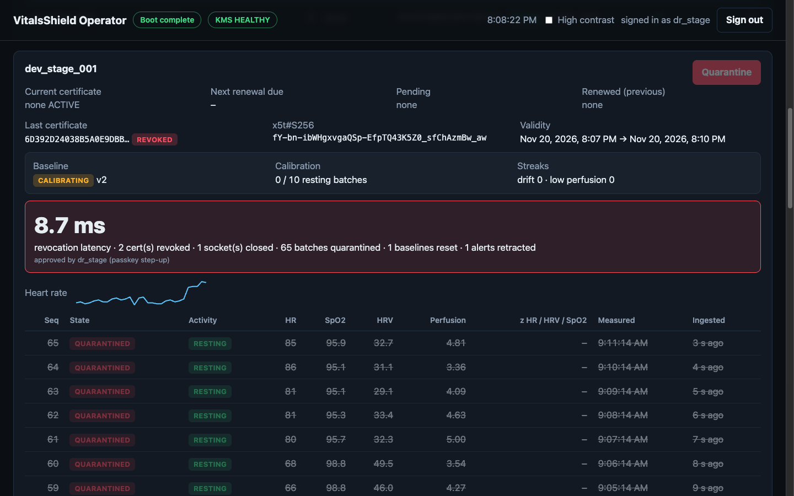
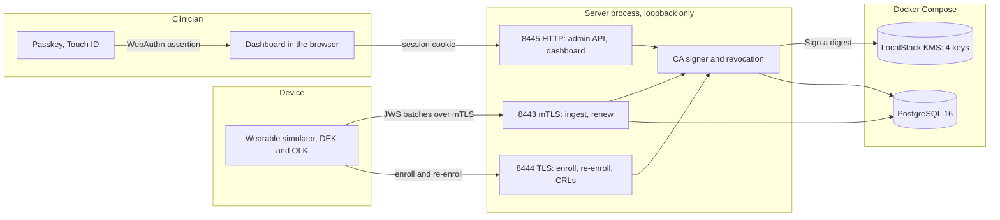
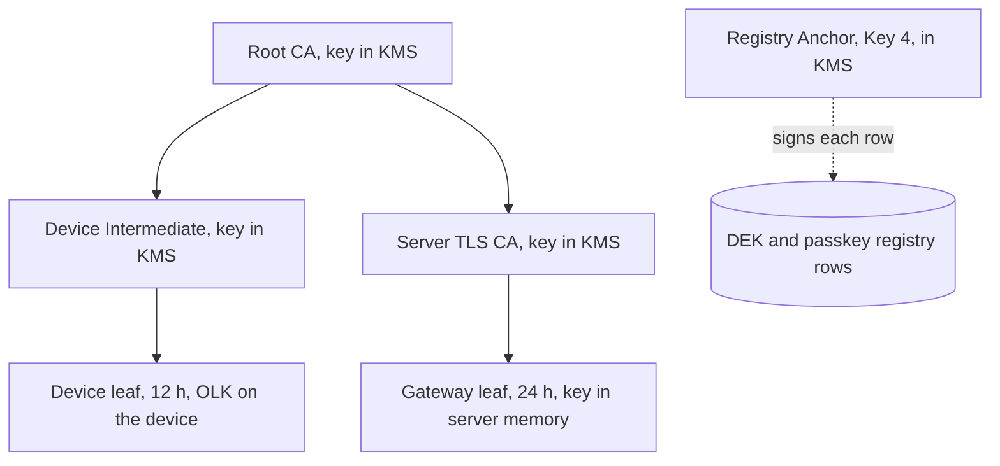
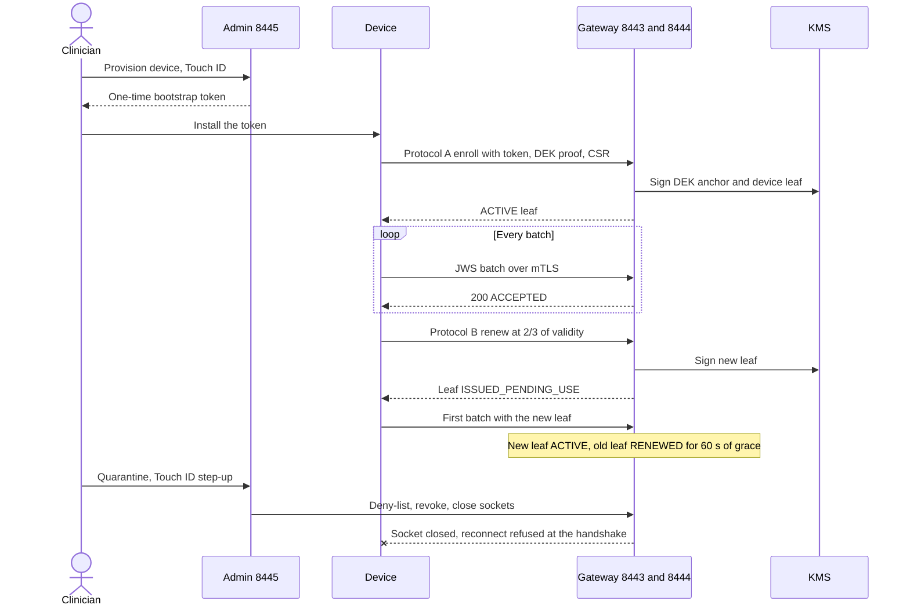
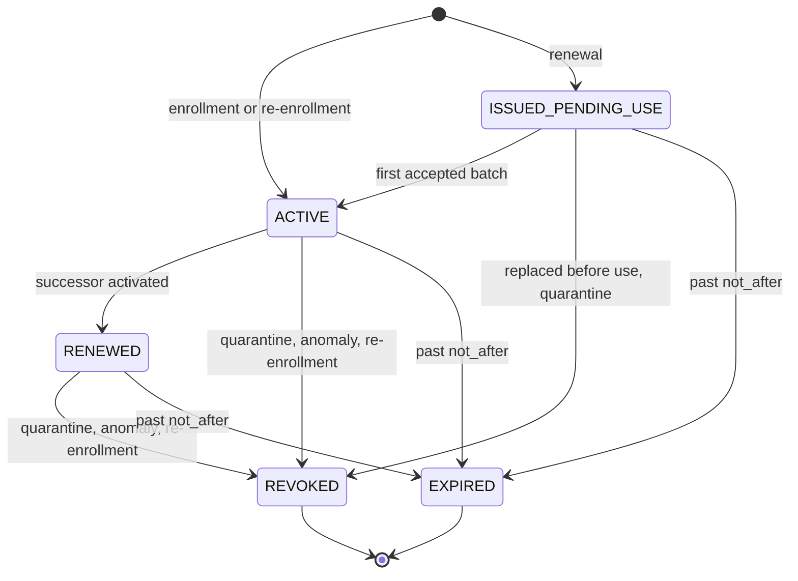
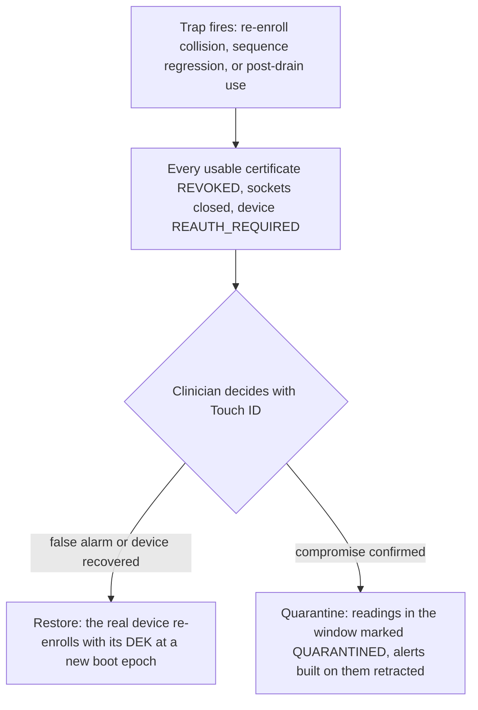

# VitalsShield

Device identity for patient wearables: every vital-sign reading is tied to one certified device, and a compromised
device is cut off mid-stream without deleting patient data.

[](https://github.com/atharva009/vitals-shield/actions/workflows/ci.yml)
[](LICENSE)


## What it is

Clinicians act on readings from wearables, so they need to know which device produced each reading, and anyone who
copies a device's keys can forge readings. VitalsShield gives each wearable a short-lived certificate from a two-tier
certificate authority whose private keys never leave AWS KMS (Key Management Service). Every batch of readings is
signed by the key of the connection that carried it. When a device looks compromised, the server cuts it off within
milliseconds, keeps every reading, and asks a clinician to decide with a passkey (Touch ID).



*The operator dashboard after a passkey-approved quarantine in the scripted stage rehearsal: 2 certificates revoked
and 1 live socket closed in 8.7 ms, 65 batches marked QUARANTINED (kept, struck through), the baseline reset.*

## Highlights

- **Revocation in milliseconds.** From the server starting the quarantine to the device's last socket closing:
  1.3 to 2.7 ms over 5 end-to-end runs (asserted under 500 ms), and 8.7 ms in the stage rehearsal.
  [Evidence](docs/TRACEABILITY.md#layer-1-transport-authentication) (L1.9),
  [rehearsal record](docs/DEMO_RUNBOOK.md#rehearsal-record).
- **Reconnect refused at the handshake.** A revoked certificate gets TLS alert 46 (`certificate_unknown`), asserted on
  `openssl s_client` output before and after the revocation.
  [Evidence](docs/TRACEABILITY.md#layer-1-transport-authentication) (L1.6, L1.10).
- **Every serial accounted for.** Each device serial is reserved before KMS signs it and ends RECORDED or VOIDED; the
  ledger invariant (every certificate has a ledger row, none is left RESERVED) is asserted at 0 violations.
  [Evidence](docs/TRACEABILITY.md#section-8-live-tested-items).
- **Touch ID approval.** A clinician's real Touch ID passkey approved a device provisioning and a quarantine
  (2026-11-16); after the quarantine the device's reconnect was refused at the handshake.
  [Record](docs/learning/phase-06-manual-touchid.md), [decision 80](docs/DECISIONS.md).
- **Clone caught in under a second.** Two copies of one device streaming at once tripped the sequence-regression trap
  in 775 ms in `CloneTrapIT`, and on the clone's third batch, about 1 s after both started, in the stage rehearsal.
  [Evidence](docs/TRACEABILITY.md#layer-5-split-brain-anomaly-detection) (L5.3),
  [timings](docs/learning/phase-09-recovery.md#tests).
- **Offline expiry recovers by itself.** A device that woke 1004 ms after its certificate expired re-enrolled with its
  device key 71 ms later and resumed at the next sequence number with the same boot epoch.
  [Evidence](docs/TRACEABILITY.md#layer-4-device-credential-hierarchy) (L4.3),
  [timeline](docs/learning/phase-09-recovery.md#tests).
- **Soak.** 30 min 37 s at one batch per second with every trap on: 1800 batches, 0 non-200 responses, 18 automatic
  renewals, 0 security anomalies. [Soak results](docs/DEMO_RUNBOOK.md#soak-results).
- **561 automated tests, 0 failures** (329 unit, 226 integration, 6 end-to-end), plus a LocalStack restart drill.
  [Test run](docs/TRACEABILITY.md#test-run-behind-this-matrix).

## How it works

The wearable (a simulator here) holds two keys: a long-lived DEK (device enrollment key) used only to prove its
identity, and an OLK (operational leaf key) certified for 12 hours (3 minutes in the demo profile). It streams batches
as JWS (JSON Web Signature) objects over mTLS (mutual TLS, where both sides present certificates). One Spring Boot
process runs three listeners, the certificate authority, and the clinical engine.

### Architecture

Notice the trust boundaries: the CA keys stay inside KMS, and every listener binds to loopback only.



CRLs (certificate revocation lists) are published on 8444. WebAuthn (Web Authentication) is the browser passkey
standard the admin plane uses.

### Certificate hierarchy

Notice where each private key lives: only the device leaf key and the gateway leaf key exist outside KMS.



The Registry Anchor is not a CA. Its signature over each device's DEK and each clinician's passkey means a database
edit cannot swap in an attacker's key.

### Device lifecycle

Notice that a renewed certificate becomes ACTIVE only when the device first uses it, and that quarantine closes the
socket before anything else happens to the data.



### Certificate states

Notice that REVOKED and EXPIRED are final: recovery always issues a new certificate.



A RENEWED certificate is refused once its 60 s grace ends, and its sockets are closed then.

### Split-brain detection and recovery

Notice that a trap never deletes data: it stops the device and hands the decision to a clinician.



A copy that tries to re-enroll after the restore presents the old epoch and is refused.

## Security model

| Layer | What it does | Spec v2 |
|---|---|---|
| mTLS, deny-list, per-request check | TLS 1.3 with a client certificate; an in-memory deny-list at the handshake, an uncached database status check on every request, and live socket eviction on revoke | [Revocation enforcement](docs/vitalsshield_technical_architecture_specification_v2.md#revocation-enforcement-path) |
| JWS bound to the TLS certificate | A batch verifies only with the key of the connection's certificate, and its header must name that certificate | [Section 5](docs/vitalsshield_technical_architecture_specification_v2.md#5-jws-telemetry-ingestion-and-conflict-safe-sliding-window) |
| Replay window | One SQL statement keeps a 64-sequence window per device and boot epoch; retries are answered without a second row | [Sliding window](docs/vitalsshield_technical_architecture_specification_v2.md#single-cte-conflict-safe-sliding-window-and-insert) |
| KMS-held CA keys | Root, Device Intermediate, Server TLS CA and the Registry Anchor exist only in KMS; every certificate, CRL and registry signature is a KMS Sign call | [Key custody](docs/vitalsshield_technical_architecture_specification_v2.md#key-custody-db-role-separation-and-signer-isolation) |
| Serial ledger | Every serial is reserved before signing and ends RECORDED or VOIDED, so nothing the CA signs goes untracked | [Schema as built](docs/vitalsshield_technical_architecture_specification_v2.md#schema-as-built) |
| WebAuthn step-up | Provisioning, quarantine and restore each need a fresh passkey assertion over the exact action | [Canonical encodings](docs/vitalsshield_technical_architecture_specification_v2.md#canonical-binary-encodings) |
| Split-brain traps | Re-enroll collision, sequence regression and post-drain use each revoke the device and set REAUTH_REQUIRED | [Anomaly response](docs/vitalsshield_technical_architecture_specification_v2.md#non-destructive-anomaly-response-and-clinician-recovery) |
| Append-only audit | Security events form a hash chain; database triggers reject UPDATE and DELETE | [Audit log](docs/vitalsshield_technical_architecture_specification_v2.md#tamper-evident-audit-log-security_audit_log) |

## Live vs designed

Condensed from [spec v2 Section 8](docs/vitalsshield_technical_architecture_specification_v2.md#8-hackathon-live-demo-scope-vs-production-architecture).

| Area | Live (tested) | Live (manual verification) | Designed |
|---|---|---|---|
| Keys and CA | Four P-256 keys in LocalStack KMS, RFC 5280 profiles checked with OpenSSL, local-profile rebuild after key loss, restart drill | Rebuild before every stage run | Real AWS KMS with HSM custody, standby Intermediate and CA failover, offline Root ceremony |
| Process separation | None: one process, one database user, one set of KMS credentials | None | Separate signer service, IAM roles, per-service database roles |
| Transport and revocation | TLS 1.3 only, deny-list, per-request check, eviction, alert 46, backstop poller, cached CRLs | Quarantine latency in the rehearsal | Redis eviction broadcast between gateways, load balancer, CRLs on a CDN, TLS on the admin plane |
| Enrollment and renewal | Protocols A, B and C, first-use switchover, grace, expiry sweep, 503 with Retry-After on KMS or database failure | Touch ID provisioning | Hardware-backed DEK in a secure element |
| Split-brain | Three traps, anomaly response, restore with resync, no false positive in normal operation | Two-copy clone drill | A trap on a renewal from a certificate whose successor went to a different key |
| Admin plane | Passkeys, sessions, action-bound step-up, KMS-anchored passkey registry | Real Touch ID registration and step-up | Attestation verification, shared sessions |
| Clinical engine and audit | Calibration, drift and acute alerts, quarantine with scoped alert retraction, hash-chained append-only audit | Audit chain shown valid in the Touch ID run and the rehearsal | Durable evaluation outbox, clinical validation, S3 Object Lock anchoring of the audit chain |

LocalStack provides the KMS API and cryptography (ECC_NIST_P256, ECDSA_SHA_256) but no hardware custody and no IAM:
its keys are data in a container. Production would point the same code at AWS KMS.

## Limitations and residual risks

From [spec v2 Section 9](docs/vitalsshield_technical_architecture_specification_v2.md#9-residual-risks-new):

- **Offline clone window.** A clone that copies the DEK and re-enrolls while the real device is off looks like a normal
  offline recovery. The traps need the two copies to overlap.
- **Renewal-race clone.** A clone copied just before a scheduled renewal can renew first; the real device sees what
  looks like a lost renewal response.
- **Software DEK.** Without a secure element the DEK is a file, and anyone who reads it can re-enroll as the device.
- **Signed is not true.** JWS proves which key signed a batch, not that the numbers are correct. A rooted device can
  send plausible, well-signed readings.
- **Clinical thresholds are not validated.** Plausibility bounds, alert limits and drift thresholds are engineering
  defaults.
- **Trap thresholds are not measured** against real multi-gateway reordering.
- **One process holds every key.** A compromise of the server process can call KMS Sign on all four keys while it
  lasts, and can write every table.
- **Admin plane without TLS.** Port 8445 is plain HTTP on loopback; the session cookie has no `Secure` flag.
- **In-memory state.** Admin sessions, ceremonies, grace-eviction timers, rate limits and trap counters live in one
  process.
- **Audit chain not anchored.** A database superuser can drop the triggers and rewrite the chain consistently.
- **Lost clinical evaluations.** Queue overflow or a crash leaves accepted batches unevaluated; they are counted, not
  replayed.

## Run it locally

Prerequisites: Docker with Compose v2, JDK 21 (Gradle downloads a Java 21 toolchain if needed), Node.js 22 or newer
with npm, and a LocalStack Pro auth token (KMS is a Pro feature). OpenSSL 3 is needed only by the OpenSSL integration tests
(`PkiOpensslIT` and the alert 46 test), which skip without it. Host ports 5433, 4566 and 8443 to 8445 must be free.

```sh
cp .env.example .env                       # then set LOCALSTACK_AUTH_TOKEN
docker compose up -d                       # PostgreSQL 16 on 5433, LocalStack KMS on 4566
./gradlew :simulator:installDist           # the simulator binary
(cd dashboard && npm ci && npm run build)  # the dashboard, served by the server on 8445

# terminal A
caffeinate -dimsu ./gradlew :server:bootRun --args='--spring.profiles.active=demo'

# terminal B
scripts/stage/00-prestage.sh               # every line must be PASS
```

Open http://localhost:8445 (use `localhost`: it is the passkey relying-party id, and `127.0.0.1` redirects there).
Register the first passkey with the setup code in `var/admin/setup-code`; the code works only while no passkey exists.

To stream from a simulated device without the browser, seed one with the dev tool and enroll it:

```sh
./gradlew -q :server:seedDemoDevice --args="--device-id dev_readme_001 --patient-id patient-readme-001"
scripts/stage/02-enroll.sh dev_readme_001 <BOOTSTRAP_TOKEN from the line above>
simulator/build/install/simulator/bin/simulator run --device-id dev_readme_001 --count 5
```

Expect `ENROLLED serial=... boot_epoch=1` and five `SENT ... status=200 ... trust_state=ACCEPTED` lines.

Caveats:
- LocalStack keeps no state across restarts. `docker compose stop`, `down` or `restart` wipes the KMS keys; the next
  boot rebuilds the CA hierarchy and every device must be provisioned again.
- `scripts/stage/01-reset.sh` drops the Compose database volume. It is the only reset, because the audit log is
  append-only.
- On macOS keep the laptop awake: with 3-minute demo leaves, a sleep of more than about a minute expires a streaming
  device's certificate (the simulator then recovers through Protocol C).

Profiles: `demo` (3-minute leaves, traps on) for stage runs, `local` (4-minute leaves) for development and tests, and
the default profile (12-hour leaves, no hierarchy rebuild) as the production setting.

## Demo

- [`docs/DEMO_RUNBOOK.md`](docs/DEMO_RUNBOOK.md): the checklists, the 5-minute script, the timed rehearsal record and
  the soak results.
- [`docs/demo-fallback.md`](docs/demo-fallback.md): the same nine beats as a static walkthrough with real screenshots
  and outputs, for when the live stack is down.

## Tests

| Tier | Command | What it covers | Tests | Needs |
|---|---|---|---|---|
| Unit | `./gradlew test` | Rules and encodings: trust manager, JWS policy, replay window model, epoch and collision rules, clinical rules, demo profile values | 329 | nothing (passes with `DOCKER_HOST=unix:///nonexistent.sock`) |
| Integration | `./gradlew integrationTest` | Real listeners with Testcontainers PostgreSQL and LocalStack KMS: every protocol, revocation, quarantine, traps, WebAuthn, outages | 226 | Docker and the Compose LocalStack |
| End-to-end | `./gradlew e2eTest` | Whole flows, including `NormalOperationNoAnomalyE2E` (270 batches, 37 renewals, 0 anomalies with every trap on) | 6 | Docker and the Compose LocalStack |
| Drill | `./gradlew drillTest` | Restarts LocalStack, checks the rebuild and device recovery | 1 | Docker; it wipes the KMS keys, so never run it before a demo |

The gate before every commit is `./gradlew test e2eTest`. CI ([`.github/workflows/ci.yml`](.github/workflows/ci.yml))
runs the unit tests on Java 21 and the dashboard's typecheck, lint and build on Node 22. It runs no integration or
end-to-end jobs, because they need a LocalStack token that must never be in CI.
[`docs/TRACEABILITY.md`](docs/TRACEABILITY.md) maps each claim to the test that proves it.

## Where to look in the code

Server paths are under `server/src/main/java/com/vitalsshield/server/`.

| Concept | Main code |
|---|---|
| CA hierarchy and certificate profiles | `pki/HierarchyReconciler.java`, `pki/CertificateProfiles.java`, `pki/KmsCertificateIssuer.java` |
| KMS signing | `kms/KmsSigner.java`, `pki/KmsContentSigner.java` |
| Handshake trust and deny-list | `pki/trust/DynamicMtlsTrustManager.java`, `pki/trust/CertificateDenyList.java`, `gateway/PostHandshakeGate.java` |
| Per-request status and live eviction | `gateway/CertStatusResolver.java`, `signer/SignerRevocationService.java`, `session/ActiveSessionRegistry.java`, `signer/BackstopPoller.java` |
| JWS ingest and replay window | `telemetry/TelemetryIngestService.java`, `crypto-common/src/main/java/com/vitalsshield/crypto/TelemetryJws.java` |
| Serial ledger and CRLs | `pki/IssuedSerialLedger.java`, `pki/CrlService.java` |
| Quarantine | `quarantine/QuarantineService.java` |
| Enrollment (Protocol A) | `enrollment/EnrollmentService.java`, `admin/webauthn/ProvisioningService.java` |
| Renewal (Protocol B) | `renewal/RenewalService.java`, `renewal/CertificateActivationService.java`, `renewal/RenewalSweepers.java` |
| Re-enrollment (Protocol C) and traps | `reenroll/ReEnrollService.java`, `reenroll/CollisionRule.java`, `anomaly/SequenceRegressionTrap.java`, `anomaly/PostDrainTrap.java`, `anomaly/AnomalyService.java` |
| WebAuthn and step-up | `admin/webauthn/WebAuthnService.java`, `admin/webauthn/StepUpService.java`, `admin/webauthn/PasskeyAnchor.java` |
| Clinical engine | `clinical/ClinicalEvaluator.java`, `clinical/DriftRule.java`, `clinical/AcuteRules.java` |
| Audit log | `audit/AuditLog.java` |
| Database schema | `server/src/main/resources/db/migration/` |
| Simulator | `simulator/src/main/java/com/vitalsshield/simulator/Simulator.java` |
| Dashboard | `dashboard/app/page.tsx` |

## Documentation map

| Document | What it is for |
|---|---|
| [Spec v2](docs/vitalsshield_technical_architecture_specification_v2.md) | The architecture as built, with every deviation from v1 marked `[Dnn]` |
| [DECISIONS](docs/DECISIONS.md) | Every design decision and deviation, numbered |
| [TRACEABILITY](docs/TRACEABILITY.md) | Each spec claim mapped to the test or record that proves it |
| [CLOCK_INVENTORY](docs/CLOCK_INVENTORY.md) | Every timestamp comparison and which clock it uses |
| [QA_DRILL](docs/QA_DRILL.md) | 37 judge questions with answers and evidence |
| [Learning notes](docs/learning/README.md) | Phase-by-phase notes on how each part was built, with a glossary |
| [RELEASE_CHECK](docs/RELEASE_CHECK.md) | The history scan for secrets before publication |
| [Spec v1](docs/vitalsshield_technical_architecture_specification.md) | The original design, kept unchanged for history |

## License

MIT, see [`LICENSE`](LICENSE).
