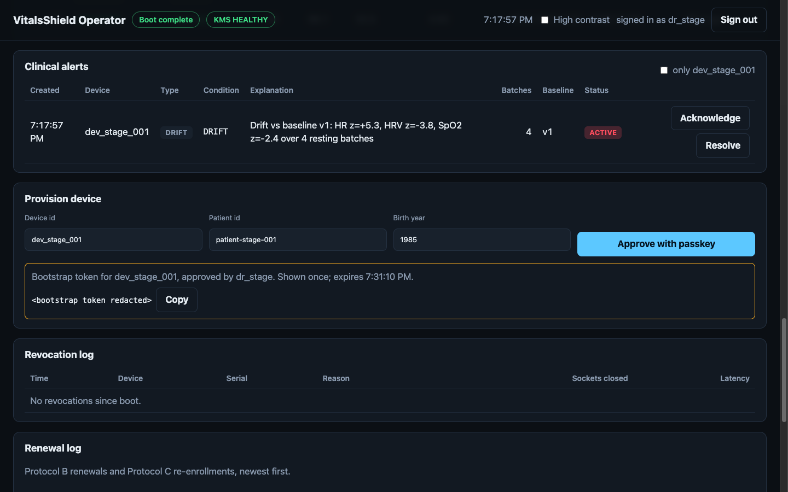
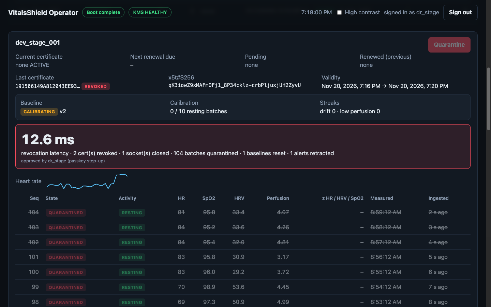
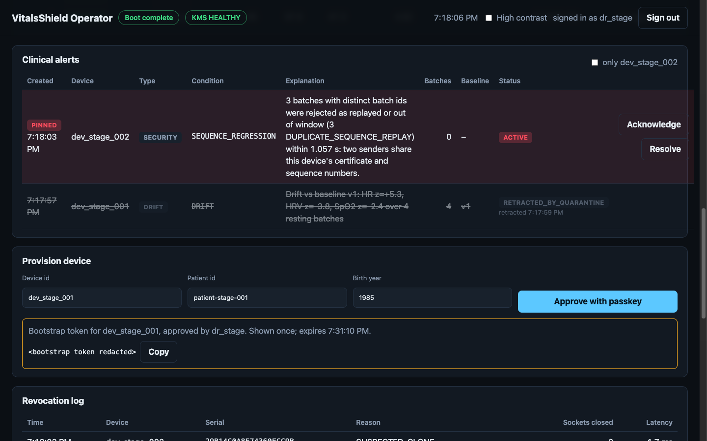

# VitalsShield demo: static walkthrough

Use this if the live stack is down (`scripts/stage/99-panic.sh`). Every screenshot and output below is real. They come
from the timed rehearsal of `docs/DEMO_RUNBOOK.md` on 2026-11-20 (19:15 to 19:18 EST). That run used the demo profile
(DECISIONS 99): LocalStack KMS, 4-minute device certificates, every clone trap on. A headless Chrome at 1440x900 with a
virtual authenticator stood in for Touch ID. Each screenshot links to its high-contrast version. Bootstrap tokens are
blanked in every image.

## 1. The problem


([high contrast](learning/img/stage-01-problem-hc.png))

**What it proves.** The system is up and the dashboard reflects the server's own checks: boot complete, the KMS keys
present and enabled, and the database and server clocks in agreement. A wearable's readings drive clinical alerts.
Whoever holds its keys can forge those readings, so everything that follows is about who holds which key and how fast
a copied key is stopped.

**Evidence** (`scripts/stage/00-prestage.sh`, just before the run):

```
PASS  Server on 8445 with demo profile       profiles=demo,local
PASS  Boot status has all steps              all 8 steps
PASS  KMS health HEALTHY                     kms_state=HEALTHY
PASS  Clock skew under 2 s                   skew_ms=-1 state=GREEN
PRESTAGE: all checks PASS
```

## 2. The trust chain lives in KMS


([high contrast](learning/img/stage-02-trust-chain-hc.png))

**What it proves.** Three CAs (Root, Device Intermediate, Server TLS CA) whose private keys exist only in KMS. Every
certificate and CRL signature is a KMS Sign call, and no CA key is ever in the server's memory or on its disk.

**Evidence.** The four KMS keys the database points at (key IDs truncated):

```
       purpose       | status | key_id_suffix
---------------------+--------+---------------
 ROOT_CA             | ACTIVE | 9ecf2e0b98d5
 DEVICE_INTERMEDIATE | ACTIVE | efd0d2eebfa8
 SERVER_TLS_CA       | ACTIVE | 8794752a6cf2
 REGISTRY_ANCHOR     | ACTIVE | 34d48cc96343
```

The Device Intermediate's CRL at this point (`openssl crl -noout -text`):

```
Certificate Revocation List (CRL):
    Version 2 (0x1)
    Signature Algorithm: ecdsa-with-SHA256
    Issuer: O=VitalsShield, CN=VitalsShield Issuing CA G1
    Last Update: Nov 21 00:15:49 2026 GMT
    Next Update: Nov 22 00:15:49 2026 GMT
    CRL extensions:
        X509v3 CRL Number:
            1
No Revoked Certificates.
```

## 3. Touch ID provisioning, then enrollment


([high contrast](learning/img/stage-03-provisioned-hc.png))

**What it proves.** A clinician's passkey approves the device. The bootstrap token is bound to that approval and shown
once. The device then enrolls: it proves it holds its long-lived device key (DEK) and a new transport key, and the
server records the DEK under a KMS Key #4 signature.

**Evidence** (`scripts/stage/02-enroll.sh dev_stage_001 <token>`):

```
== VitalsShield stage: 02 enroll dev_stage_001 ==
FACTORY_WIPED simulator-state/dev_stage_001
ENROLLED serial=2f7b5063affc16dde4a2de0c8b1c9e96b3763a2b boot_epoch=1 not_after=2026-11-21T00:19:12Z
```

## 4. Streaming


([high contrast](learning/img/stage-04-streaming-hc.png))

**What it proves.** One signed batch per second over mutual TLS. Each batch's JWS signature must come from the
certificate of that very connection. Each one is checked against the replay window and classified, and the patient's
resting baseline locks after 10 resting batches.

**Evidence** (`scripts/stage/03-stream.sh dev_stage_001`):

```
== VitalsShield stage: 03 stream dev_stage_001 (Ctrl-C to stop) ==
SCENARIO resting
SENT seq=1 batch=d500fdf8 status=200 rtt_ms=95 measured_at=2026-11-20T12:16:12.801101Z scenario=resting trust_state=ACCEPTED
SENT seq=20 batch=0515150a status=200 rtt_ms=10 measured_at=2026-11-20T12:35:12.801101Z scenario=resting trust_state=ACCEPTED
```

## 5. Automatic certificate rollover


([high contrast](learning/img/stage-05-rollover-hc.png))

**What it proves.** The 4-minute certificate renews itself at two thirds of its life with no human (Protocol B). The new
certificate becomes active on its first accepted batch. The old one is accepted for a 60-second grace and then refused.

**Evidence** (same stream):

```
RENEWED old=2F7B5063AFFC16DDE4A2DE0C8B1C9E96B3763A2B new=191506149A812043EE93CD1BB4D31D4223E3D9DA due_at=2026-11-21T00:17:52Z at=2026-11-21T00:17:52.333666Z
ACTIVATED new=191506149A812043EE93CD1BB4D31D4223E3D9DA at=2026-11-21T00:17:52.357493Z
```

24 ms from renewal to first use. In the 30-minute soak on the same profile (Phase 10a), 18 renewals took 25.7 ms to
70.7 ms to activate, median 40.2 ms, with all 1800 batches accepted.

## 6. Drift alert


([high contrast](learning/img/stage-06-drift-hc.png))

**What it proves.** Alerts are relative to the patient's own locked baseline and need several consecutive resting
breaches. Every alert records the batches and the baseline version it was computed from.

**Evidence** (`scripts/stage/04-drift.sh dev_stage_001`, then on the dashboard):

```
DRIFT   Drift vs baseline v1: HR z=+5.3, HRV z=-3.8, SpO2 z=-2.4 over 4 resting batches   4 batches   v1   ACTIVE
```

## 7. Touch ID quarantine


([high contrast](learning/img/stage-07-quarantine-hc.png))

**What it proves.** One passkey step-up, bound to this device and this action, does all of the following in one
operation:
- revokes every certificate of the device;
- closes its live connection;
- marks the lookback telemetry QUARANTINED;
- resets the baseline built on it;
- retracts exactly the alerts that came from that data;
- writes the audit entry in the same transaction.

**Evidence.** The quarantine result (from the overview API):

```json
{
  "device_id": "dev_stage_001",
  "at": "2026-11-21T00:17:59.013812Z",
  "certs_revoked": 2,
  "channels_closed": 1,
  "revocation_latency_micros": 12621,
  "batches_quarantined": 104,
  "baselines_reset": 1,
  "alerts_retracted": 1
}
```

The stream, a second later:

```
SCENARIO drift
REJECTED handshake_refused last_ok_seq=104 ms_since_last_ok=1031
simulator exit 3 (0 done, 3 refused/revoked, 4 expired and unrecoverable, 5 REAUTH_REQUIRED)
```

## 8. Clone drill and Touch ID restore


([high contrast](learning/img/stage-08a-reauth-hc.png))


([high contrast](learning/img/stage-08b-pinned-alert-hc.png))


([high contrast](learning/img/stage-08c-recovered-hc.png))

**What it proves.** Two copies of one device's flash run at once. Each works on its own; the server sees their
sequence numbers collide. Within about a second:
- every certificate is revoked as a suspected clone;
- both copies are cut off;
- the device needs a clinician;
- no data is changed.

The clinician restores with Touch ID. The real device re-enrolls with its device key under a new epoch. A copy that
tries the same later presents the old epoch and is refused (shown in Phase 9's CloneTrapIT).

**Evidence** (`scripts/stage/05-clone.sh dev_stage_002`):

```
leaf renewal due in -26 s (or already expired): re-enrolling once before cloning
RE-ENROLLED serial=29B14C0A8E74360FCC9B3736CCE3E66B7F74E3F6 boot_epoch=1 reason=manual at=2026-11-21T00:18:02.216724Z
CLONED simulator-state/dev_stage_002 -> simulator-state-clone/dev_stage_002
SENT seq=1 batch=faca5b7f status=200 rtt_ms=114 ... trust_state=ACCEPTED
SENT seq=2 batch=7dd77b14 status=200 rtt_ms=12 ... trust_state=ACCEPTED
SENT seq=3 batch=e4b10e61 status=409 rtt_ms=15 ... error=DUPLICATE_SEQUENCE_REPLAY
REJECTED handshake_refused last_ok_seq=2 ms_since_last_ok=1065
clone exit 3; original exit 3; original's last lines:
SENT seq=2 batch=bc7d7185 status=409 rtt_ms=6 ... error=DUPLICATE_SEQUENCE_REPLAY
SENT seq=3 batch=4dbc73df status=200 rtt_ms=10 ... trust_state=ACCEPTED
REJECTED handshake_refused last_ok_seq=3 ms_since_last_ok=1560
```

After "Restore (benign reset)" (`scripts/stage/06-recover.sh dev_stage_002`):

```
RE-ENROLLED serial=775AB2F6F7D5D5FB31B43989F84AB7D75F14D18E boot_epoch=2 reason=manual previous_boot_epoch=1 at=2026-11-21T00:18:08.437745Z
SENT seq=5 batch=cd3459b2 status=200 rtt_ms=86 ... trust_state=ACCEPTED
SENT seq=14 batch=c0ee418c status=200 rtt_ms=10 ... trust_state=ACCEPTED
```

The CRL after both incidents:

```
    X509v3 CRL Number:
        5
Revoked Certificates:
    Serial Number: 191506149A812043EE93CD1BB4D31D4223E3D9DA   Key Compromise   (dev_stage_001, quarantine)
    Serial Number: 2F7B5063AFFC16DDE4A2DE0C8B1C9E96B3763A2B   Key Compromise   (dev_stage_001, quarantine)
    Serial Number: 4CC53DA9AC7A7D250F17F419B5E11C14FBF55944   Superseded       (dev_stage_002, replaced by re-enrollment)
    Serial Number: 29B14C0A8E74360FCC9B3736CCE3E66B7F74E3F6   Key Compromise   (dev_stage_002, suspected clone)
```

## 9. Honest close: live vs designed


([high contrast](learning/img/stage-09-close-hc.png))

**What it proves.** Every security decision is in a hash-chained, append-only audit log. Clinician actions and the
system's own anomaly response are both there.

**Evidence** (database after the run):

```
 device_id        | trust_state | boot_epoch | last_sequence_num
 dev_precheck_001 | ACTIVE      |          1 |                 5
 dev_stage_001    | QUARANTINED |          1 |               104
 dev_stage_002    | ACTIVE      |          2 |                14

 sequence_id |     event_type     | actor_id |      device
           1 | PASSKEY_REGISTERED | dr_stage |
           2 | ASSIGNMENT_CREATED | dr_stage | dev_precheck_001
           3 | DEVICE_PROVISIONED | dr_stage | dev_precheck_001
           4 | ASSIGNMENT_CREATED | dr_stage | dev_stage_002
           5 | DEVICE_PROVISIONED | dr_stage | dev_stage_002
           6 | ASSIGNMENT_CREATED | dr_stage | dev_stage_001
           7 | DEVICE_PROVISIONED | dr_stage | dev_stage_001
           8 | DEVICE_QUARANTINED | dr_stage | dev_stage_001
           9 | SECURITY_ANOMALY   | system   | dev_stage_002
          10 | DEVICE_RESTORED    | dr_stage | dev_stage_002

 device_id        | trust_state | count
 dev_precheck_001 | ACCEPTED    |     5
 dev_stage_001    | QUARANTINED |   104
 dev_stage_002    | ACCEPTED    |    13
```

The clone's 13 batches are still ACCEPTED: the anomaly response stops both copies but leaves the data for a clinician
to judge.

**Live today.** KMS-held CA keys, mTLS with per-request status, live socket eviction, JWS-signed telemetry with a
replay window, passkey-approved provisioning and actions, automatic renewal and offline recovery, three clone traps, a
backstop poller, and a hash-chained audit log.

**Designed, not built.** A standby Intermediate CA for failover (KMS Key #3), Redis for multi-gateway eviction and
shared rate limits, a hardware secure element for the device key, and S3 Object Lock anchoring of the audit chain.

**Residual risks.**
- A clone that re-enrolls while the real device is off goes unnoticed until the real device returns.
- A software device key can be copied by anyone who can read the device's storage.
- A clone copied right before a scheduled renewal can win the renewal race and run alone. Found in the Phase 10a
  rehearsal; see `docs/DEMO_RUNBOOK.md`.
