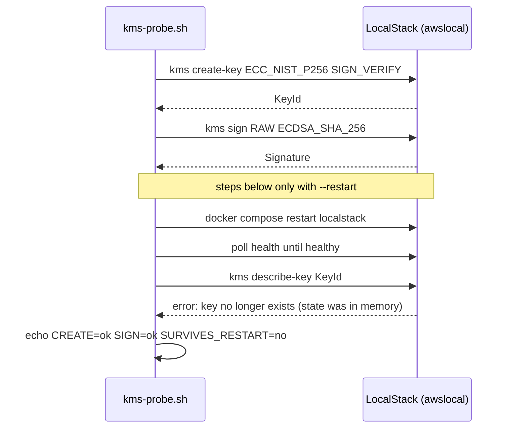
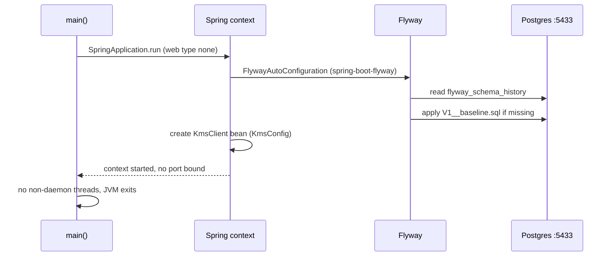
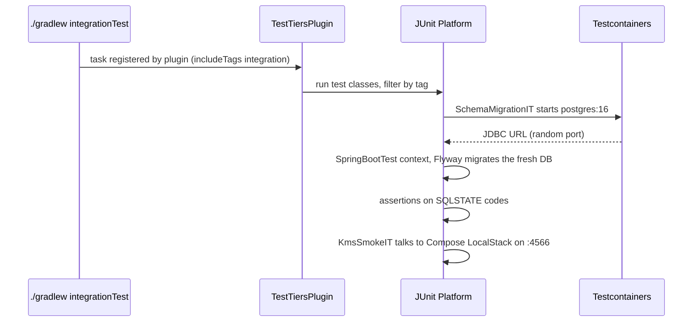

# Phase 0: Scaffold

Commits: `d23ebe7` (scaffold: Gradle modules, Compose stack, V1 schema, KMS smoke tests) and `7d8841d` (move to
Spring Boot 4.1, Gradle 9 with Groovy DSL, a Java convention plugin, Postgres on host port 5433).

## 1. What this phase built and why

Phase 0 built the ground everything else stands on, with no business logic:

- **A KMS gate first.** The whole design (spec Section 3, "Local KMS Profile") assumes we can create P-256 signing
  keys in KMS and sign with them. Before writing any Java, `scripts/kms-probe.sh` proved LocalStack can do that, and
  showed that its keys do not survive a container restart. That second fact is the reason Phase 1 needs a
  reconciliation step at startup.
- **A Docker Compose stack** (`docker-compose.yml`): `postgres:16` on host port 5433, LocalStack (`SERVICES=kms`) on
  4566, and `nsmithuk/local-kms` as an unused fallback behind the `kms-fallback` profile.
- **A Gradle build** with three modules: `crypto-common` (pure crypto helpers, no Spring), `server` (Spring Boot), and
  `simulator` (a stub that prints "simulator stub"). Versions come from `gradle/libs.versions.toml`, and most of them
  from the Spring Boot BOM.
- **Four test tiers** selected by JUnit tags, defined once in `buildSrc/.../TestTiersPlugin.java`.
- **The full database schema** from spec Section 7, copied byte for byte into
  `server/src/main/resources/db/migration/V1__baseline.sql`, plus a `kms_keys` table that the spec does not have.
- **`CanonicalBytes`** in `crypto-common`, the only way later code builds the signed byte layouts of spec Section 3.
- **A server that binds no port.** `spring.main.web-application-type: none` in `application.yml`. Later phases bind
  ports themselves, only after startup checks pass.

## 2. Concept primers

### KMS: signing with a key you cannot see

A normal signing key is a file or a byte array in memory: whoever can read it can sign as you, forever, from
anywhere. AWS KMS turns the key into an API. You call `CreateKey` and get back an identifier (an ARN), never the
private key. To sign, you call `Sign` with the key ARN and the data; KMS signs inside its HSM and returns the
signature. To verify, you call `GetPublicKey` once and verify locally like any other public key.

Example from the probe:

```
kms create-key --key-spec ECC_NIST_P256 --key-usage SIGN_VERIFY   -> KeyId
kms sign --key-id <id> --message <bytes> --signing-algorithm ECDSA_SHA_256 -> Signature
```

The useful property: an attacker who fully compromises our server can ask KMS for signatures while they control it,
but cannot copy the key and keep signing after they are evicted. (With LocalStack that property does not hold; see
section 5.)

### ARN

An ARN is AWS's global name for a resource: `arn:aws:kms:us-east-1:000000000000:key/<uuid>`. The bare `<uuid>` (key
ID) is only unique within one account and region. We store full ARNs so a row can never point at a different key in
another region by accident.

### Docker Compose healthchecks

A container can be "running" before the service inside it is ready. A healthcheck is a command Docker runs
periodically; the container is "healthy" only when it succeeds. `docker compose up -d --wait` blocks until every
service is healthy. Postgres uses `pg_isready`. LocalStack is checked by fetching
`http://localhost:4566/_localstack/health` with `python3`, because the image has no `curl`.

### Flyway migrations

Instead of creating tables by hand, the schema lives in versioned SQL files. At startup Flyway compares the files with
the `flyway_schema_history` table in the database and runs any it has not run yet, in order. After a migration has
shipped you never edit it; you add `V2__...sql`. Our only migration is `V1__baseline.sql`.

### PostgreSQL constraints the schema relies on

The schema enforces several business rules in the database, so no application bug can break them:

- **Partial unique index**: `CREATE UNIQUE INDEX ... ON certificates(device_id) WHERE status = 'ACTIVE'` means "at most
  one ACTIVE certificate per device", while any number of REVOKED rows are fine. Violations raise SQLSTATE `23505`.
- **Exclusion constraint**: `EXCLUDE USING gist (device_id WITH =, tstzrange(active_from, active_until, '[)') WITH &&)`
  on `patient_device_assignments` means "no two assignments for the same device may have overlapping time ranges".
  `&&` is "ranges overlap". The `btree_gist` extension is needed so a GiST index can also compare plain `=` on
  `device_id`. Violations raise `23P01`.
- **CHECK constraint**: `chk_alert_baseline_lineage` on `clinical_alerts` requires `baseline_version` to be set for
  drift alerts and NULL for every other alert type. Violations raise `23514`.

An SQLSTATE is a five-character standard error code. Tests assert the exact code, so they prove which constraint
fired, not just that "something failed".

### Canonical encoding, length prefixes, big-endian

A signature is over bytes, not over "values". If the signer and verifier serialize the same values differently, the
signature fails; worse, if the format is ambiguous, two different value sets can produce the same bytes. Example: a
naive concatenation of `"ab" + "c"` and `"a" + "bc"` is the same string `"abc"`. A length prefix removes the
ambiguity: `00000002 6162 | 00000001 63` differs from `00000001 61 | 00000002 6263`.

`CanonicalBytes` offers exactly these building blocks:

| Method | Writes |
| :--- | :--- |
| `uint32Be(int)` | 4 bytes, most significant first. `uint32Be(3)` is `00 00 00 03` |
| `int64Be(long)` | 8 bytes, two's complement. `int64Be(1)` is `00 00 00 00 00 00 00 01` |
| `utf8WithLength(s)` | `uint32_be(byte length)` then the UTF-8 bytes. `""` is `00 00 00 00` |
| `sha256(data)` | the 32-byte SHA-256 of `data` (fixed width, so no prefix needed) |
| `raw(data)` | the bytes as-is (only for fixed-width values) |

"Big-endian" means most significant byte first, the same as network byte order. The length counts bytes, not
characters: `"é"` is 2 UTF-8 bytes, so it encodes as `00 00 00 02 C3 A9`.

### DER-encoded ECDSA signatures

An ECDSA signature is two numbers, r and s. There are two common ways to write them as bytes:

- **DER**: `30 len 02 len r 02 len s`, an ASN.1 SEQUENCE of two INTEGERs. Length varies (about 70 to 72 bytes for
  P-256) because integers drop leading zeros and add a `00` if the top bit is set. X.509 uses this.
- **R||S**: r and s each padded to exactly 32 bytes and concatenated, 64 bytes total. JWS (`ES256`) uses this.

KMS returns DER. `KmsSmokeIT.signatureIsDer` proves it by parsing the output with BouncyCastle as a SEQUENCE of exactly
two INTEGERs and checking that re-encoding gives identical bytes.

### Test tiers by JUnit tag

Tests are tagged with `@Tag("integration")`, `@Tag("e2e")`, or `@Tag("drill")`. `TestTiersPlugin` registers four
Gradle tasks over the same compiled tests, each with a tag filter:

| Task | Runs |
| :--- | :--- |
| `test` | untagged tests only; must pass with Docker stopped |
| `integrationTest` | `integration` only; needs the Compose stack and Docker for Testcontainers |
| `e2eTest` | `e2e` only (none yet) |
| `drillTest` | `drill` only (none yet) |

Gradle 9 changed the default so a test task can fail when it discovers zero tests. `e2eTest` and `drillTest` set
`failOnNoDiscoveredTests = false` so they pass while empty. (In practice `server:test`, which finds zero tests through
its tag filter, passes without the setting; the setting is there so the empty tiers do not depend on that detail.)

Changed in Phase 5a: `integrationTest`, `e2eTest`, and `drillTest` are never up to date
(`outputs.upToDateWhen { false }` in `TestTiersPlugin`). Their results depend on Docker, LocalStack, and database
state that Gradle cannot see as task inputs, so with unchanged code Gradle used to skip them as UP-TO-DATE and a
regression gate could pass without running. The unit `test` task stays cacheable because it depends only on code.

### Testcontainers

A library that starts a real Docker container from a test (here `postgres:16`), gives the test its JDBC URL, and
removes it afterwards. Each schema test class gets a fresh, empty database, so tests never depend on the state of the
Compose database. `@ServiceConnection` (Spring Boot) wires the container's URL and credentials into the datasource
automatically.

## 3. How it works in our code

### Flow A: the KMS gate (`scripts/kms-probe.sh`)

1. `docker compose exec -T localstack awslocal kms create-key --key-spec ECC_NIST_P256 --key-usage SIGN_VERIFY`.
2. `kms sign` on a small base64 message with `ECDSA_SHA_256`, `--message-type RAW`.
3. Only with `--restart`: `docker compose restart localstack`, wait for healthy, then `kms describe-key` on the same
   key. Without the flag this step is skipped.
4. Print one line: `CREATE=ok|fail SIGN=ok|fail SURVIVES_RESTART=yes|no|skipped`. Stderr (which carries an
   `awslocal` deprecation banner) is kept in a temp file and shown only if CREATE or SIGN fails.

Changed in Phase 2: the restart moved behind `--restart`. A LocalStack restart wipes every KMS key (no persistence),
so the next server boot finds the four CA keys missing, rebuilds the whole hierarchy, and revokes every certificate
issued under the old one. Running the probe by default should not have that side effect.



### Flow B: application startup and Flyway

1. `VitalsShieldServerApplication.main` starts Spring with `web-application-type: none`, so no Netty server is
   created and no port is bound.
2. During context refresh, Boot's Flyway auto-configuration (from `spring-boot-starter-flyway`) connects to the
   datasource and applies pending migrations from `classpath:db/migration`.
3. `KmsConfig` builds the KMS client from `KmsProperties` (`vitalsshield.kms.*`). In the `local` profile
   (`application-local.yml`) that means endpoint `http://localhost:4566`, region `us-east-1`, credentials
   `test` / `test`. Phase 1 changed this client from async to sync; see the Phase 1 note.
4. With nothing else to do in Phase 0, the process exits.

Changed in Phase 2: the process now stays running. `BootSequence` binds three Reactor Netty listeners as its
last step, and `spring.main.keep-alive: true` keeps the JVM alive (Netty's threads are daemon threads). Spring still
never binds a port itself; `web-application-type` is still `none`. See the Phase 2 note.



### Flow C: choosing a test tier



## 4. Data model

### Whole schema, summary (spec Section 7, unchanged in `V1__baseline.sql`)

| Table | Holds |
| :--- | :--- |
| `clinician_passkeys` | WebAuthn credentials of clinicians, each anchored by a KMS signature (`passkey_registry_kms_sig`) |
| `ca_issuers` | one row per CA certificate: `issuer_key_hash`, DN, KMS key ARN, PEM, CRL number, status |
| `devices` | one row per wearable: DEK public key and its KMS anchor signature, replay window counters, `trust_state` |
| `device_bootstrap_tokens` | one-time enrollment tokens approved by a clinician's WebAuthn assertion |
| `consumed_challenge_nonces` | nonces already used, to stop replay of challenge responses |
| `certificates` | every leaf certificate issued: serial, issuer, status, validity, revocation fields |
| `patient_device_assignments` | which patient wears which device, when, and their baseline vitals |
| `telemetry_records` | signed vitals batches (JWS), with replay-window fields and a trust state |
| `clinical_alerts` | alerts with a lineage check tying drift alerts to a baseline version |
| `security_audit_log` | hash-chained audit entries |

Only `kms_keys` and the CA-related columns are used by code so far. The rest is in place for later phases.

### `kms_keys` in detail (not in the spec; added in Phase 0)

```sql
CREATE TYPE kms_key_purpose AS ENUM ('ROOT_CA', 'DEVICE_INTERMEDIATE', 'SERVER_TLS_CA', 'REGISTRY_ANCHOR');
CREATE TYPE kms_key_status AS ENUM ('ACTIVE', 'RETIRED');
CREATE TABLE kms_keys (
    kms_key_id   TEXT PRIMARY KEY,          -- full ARN, not bare key ID
    purpose      kms_key_purpose NOT NULL,  -- what this key is for
    status       kms_key_status NOT NULL DEFAULT 'ACTIVE',
    created_at   TIMESTAMPTZ NOT NULL DEFAULT NOW(),
    retired_at   TIMESTAMPTZ                -- set when a rebuild replaces it
);
CREATE UNIQUE INDEX idx_one_active_key_per_purpose ON kms_keys(purpose) WHERE status = 'ACTIVE';
```

Why it exists: `ca_issuers.kms_primary_arn` records which key signs for a CA, but the fourth key (the registry and
audit anchor, KMS Key #4 in spec Section 3) has no certificate and so no `ca_issuers` row. `kms_keys` gives every key
a purpose and a lifecycle in one place, and the partial unique index guarantees one ACTIVE key per purpose.

## 5. Security reasoning

Defends against, in this phase:

- **Secrets in git.** `.env` holds `LOCALSTACK_AUTH_TOKEN` and is in `.gitignore`; `.env.example` holds a placeholder.
  `git check-ignore .env` prints `.env`.
- **Constraint bugs in later code.** One-active-cert-per-device, one-active-key-per-purpose, non-overlapping
  assignments, and alert lineage are enforced by the database, and tests prove each one by SQLSTATE.
- **Accidental early exposure.** The server cannot bind a port in this phase (`web-application-type: none`).
- **Field-shifting in signed payloads.** `CanonicalBytes` makes length prefixes and fixed-width fields the only way
  to build them.

Does NOT defend against:

- **Key theft in local mode.** LocalStack keeps "KMS" keys as data in a container. There is no HSM and no IAM, so
  anyone with access to the container has the keys. This is a development stand-in only (spec Section 3 says the
  same).
- **Database role separation.** The spec's separate DB roles (gateway, signer, admin) are not created yet; everything
  connects as `vitalsshield`.
- **Anything at runtime.** No listeners, no authentication, no telemetry yet.

## 6. Design decisions

| Decision | Alternatives | Why the alternative lost |
| :--- | :--- | :--- |
| Probe KMS before writing Java | Write code first and discover limits later | The design depends on P-256 signing in KMS; a failure there would change the architecture, so it was checked first |
| LocalStack (`localstack/localstack:2026.10.7`) as the KMS stand-in | `nsmithuk/local-kms` | LocalStack's current docs use this image with an auth token and it worked; local-kms stays as a profile-gated fallback |
| Store full ARNs | Bare key IDs | Key IDs are only unique per account and region |
| Testcontainers for schema tests | Point tests at the Compose Postgres | Each class gets a fresh database, so tests are independent of local state and of each other |
| JUnit tags plus one convention plugin for tiers | Separate source sets per tier | One test source set, four filters; `test` stays runnable without Docker |
| `web-application-type: none` | Let Spring bind 8080 | Later phases must bind ports only after reconciliation; Spring binding early would bypass that ordering |
| Spring Boot 4.1.2, versions from its BOM | Boot 3.5 with hand-pinned versions | Boot 3.5 is past open-source support; the BOM avoids version mismatches. Only AWS SDK, BouncyCastle, Nimbus are pinned |
| Gradle 9 with Groovy DSL, Java `Plugin<Project>` in buildSrc | Kotlin DSL | Directed change: keep all source in Java; the Phase 0 follow-up converted every `.kts` file |
| Compose Postgres on host port 5433 | 5432 | A host-native Postgres already owns 5432 on the dev machine |

## 7. Verify it yourself

All output below was produced on 2026-11-13 against the running stack.

**Stack health.** Look for `(healthy)` on both and `5433->5432` on postgres.

```
$ docker compose ps
NAME                         IMAGE                             COMMAND                  SERVICE      CREATED          STATUS                   PORTS
vitals-shield-localstack-1   localstack/localstack:2026.10.7   "docker-entrypoint.sh"   localstack   43 minutes ago   Up 8 minutes (healthy)   0.0.0.0:4566->4566/tcp, [::]:4566->4566/tcp
vitals-shield-postgres-1     postgres:16                       "docker-entrypoint.s…"   postgres     29 minutes ago   Up 8 minutes (healthy)   0.0.0.0:5433->5432/tcp, [::]:5433->5432/tcp
```

**KMS probe.** Look for `CREATE=ok SIGN=ok`. By default (changed in Phase 2) LocalStack is not restarted:

```
$ scripts/kms-probe.sh
CREATE=ok SIGN=ok SURVIVES_RESTART=skipped
```

With `--restart`, `SURVIVES_RESTART=no` is expected. This destroys every KMS key in LocalStack, and the next `bootRun`
rebuilds the hierarchy (shown in the Phase 1 note). Output from the run used for these notes, before the flag
existed, when the restart always happened:

```
$ scripts/kms-probe.sh            (now: scripts/kms-probe.sh --restart)
CREATE=ok SIGN=ok SURVIVES_RESTART=no
```

**Flyway ran.** Look for version 1, success `t`.

```
$ docker compose exec postgres psql -U vitalsshield -d vitalsshield -c "select version, description, success from flyway_schema_history"
 version | description | success
---------+-------------+---------
 1       | baseline    | t
(1 row)
```

**Unit tests.** Counts per class from `./gradlew test --rerun-tasks` (the Phase 0 class is `CanonicalBytesTest`; the
others arrived in Phase 1). Look for zero failures and `BUILD SUCCESSFUL`.

```
$ ./gradlew test --rerun-tasks --console=plain | grep -E 'PASSED|FAILED|BUILD'   (counted per class)
   5 CanonicalBytesTest PASSED
  13 CanonicalEncodingsTest PASSED
   9 CertificateProfileTest PASSED
  14 CrlReasonMappingTest PASSED
   2 NoNettyNioClientTest PASSED
BUILD SUCCESSFUL in 2s
```

**Phase 0 integration tests.** From `./gradlew integrationTest --rerun-tasks` (23 passed in total, 0 failed, `BUILD
SUCCESSFUL in 16s`); the Phase 0 ones:

```
SchemaMigrationIT > oneActiveKeyPerPurpose() PASSED
SchemaMigrationIT > oneActiveCertPerDevice() PASSED
SchemaMigrationIT > assignmentOverlapRejected() PASSED
SchemaMigrationIT > driftAlertNeedsBaselineVersion() PASSED
SchemaMigrationIT > migratesCleanly() PASSED
SpringContextFlywayIT > flywayAppliedBaselineOnStartup() PASSED
KmsSmokeIT > signatureIsDer() PASSED
KmsSmokeIT > createSignVerify() PASSED
```

**Secret is ignored.** Look for the path echoed back.

```
$ git check-ignore .env
.env
```

## 8. How the tests prove it

| Test | Property proved |
| :--- | :--- |
| `CanonicalBytesTest.encodesFieldsBigEndianWithLengthPrefixes` | `uint32Be(3) + utf8WithLength("abc") + int64Be(1)` equals a hand-computed byte array |
| `CanonicalBytesTest.emptyStringEncodesAsFourZeroBytes` | an empty string still gets a 4-byte zero length |
| `CanonicalBytesTest.sha256AppendsExactly32ByteDigest` | `sha256` appends exactly the 32-byte digest |
| `CanonicalBytesTest.negativeAndHighBitValuesAreEncodedUnsignedBigEndian` | high-bit and negative values encode bit-for-bit |
| `CanonicalBytesTest.utf8LengthCountsBytesNotChars` | the length prefix counts UTF-8 bytes |
| `SchemaMigrationIT.migratesCleanly` | every Section 7 table plus `kms_keys` exists after Flyway |
| `SchemaMigrationIT.oneActiveKeyPerPurpose` | a second ACTIVE ROOT_CA fails with 23505; a RETIRED one is allowed |
| `SchemaMigrationIT.oneActiveCertPerDevice` | a second ACTIVE certificate for a device fails with 23505 |
| `SchemaMigrationIT.assignmentOverlapRejected` | overlapping assignment ranges fail with 23P01 (the first row is CLOSED so only the exclusion constraint can fire) |
| `SchemaMigrationIT.driftAlertNeedsBaselineVersion` | the lineage CHECK rejects both wrong combinations with 23514 |
| `SpringContextFlywayIT.flywayAppliedBaselineOnStartup` | the full app context really runs Flyway (fails with "relation flyway_schema_history does not exist" if the Flyway starter is removed; checked once by hand) |
| `KmsSmokeIT.createSignVerify` | CreateKey, Sign, GetPublicKey work and the signature verifies with JCA `SHA256withECDSA` |
| `KmsSmokeIT.signatureIsDer` | KMS returns a strict DER SEQUENCE of two INTEGERs, not raw R\|\|S |

## 9. Gotchas hit during the build

- **LocalStack image has no `curl`.** The first healthcheck used curl and the container stayed `unhealthy` with
  `/bin/sh: 1: curl: not found`. Fixed by probing the health URL with `python3`.
- **`awslocal` is deprecated.** It prints a large banner recommending `lstk aws`, which broke the "one line of
  output" rule for the probe. The probe now captures stderr and prints it only on failure.
- **Host Postgres on 5432.** A native Postgres (Homebrew) listens on `127.0.0.1:5432` and takes `localhost`
  connections ahead of Docker's port mapping, so the app failed with `role "vitalsshield" does not exist`. The
  Compose port moved to 5433.
- **Spring Boot 4 needs `spring-boot-starter-flyway`.** Boot 4 split auto-configuration into modules. With only
  `flyway-core`, the context starts but no migration runs. `SpringContextFlywayIT` exists to catch this; removing the
  starter made it fail with `relation "flyway_schema_history" does not exist`.
- **Gradle property availability.** `failOnNoDiscoveredTests` does not exist in Gradle 8.14 (the first build failed
  to compile on it) and is required in Gradle 9 for empty tiers. After the move to Gradle 9 it is set on `e2eTest`
  and `drillTest`.
- **Wrapper upgrade chicken-and-egg.** The old 8.14 wrapper could not compile the new Java buildSrc plugin, so
  `./gradlew wrapper` could not run. `gradle-wrapper.properties` was pointed at 9.9.1 by hand, then the wrapper was
  regenerated with 9.9.1.
- **foojay plugin declared twice.** Declaring the toolchain resolver in `buildSrc/settings.gradle` as well as the root
  failed with "already on the classpath with an unknown version". It is declared only in the root.
- **The `.gitignore` `build/` trap.** The pattern `build/` also matched the buildSrc package directory
  `com/vitalsshield/build/`, so `TestTiersPlugin.java` was silently left out of a commit. Phase 1 renamed the package
  to `com.vitalsshield.gradle` and removed the workaround.
- **Testcontainers 2 renames.** `org.testcontainers:postgresql` became `testcontainers-postgresql`, and the class
  moved to `org.testcontainers.postgresql.PostgreSQLContainer` (no type parameter).
- **Netty version skew.** The AWS SDK asked for Netty 4.1.138 while the Boot BOM forced 4.2.19. Phase 1 removed the
  question for KMS by excluding the SDK's Netty client.
- **OrbStack.** The brief assumed OrbStack; this machine runs Docker Desktop (`docker context show` prints
  `desktop-linux`). Nothing depended on it.

## 10. Judge Q&A

**Q: Your local KMS is LocalStack. What does that change about your security claims?**
A: It keeps the API and the cryptography (P-256, ECDSA_SHA_256, DER output) but none of the custody. LocalStack keys
are data in a container, with no HSM and no IAM. The code is written against the real KMS API, so production swaps
the endpoint, not the code. We say this in spec Section 3 and in these notes.

**Q: Why record keys in your own `kms_keys` table when KMS already knows them?**
A: KMS knows keys exist; it does not know which one is the current Root or which one is retired. `kms_keys` records
purpose and lifecycle, and its partial unique index guarantees one ACTIVE key per purpose. It also covers the
registry anchor key, which has no certificate and so no `ca_issuers` row.

**Q: How do you know the schema rules actually hold?**
A: `SchemaMigrationIT` inserts violating rows into a fresh Testcontainers database and asserts the exact SQLSTATE:
23505 for the unique indexes, 23P01 for the overlapping assignment exclusion constraint, 23514 for the alert lineage
CHECK.

**Q: KMS gives you DER signatures. Where does that matter?**
A: X.509 certificates and CRLs need DER, so CA signing uses KMS output as-is. JWS `ES256` needs the 64-byte R||S
form, so any KMS signature that goes into a JWS later must be converted. `KmsSmokeIT.signatureIsDer` pins the current
format.

**Q: Why does the server not listen on any port?**
A: Ports must open only after startup checks pass (Phase 1's reconciliation, and Phase 2's trust store load). With
`web-application-type: none`, Spring cannot open a port on its own, so there is no window where the server accepts
connections with an unchecked hierarchy.

Changed in Phase 2: the server now listens on 8443, 8444, and 8445, bound by `ListenerManager` only as the last
boot step (after reconciliation, trust anchors, and deny-list seeding). The answer above is still why Spring itself
never binds a port.
