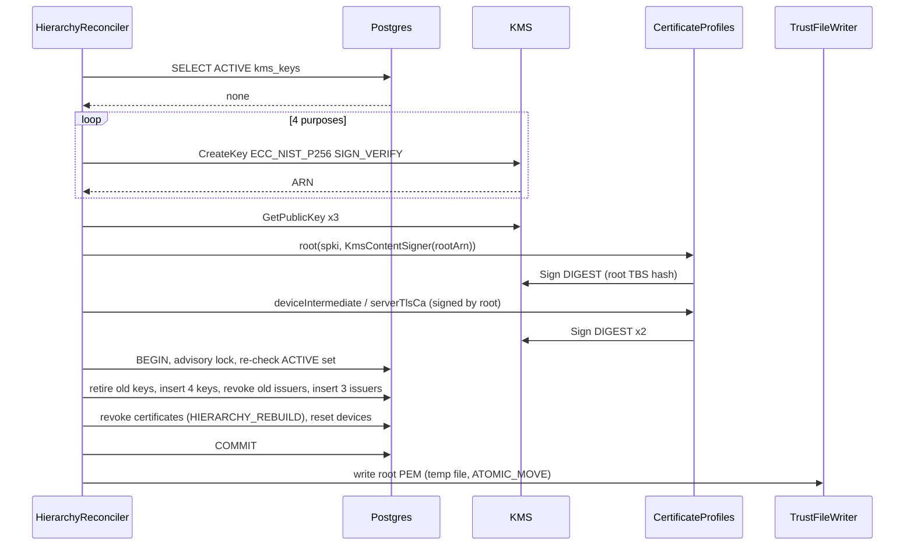
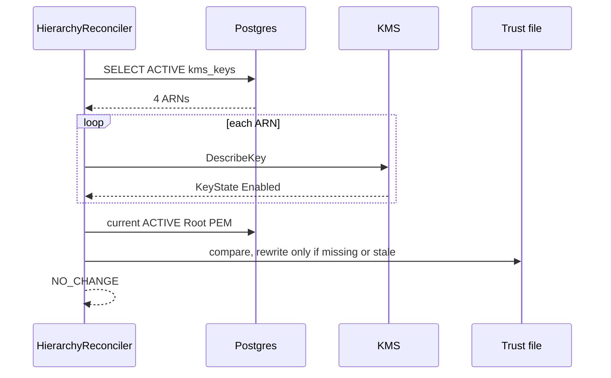
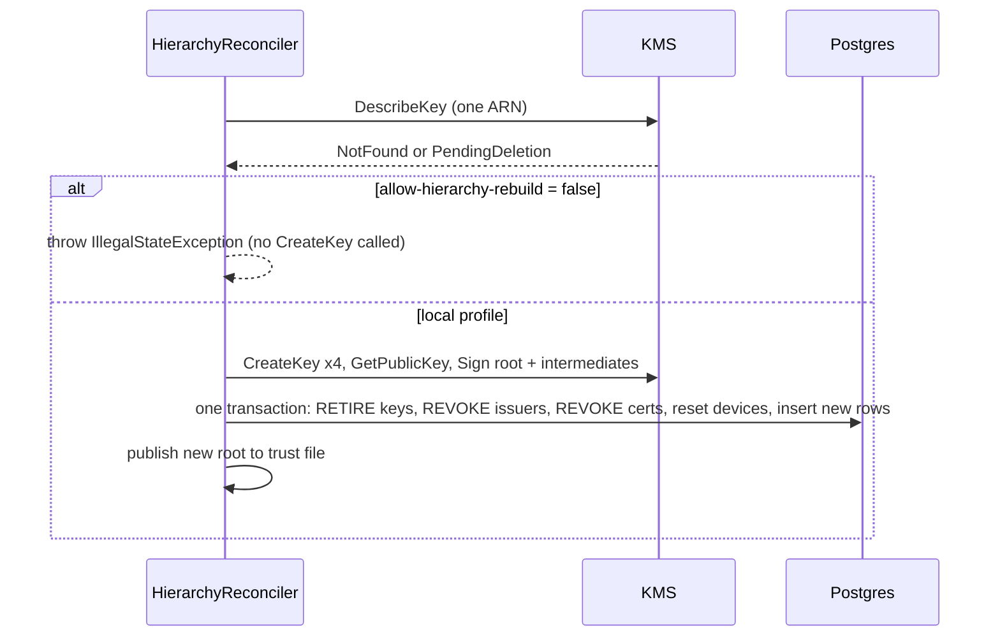
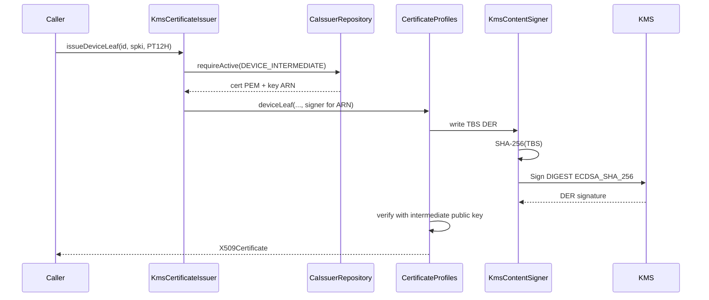
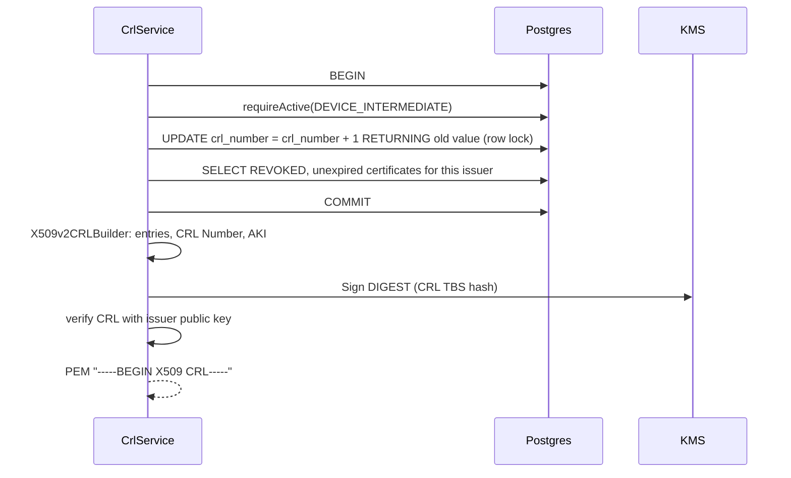
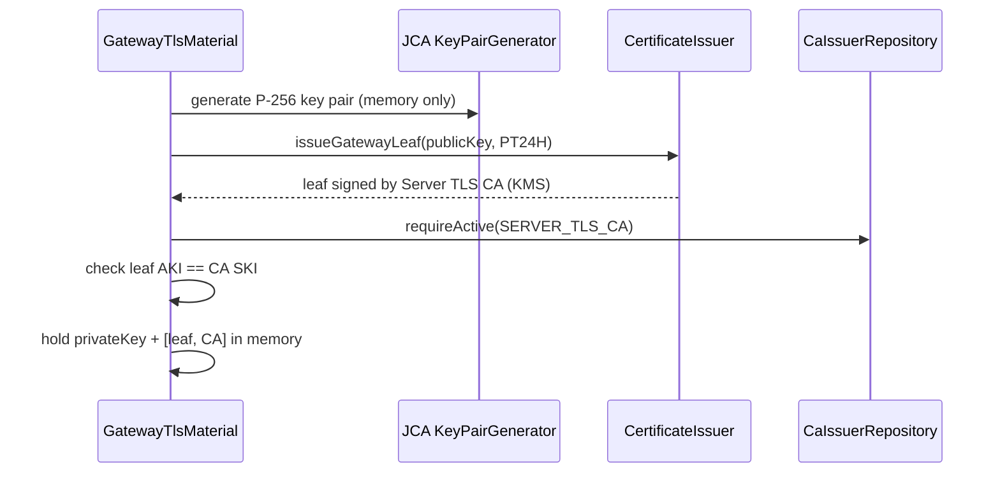
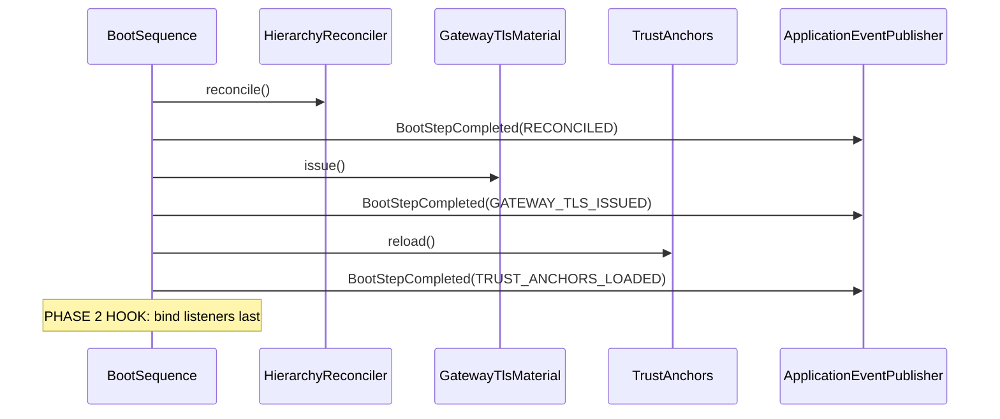

# Phase 1: PKI core

Commit: `236b697` (feat(pki): kms-backed ca hierarchy, rfc 5280 profiles, crls, reconciliation, boot sequence).

## 1. What this phase built and why

Phase 1 builds the certificate authority that every later phase relies on. It follows spec Section 3 ("Two-Tier AWS
KMS PKI", "Local KMS Profile", "Canonical Binary Encodings", "Explicit RFC 5280 X.509v3 Certificate Profiles") and
the revocation record in Section 4 ("Revocation Enforcement Path", last row).

What exists now:

- **Canonical encodings** (`crypto-common/.../encoding/CanonicalEncodings.java`): the five signed layouts of spec
  Section 3 plus the Protocol C re-enrollment proof (Section 4, Protocol C step 2), checked against an independent
  Python implementation (`scripts/golden_vectors.py`).
- **A KMS signing adapter** (`server/.../kms/KmsSigner.java`, `KmsKeyAdmin.java`) on the synchronous AWS SDK client
  using the JDK HTTP stack.
- **A BouncyCastle `ContentSigner` backed by KMS** (`pki/KmsContentSigner.java`), so certificates and CRLs are signed
  inside KMS.
- **Five certificate profiles** (`pki/CertificateProfiles.java`): Root CA, Device Issuing Intermediate, Server TLS CA,
  device leaf, gateway leaf. The first three and the device leaf are the spec Section 3 table; the Server TLS CA and
  gateway leaf are additions so the gateway's TLS server certificate does not come from the device CA.
- **A `CertificateIssuer` interface** with a KMS implementation (`KmsCertificateIssuer`). The spec says Keytos EZCA
  should be a drop-in replacement; this interface is that seam.
- **CRLs** (`pki/CrlService.java`) for the Device Intermediate and the Root, as PEM strings. No HTTP endpoint yet.
- **Startup reconciliation** (`pki/HierarchyReconciler.java`) that checks the four KMS keys and, in the `local`
  profile only, rebuilds the hierarchy when one is gone (spec Section 3, "Local KMS Profile"). Outside `local` it
  fails closed.
- **In-memory gateway TLS material** (`pki/GatewayTlsMaterial.java`) and **trust anchors** (`pki/TrustAnchors.java`)
  for Phase 2's listeners and trust manager.
- **`BootSequence`** (`boot/BootSequence.java`), an `ApplicationRunner` that runs reconcile, gateway TLS, trust
  anchors, in that order, and publishes an event after each.

Differences from the spec, all deliberate and listed again in section 6:

- The spec says the local check looks at "the key IDs referenced by `ca_issuers`". The code checks the four ACTIVE
  rows of `kms_keys`, because the registry anchor key (Key #4) has no `ca_issuers` row.
- The spec puts the Root key behind an offline ceremony role. In the local profile the Root key is used online, once,
  during a rebuild.
- The spec's Cold Standby Intermediate (Key #3) and multi-region replica keys are not built yet.

## 2. Concept primers

### What a certificate actually contains

An X.509 v3 certificate is three things in a DER-encoded ASN.1 SEQUENCE:

```
Certificate ::= SEQUENCE {
    tbsCertificate      TBSCertificate,   -- the part that is signed
    signatureAlgorithm  AlgorithmIdentifier,
    signatureValue      BIT STRING        -- the issuer's signature over tbsCertificate's DER bytes
}
```

The TBS ("to be signed") part, field by field, using our device leaf:

| Field | Meaning | Our device leaf |
| :--- | :--- | :--- |
| version | 3 means extensions are allowed | `3 (0x2)` (the encoded value is 2) |
| serialNumber | unique per issuer; CRLs list revoked certs by it | 20 random bytes, e.g. `5F3126F0...2FB954` |
| signature | algorithm the issuer used; must equal the outer `signatureAlgorithm` | `ecdsa-with-SHA256`, OID `1.2.840.10045.4.3.2`, no parameters |
| issuer | DN of the CA that signed this | `O=VitalsShield, CN=VitalsShield Issuing CA G1` |
| validity | `notBefore`, `notAfter` | 12 hours, starting 60 s before issuance |
| subject | DN of the key holder | `O=VitalsShield Devices, CN=dev_wearable_019` |
| subjectPublicKeyInfo | the public key and its algorithm | `id-ecPublicKey`, curve `prime256v1` (P-256) |
| extensions | policy: what the key may do, who issued it, where to check revocation | BC, KU, EKU, SKI, AKI, SAN, CDP |

The signature covers every byte of the TBS. Change one bit of the subject or an extension and the signature no longer
verifies.

### How chain validation works, step by step

A relying party (a TLS client, OpenSSL, later our gateway) is given a leaf, some intermediates, and a set of trust
anchors it already trusts. It builds a path leaf, intermediate, root and checks each certificate:

1. **Signature.** Verify the certificate's signature with the public key of the next certificate up. For the Root
   (the trust anchor) there is nothing above; it is trusted because it was installed out of band.
2. **Name chaining.** The certificate's issuer name must equal the parent's subject name. When several candidate
   parents exist, the verifier uses the child's AKI to pick the one whose SKI matches (path building).
3. **Validity.** The current time must be within `[notBefore, notAfter]` for every certificate.
4. **Basic Constraints.** Every certificate that signed another must have `CA:TRUE`. A leaf with `CA:FALSE` cannot
   be used as an issuer.
5. **pathLenConstraint.** No CA may have more CA certificates below it than its `pathLen` allows.
6. **Key Usage.** A CA must have `keyCertSign` to sign certificates (and `cRLSign` to sign CRLs). A TLS leaf needs a
   usage that fits the handshake; for ECDSA that is `digitalSignature`.
7. **Extended Key Usage / purpose.** If the leaf has EKU, it must include the purpose being checked (clientAuth for a
   TLS client, serverAuth for a TLS server). OpenSSL also checks EKU on CA certificates if they have one.
8. **Critical extensions.** Any critical extension the verifier does not understand makes the certificate invalid.
9. **Revocation** (if the relying party checks it): no certificate in the path may be on its issuer's CRL.

Our `openssl verify -x509_strict -purpose sslserver` on the device leaf fails at step 7, at depth 0 (the leaf has only
clientAuth) and at depth 1 (the Device Intermediate also has only clientAuth):

```
error 26 at 0 depth lookup: unsuitable certificate purpose
error 26 at 1 depth lookup: unsuitable certificate purpose
```

### Why KU and EKU both exist

They answer different questions. **Key Usage** is about cryptographic operations: may this key make signatures
(`digitalSignature`), sign certificates (`keyCertSign`), sign CRLs (`cRLSign`), encrypt keys, and so on. It comes from
the original X.509 design. **Extended Key Usage** is about application purposes, named by OID: TLS server, TLS client,
code signing, email. It was added later because "may sign" is too broad: a key allowed to make signatures could sign a
TLS handshake as a server or as a client, and those are different trust decisions.

Example: our device leaf and gateway leaf both have KU `digitalSignature`. Only EKU separates them: the device leaf
has clientAuth, the gateway leaf has serverAuth. Without EKU, a stolen device certificate could impersonate the
gateway in a TLS handshake.

### What pathLenConstraint stops

Without a limit, any CA could create a new sub-CA, which could create another, and every one of them would chain to
our Root. `pathLenConstraint` is the maximum number of CA certificates allowed below this CA in a path (not counting
the leaf).

- Root: `CA:TRUE, pathlen:1`. One intermediate level is allowed below it.
- Device Intermediate and Server TLS CA: `CA:TRUE, pathlen:0`. They may sign leaves only.

So if the Device Intermediate's key were misused to sign a certificate with `CA:TRUE`, that new "CA" could not issue
anything a verifier would accept, because it would put a CA below a `pathlen:0` CA.

### SKI and AKI, and why we look issuers up by key ID, not by name

**SKI (Subject Key Identifier)** is an identifier for the certificate's own public key. **AKI (Authority Key
Identifier)** in a child certificate holds the issuer's SKI. Together they link a chain by key, not by name.

From the real files in `build/pki-out/`:

```
root.pem        SKI 0E:F7:F8:0C:...:35:75:FD:BB
device-int.pem  SKI F2:70:BA:A2:...:25:A8:6F   AKI 0E:F7:F8:0C:...:35:75:FD:BB  (= Root SKI)
device-leaf.pem SKI 07:64:0A:F8:...:68:94:58   AKI F2:70:BA:A2:...:25:A8:6F     (= Device Intermediate SKI)
```

How we compute them: SKI = SHA-256 of the subject's full SubjectPublicKeyInfo DER, 32 bytes. That is "method 4" in RFC
7093 section 2 (RFC 5280's examples use SHA-1 of the key bits; RFC 7093 adds SHA-256 options). The lowercase hex of a
CA's SKI is its `issuer_key_hash`, the primary key of `ca_issuers`.

Why by key ID: names repeat. After a rebuild, the new Root has the same DN as the revoked one. This is real data from
our Compose database after the rebuild in section 7:

```
 issuer_key_hash  |                   subject_dn                    | status
------------------+-------------------------------------------------+---------
 939fe45152572848 | CN=VitalsShield Root CA,O=VitalsShield          | REVOKED
 f29b4b85c6428117 | CN=VitalsShield Root CA,O=VitalsShield          | ACTIVE
```

Looking up "the issuer named CN=VitalsShield Root CA" is ambiguous. Looking up issuer key hash `f29b4b85...` is not.
`GatewayTlsMaterial.issue` checks that the new gateway leaf's AKI equals the SKI of the current Server TLS CA for the
same reason, and `BootSequenceIT.gatewayCertIssuedByCurrentServerCa` tests it.

### What a CRL is and how a relying party uses it

A certificate is valid until `notAfter`, but sometimes you must withdraw it earlier (a device is stolen, a key leaks).
A CRL (Certificate Revocation List) is a list of revoked serial numbers, signed by the CA that issued them. Its main
fields:

- **issuer**: which CA's certificates this list covers.
- **thisUpdate / nextUpdate**: when it was made and when a newer one is due. A relying party should not trust a CRL
  past `nextUpdate`.
- **revokedCertificates**: serial number, revocation date, and optionally a reason code per entry.
- **extensions**: CRL Number (increases every time) and AKI (which issuer key signed it).

A relying party that checks revocation: fetch the CRL from the URL in the certificate's CRL Distribution Point,
verify the CRL's signature with the issuer's key (found via AKI), check `nextUpdate` has not passed, and reject the
certificate if its serial is listed.

In VitalsShield (spec Section 4, "Revocation Enforcement Path") the CRL is the published record for outside relying
parties. Our own enforcement will be the database status check in the TLS trust manager and per-request filter
(Phase 2 and later), because those react in seconds, while a CRL is refreshed on a schedule.

### How KMS signs without exposing the key

ECDSA signing needs the private key and the hash of the message. With KMS, the private key stays inside KMS:

1. We serialize the TBS to DER locally (BouncyCastle does this).
2. We compute SHA-256 of those bytes locally: 32 bytes.
3. We call `Sign(KeyId=<ARN>, Message=<32 bytes>, MessageType=DIGEST, SigningAlgorithm=ECDSA_SHA_256)`.
4. KMS signs the 32 bytes with the private key inside its HSM and returns a DER signature.
5. We put that signature into the certificate.

The key is never in our process. What an attacker with our credentials can do is ask KMS to sign; what they cannot do
is take the key away.

### Why DIGEST and not RAW

With `MessageType=RAW`, KMS receives the whole message and hashes it itself. RAW messages are limited to 4096 bytes.
A certificate's TBS is a few hundred bytes, but a CRL grows by roughly 40 to 50 bytes per revoked entry, so a CRL
with about a hundred entries passes 4096 bytes. With `MessageType=DIGEST` we always send exactly 32 bytes, so size never matters.
`KmsSignerIT.signsDigestOf10000ByteMessage` proves this with a 10,000-byte message.

The resulting signature is the same either way: ECDSA_SHA_256 over RAW data is ECDSA over SHA-256(data), which is what
we send in DIGEST mode. That is why a plain JCA `SHA256withECDSA` verify of the original message succeeds.

### Why KMS returns DER, and how that differs from R||S

An ECDSA signature is two integers, r and s. KMS returns them as DER:

```
30 45                 SEQUENCE, 69 bytes
   02 21 00 ef 5f ...   INTEGER r (33 bytes: a 00 is added because the top bit of ef is set)
   02 20 4b 23 67 ...   INTEGER s (32 bytes)
```

(This is the start of the real intermediate CRL signature from the Phase 1 build.) Length varies from about 70 to 72
bytes. X.509 certificates and CRLs require exactly this form, so `KmsContentSigner` passes the KMS output through
unchanged.

JWS `ES256` (used later for telemetry) uses a different form: r and s each left-padded to exactly 32 bytes and
concatenated, 64 bytes, called R||S. Any KMS signature destined for a JWS must be converted (strip the DER header,
remove or add leading zeros to make each integer exactly 32 bytes). Mixing them up produces signatures that fail to
verify, or worse, a verifier that accepts malformed input.

### Why serial numbers are random and at most 20 octets

RFC 5280 section 4.1.2.2: a serial must be a positive integer, unique per issuer, at most 20 octets. Long and random
serials became standard practice after a 2008 attack in which researchers created a rogue CA certificate by predicting
a real CA's next serial number and validity time and building an MD5 collision with them. If the CA puts unpredictable
bytes at the start of what it signs, an attacker cannot prepare a collision in advance.

`SerialNumbers.random` takes 20 bytes from `SecureRandom`, clears the top bit, and retries if the result is zero.
Clearing the top bit matters: a DER INTEGER is signed, so a number whose first byte is `0x80` or higher needs an extra
`00` byte to stay positive, which would make it 21 octets. With the top bit cleared, every serial is positive and fits
in 20 octets, with 159 bits of randomness. Stored form: lowercase hex, no leading zeros (`SerialNumbers.toHex`).

### Why DN order in OpenSSL output is O then CN

In DER, a DN is a SEQUENCE of RDNs, and order matters. There are two conventions for writing it as text:

- **RFC 4514 (LDAP strings)** writes the RDNs in reverse DER order, most specific first: `CN=VitalsShield Root CA,
  O=VitalsShield`. Java's `X500Principal.getName()` uses this.
- **OpenSSL's default** prints in DER order: `O=VitalsShield, CN=VitalsShield Root CA`.

The spec writes DNs as "CN=..., O=...". `CertificateProfiles.name()` treats that as an RFC 4514 string and encodes it
with `X500Principal`, which gives DER order O then CN. Both views of the same Root, run on the real file:

```
$ openssl x509 -in root.pem -noout -subject -nameopt RFC2253
subject=CN=VitalsShield Root CA,O=VitalsShield
```

and the default `openssl x509 -text` prints `Issuer: O=VitalsShield, CN=VitalsShield Root CA`. Same bytes, two
renderings. `ca_issuers.subject_dn` stores the RFC 4514 form.

## 3. How it works in our code

### Flow 1: first-boot hierarchy build

`HierarchyReconciler.reconcile()` on an empty `kms_keys` table with `allow-hierarchy-rebuild=true` (local profile):

1. `activeKeys()` reads `kms_keys WHERE status='ACTIVE'`: empty, so every purpose is a problem.
2. Rebuild is allowed, so `rebuild()` starts. Outside any transaction:
   1. `KmsKeyAdmin.createP256SigningKey` four times (ROOT_CA, DEVICE_INTERMEDIATE, SERVER_TLS_CA, REGISTRY_ANCHOR).
   2. `KmsKeyAdmin.publicKeySpki` (GetPublicKey) for the three CA keys.
   3. `CertificateProfiles.root` builds the Root and signs it with the Root key through `KmsContentSigner`.
   4. `deviceIntermediate` and `serverTlsCa` build both intermediates, each signed by the Root key.
   5. Each certificate is verified against its issuer's public key before it is returned (`finish()`).
3. One transaction (`TransactionTemplate`): take advisory lock, re-read ACTIVE keys and abort if they changed, retire
   old keys, insert four new ACTIVE `kms_keys` rows, revoke old `ca_issuers`, insert three new ones, revoke all
   non-REVOKED certificates with `HIERARCHY_REBUILD`, clear DEK anchors on devices.
4. After commit, `TrustFileWriter.write` publishes the Root PEM to `var/trust/root-ca.pem` by atomic rename.
5. If anything fails before commit, the keys created in step 2.1 are scheduled for deletion (7 days).



### Flow 2: second-boot no-op

1. `activeKeys()` returns four ARNs.
2. `KmsKeyAdmin.describeEnabled` on each: `DescribeKey` succeeds and `KeyState == Enabled` for all four.
3. Nothing is created. `syncTrustFile` rewrites the trust file only if it is missing or differs from the ACTIVE Root
   PEM (an addition beyond the brief, so a deleted trust file heals itself).
4. Returns `NO_CHANGE`.



### Flow 3: rebuild after key loss

Key loss happens two ways: LocalStack restarts (keys vanish, `DescribeKey` throws `NotFoundException`) or a key is
scheduled for deletion (state `PendingDeletion`). Either makes `describeEnabled` return false.

- **local profile**: same as Flow 1, except step 3 now changes existing rows: the old four keys become RETIRED with
  `retired_at`, the old three issuers become REVOKED (never deleted), every live certificate is REVOKED with
  `HIERARCHY_REBUILD`, and devices lose their DEK anchor.
- **any other profile**: `reconcile()` throws `IllegalStateException("KMS hierarchy incomplete; refusing to
  regenerate CA keys outside the local profile")` before calling `CreateKey`, and startup fails.

Important: `describeEnabled` returns false only for `NotFoundException` or a non-Enabled state. A network or auth
error propagates. Otherwise a KMS outage would look like key loss and trigger a full rebuild.



### Flow 4: device leaf issuance

`KmsCertificateIssuer.issueDeviceLeaf(deviceId, spki, ttl)`:

1. `CaIssuerRepository.requireActive(DEVICE_INTERMEDIATE)`: joins `ca_issuers.kms_primary_arn` to
   `kms_keys.kms_key_id` where the key purpose is DEVICE_INTERMEDIATE, key status ACTIVE, issuer status ACTIVE.
2. `CertificateProfiles.deviceLeaf` validates the device ID (`[A-Za-z0-9_.-]{1,64}`), builds the TBS with issuer DN
   copied from the intermediate, a random serial, `notBefore = now - 60 s`, `notAfter = notBefore + ttl`, and the
   extensions in fixed order.
3. BouncyCastle writes the TBS DER into `KmsContentSigner`'s buffer; `getSignature` hashes it and calls
   `KmsSigner.signDigestBlocking(intermediateArn, digest)`.
4. The finished certificate is verified with the intermediate's public key and returned. Nothing is stored; enrollment
   (a later phase) will persist it.

From reactive code use `issueDeviceLeafAsync`, which runs the same thing on `boundedElastic`.



### Flow 5: CRL generation

`CrlService.intermediateCrlPem()` (the Root CRL is the same shape with different entries and +180 days):

1. Transaction: `requireActive(DEVICE_INTERMEDIATE)`, then
   `UPDATE ca_issuers SET crl_number = crl_number + 1 WHERE issuer_key_hash = ? RETURNING crl_number - 1`. The column
   holds the next number to use, so the first CRL is number 1. The UPDATE locks the issuer row, so two generations
   cannot interleave.
2. In the same transaction, read entries: `certificates` with that `issuer_key_hash`, `status='REVOKED'`,
   `not_after > now`. Each reason goes through `CrlReasons.toCrlReason`.
3. Commit. Then build the CRL (issuer DN, `thisUpdate`, `nextUpdate = +24h`, entries, CRL Number, AKI) and sign it
   through `KmsContentSigner`. KMS is called outside the transaction.
4. Verify the CRL signature with the issuer's public key, return PEM.

For `unspecified` (code 0) the entry has no reasonCode extension, following RFC 5280 section 5.3.1. Root CRL entries
come from REVOKED `ca_issuers` rows whose stored certificate has an AKI equal to the current Root's SKI and has not
expired; since a rebuild replaces the Root too, this list is empty in practice.



### Flow 6: gateway TLS material

`GatewayTlsMaterial.issue()`:

1. Generate an EC P-256 key pair with JCA, in memory.
2. `CertificateIssuer.issueGatewayLeaf(publicKey, PT24H)`: signed by the ACTIVE Server TLS CA's KMS key.
3. Load the ACTIVE Server TLS CA certificate and check that the leaf's AKI equals its SKI (guards against a rebuild
   between steps 2 and 3).
4. Keep the private key and the chain `[gateway leaf, Server TLS CA]` in a private `Material` object. It is a class,
   not a record, because a record's generated `toString` would print the private key. Nothing is written to disk or
   logged except the leaf's serial and expiry.



### Flow 7: BootSequence order

`BootSequence.run(args)` calls `runBoot()` on the Spring boot thread, after Flyway has migrated during context
refresh:

1. `HierarchyReconciler.reconcile()`, then publish `BootStepCompleted(RECONCILED)`.
2. `GatewayTlsMaterial.issue()`, then publish `GATEWAY_TLS_ISSUED`.
3. `TrustAnchors.reload()` (current Root and Device Intermediate from `ca_issuers`), then publish
   `TRUST_ANCHORS_LOADED`.
4. A marked `PHASE 2 HOOK` comment: listeners are bound here, last, in Phase 2.

Changed in Phase 2: the hook is filled. Two steps follow `TRUST_ANCHORS_LOADED`: `DENY_LIST_SEEDED` (load revoked,
expired, and renewed certificates into memory and start the 30-second refresh) and `LISTENERS_BOUND` (bind 8443, 8444,
8445). `LISTENERS_BOUND` is always last. Re-running the sequence after a rebuild re-binds the listeners with the new
gateway leaf.

Order matters: the gateway leaf must be issued by the Server TLS CA that reconciliation just confirmed or built, and
trust anchors must reflect the post-reconcile hierarchy. The boot thread is allowed to block, so the synchronous KMS
calls are fine here. `vitalsshield.boot.enabled=false` turns the runner off for schema-only tests.



## 4. Data model

Tables and columns this phase reads or writes.

### `kms_keys`

| Column | Meaning |
| :--- | :--- |
| `kms_key_id` | full KMS key ARN (primary key) |
| `purpose` | ROOT_CA, DEVICE_INTERMEDIATE, SERVER_TLS_CA, REGISTRY_ANCHOR |
| `status` | ACTIVE or RETIRED; at most one ACTIVE per purpose (partial unique index) |
| `created_at` | insert time; queries order by it |
| `retired_at` | set when a rebuild retires the key |

### `ca_issuers`

| Column | Meaning in Phase 1 |
| :--- | :--- |
| `issuer_key_hash` | lowercase hex of the CA's SKI (SHA-256 of its SPKI DER); primary key; leaves reference it |
| `subject_dn` | RFC 4514 form from `X500Principal.getName()`, e.g. `CN=VitalsShield Root CA,O=VitalsShield` |
| `kms_primary_arn` | ARN of the KMS key that signs for this CA; joined to `kms_keys.kms_key_id` to find the purpose |
| `kms_replica_arn` | NULL (multi-region replicas not built yet) |
| `cert_pem` | the CA certificate |
| `crl_number` | next CRL Number to use; incremented by `CrlService` |
| `status` | ACTIVE or REVOKED (STANDBY exists in the enum but is unused yet) |
| `created_at` | insert time |

No `revoked_at`, revocation reason, or `not_after` column exists here, which limits what the Root CRL can say (section 6).

### `certificates` (columns used)

| Column | Use |
| :--- | :--- |
| `issuer_key_hash`, `serial_number` | composite key; serial is lowercase hex |
| `status` | REVOKED entries feed the CRL; a rebuild sets every non-REVOKED row to REVOKED |
| `revocation_reason` | mapped to a CRL reason code; a rebuild writes `HIERARCHY_REBUILD` |
| `revoked_at` | CRL entry revocation date (falls back to `thisUpdate` with a warning if NULL) |
| `not_after` | expired certificates are left off the CRL |

### `devices` (columns touched by reconciliation)

| Column | Rebuild sets |
| :--- | :--- |
| `dek_spki_der_b64`, `dek_spki_sha256`, `dek_registry_kms_sig`, `provisioned_at` | NULL (the anchor signature was made by the old registry key) |
| `trust_state` | PROVISIONED, except QUARANTINED and DECOMMISSIONED, which keep their state |
| `updated_at` | NOW() |

Untouched by design: `boot_epoch`, replay counters, telemetry, assignments, tokens.

## 5. Security reasoning

Defends against:

- **CA key theft from the application.** CA private keys exist only in KMS. The JVM holds ARNs and sends digests.
  (Holds for real KMS; see "does not" below for LocalStack.)
- **Wrong-key signing.** Every certificate and CRL is verified against the expected issuer key right after signing,
  so a mix-up of ARNs fails loudly instead of producing a bad certificate.
- **Cross-purpose use of certificates.** Devices and the gateway chain to different intermediates, with different
  EKUs. A device certificate fails `sslserver`, the gateway certificate fails `sslclient` (OpenSSL output in section 7).
- **Sub-CA creation.** `pathlen:0` on both intermediates.
- **Silent CA regeneration in production.** Outside the `local` profile a missing key stops startup before any
  `CreateKey` call; `ReconciliationIT.prodProfileFailsClosed` checks that neither `kms_keys` nor the KMS key count
  changes.
- **Half-rebuilt state.** All DB changes of a rebuild are in one transaction behind an advisory lock. If KMS work fails
  first, nothing in the DB changes and the new keys are scheduled for deletion.
- **Stale trust after rebuild.** Every certificate from the old hierarchy is REVOKED, devices must re-provision, and
  the trust file is replaced atomically.
- **Predictable serials.** 159 random bits per serial.
- **Gateway key leakage to disk or logs.** In-memory only, no `toString` exposure, and
  `BootSequenceIT.noPrivateKeyOnDisk` scans `var/` and the temp directory for "PRIVATE KEY".
- **Blocking an event loop.** `KmsSigner.signDigestBlocking` throws if called on a Reactor non-blocking thread.

Does NOT defend against:

- **LocalStack custody.** No HSM and no IAM. Anyone with the LocalStack container has every CA key. Local only.
- **Process compromise in real KMS.** An attacker running code in our process can call `Sign` while they are there.
  The spec's split between a gateway with no KMS permissions and a separate signer service is not built; everything
  is one process today.
- **Gateway key in JVM memory.** A heap dump or memory read gets the gateway TLS private key. The mitigation is that
  it is short-lived (24 h) and regenerated every boot.
- **Root online in local mode.** The spec's offline ceremony for the Root key does not exist locally.
- **Revocation checking.** CRLs are generated but not served, and nothing consumes them yet. Real-time enforcement
  comes with the Phase 2 trust manager.
  Changed in Phase 2: both CRLs are served on port 8444 at their CDP URLs, and revocation is enforced by the
  handshake deny-list, the post-handshake gate, the per-request DB check, and socket eviction.
- **Database tampering.** Someone with write access to `ca_issuers` could change which certificate the app treats as
  current. They still could not sign without the KMS key, and the post-sign verification would fail.

## 6. Design decisions

| Decision | Alternatives | Why the alternative lost |
| :--- | :--- | :--- |
| **Sync `KmsClient` on `UrlConnectionHttpClient`**, Netty and Apache HTTP clients excluded | `KmsAsyncClient` (Netty) | The async client's Netty client asked for Netty 4.1.138 while Boot forces 4.2.19, an untested combination, and it returns futures that are easy to block on in the wrong place. CA signing is rare and runs on the boot thread or `boundedElastic`, so a blocking client is simpler. `NoNettyNioClientTest` keeps the exclusion in place |
| **`MessageType.DIGEST`** | `RAW` | RAW is capped at 4096 bytes and CRLs grow past that. DIGEST always sends 32 bytes and gives the same signature |
| **All-or-nothing reconciliation**: any one key missing rebuilds all four | Replace only the missing key | Replacing one CA key changes its SKI, so everything it signed (or that signed it) no longer chains. Partial repair leaves a mixed hierarchy that is hard to reason about. Full rebuild plus revoke-all is simple and testable |
| **KMS calls outside the DB transaction** | Do everything in one transaction | A transaction held across several network calls holds locks for seconds and can time out. Instead: KMS first, then a short transaction, and orphan keys are scheduled for deletion if the transaction never commits |
| **REVOKED / RETIRED, never DELETE** | Delete old rows | `certificates.issuer_key_hash` has a foreign key to `ca_issuers`; old leaves must still resolve their issuer for audit and CRLs. The test checks the old issuer row still exists |
| **Separate `kms_keys` table** | Only `ca_issuers.kms_primary_arn` | The registry anchor key has no certificate. One table gives every key a purpose and lifecycle, with one-ACTIVE-per-purpose enforced by the database |
| **Ephemeral gateway TLS key** (new on every boot, memory only) | Key file on disk, or a KMS key | A file can be copied. KMS cannot do the TLS handshake for us (the TLS stack needs a local private key). A memory-only key with a 24 h leaf is the smallest exposure |
| **SKI = SHA-256 of the full SPKI DER** (RFC 7093 section 2, method 4) | RFC 5280's SHA-1 of the key bits | The spec mandates SHA-256; SHA-1 is deprecated; the 32-byte hex doubles as `issuer_key_hash`. OpenSSL 3.6.4 and 4.0.3 accept it |
| **Omit reasonCode for `unspecified`** | Write reasonCode 0 | RFC 5280 section 5.3.1 says the extension SHOULD be absent rather than 0. `CrlReasons` still returns 0 and logs a warning; only the encoding omits it. BouncyCastle does the same for 0 |
| **Do not reset QUARANTINED / DECOMMISSIONED devices on rebuild** (DEK still cleared) | Reset every device to PROVISIONED | Those states are clinician decisions after a confirmed compromise or retirement. A key rebuild must not silently undo them |
| **16-byte nonce enforced in `reEnrollProofBytes`** | Accept any length | The nonce is written without a length prefix, so a variable length would let bytes shift into the next field. 16 bytes matches the Protocol B challenge nonce. The spec does not state the width for Protocol C |
| **`allow-hierarchy-rebuild` true only in `application-local.yml`**, default false | One flag everywhere, or always rebuild | Rebuilding CA keys revokes every device certificate. That is acceptable only on a developer machine where LocalStack forgets keys on restart |
| **`describeEnabled` throws on network or auth errors** | Return false on any error | False means "key lost", which triggers a full rebuild. A transient KMS outage must not destroy the hierarchy |
| **Subject DN encoded via `X500Principal`** (DER order O, CN) | DER order CN, O | Treats the spec's "CN=..., O=..." as RFC 4514, the standard meaning. A one-line change in `CertificateProfiles.name()` would flip it |
| **CRL signed after the number transaction commits** | Sign inside the transaction | Same reason as KMS outside the rebuild transaction. A failed signature leaves a gap in CRL numbers, which RFC 5280 allows |

## 7. Verify it yourself

All output below was produced on 2026-11-13 against the running stack. Long hex dumps (public keys, signatures) are
cut where marked.

**Rebuild after key loss, for real.** `scripts/kms-probe.sh --restart` restarts LocalStack, which wipes every key
(before Phase 2 the probe always restarted; this output was captured then, without the flag). The next
boot finds all four ACTIVE keys missing and rebuilds. Look for `missing or not Enabled in KMS`, then `REBUILT`, then a
second run with `NO_CHANGE`.

```
$ scripts/kms-probe.sh --restart
CREATE=ok SIGN=ok SURVIVES_RESTART=no

$ ./gradlew :server:bootRun --args='--spring.profiles.active=local'   (log lines filtered)
WARN c.v.server.pki.HierarchyReconciler       : Hierarchy check failed, rebuilding (local profile): [ROOT_CA: arn:aws:kms:us-east-1:000000000000:key/68e21803-a22f-4e5a-aa9c-a2ac01bf2d2c missing or not Enabled in KMS, DEVICE_INTERMEDIATE: arn:aws:kms:us-east-1:000000000000:key/73e21d3d-18d2-48c3-917a-c83e7f3bf023 missing or not Enabled in KMS, SERVER_TLS_CA: arn:aws:kms:us-east-1:000000000000:key/4b996962-76f6-4802-9462-5ee6b83b8b89 missing or not Enabled in KMS, REGISTRY_ANCHOR: arn:aws:kms:us-east-1:000000000000:key/77282345-294c-49a6-9f45-3b97f11e1e46 missing or not Enabled in KMS]
WARN c.v.server.pki.HierarchyReconciler       : Hierarchy rebuild revoked 0 certificates (HIERARCHY_REBUILD) and reset 0 devices
INFO c.v.server.pki.HierarchyReconciler       : Hierarchy reconciliation: REBUILT
INFO c.vitalsshield.server.boot.BootSequence  : Boot step RECONCILED: REBUILT
INFO c.v.server.pki.GatewayTlsMaterial        : Issued gateway TLS leaf serial 4209e0be6327ba1463ffadf7aad5223606c078de valid until 2026-11-14T23:25:01Z
INFO c.vitalsshield.server.pki.TrustAnchors   : Trust anchors loaded: root f29b4b85c6428117a7d1c2b9ce9d1985cf9c11ac677afd5267ce0bbba9f96897 / device intermediate b6f0e167dd694cf57846e4931333ee3e11a72d32535189bc3e9b4d650e1dae73

$ ./gradlew :server:bootRun --args='--spring.profiles.active=local'   (again)
INFO c.v.server.pki.HierarchyReconciler       : Hierarchy reconciliation: NO_CHANGE
INFO c.vitalsshield.server.boot.BootSequence  : Boot step RECONCILED: NO_CHANGE
```

**`kms_keys` after the rebuild.** Look for four RETIRED rows with `retired_at` set (the old keys) and four ACTIVE rows
with new UUIDs, one per purpose. Nothing was deleted.

```
$ docker compose exec postgres psql -U vitalsshield -d vitalsshield -c "select purpose, status, retired_at is not null as retired, right(kms_key_id, 36) as key_uuid from kms_keys order by created_at"
       purpose       | status  | retired |               key_uuid
---------------------+---------+---------+--------------------------------------
 ROOT_CA             | RETIRED | t       | 68e21803-a22f-4e5a-aa9c-a2ac01bf2d2c
 DEVICE_INTERMEDIATE | RETIRED | t       | 73e21d3d-18d2-48c3-917a-c83e7f3bf023
 SERVER_TLS_CA       | RETIRED | t       | 4b996962-76f6-4802-9462-5ee6b83b8b89
 REGISTRY_ANCHOR     | RETIRED | t       | 77282345-294c-49a6-9f45-3b97f11e1e46
 ROOT_CA             | ACTIVE  | f       | 857ab58e-4a12-4691-b14a-65f687213f13
 DEVICE_INTERMEDIATE | ACTIVE  | f       | c13fa138-9e60-44ac-bfb5-e0f202fb46ab
 SERVER_TLS_CA       | ACTIVE  | f       | 153b0951-4100-4305-8a14-9264d7a48177
 REGISTRY_ANCHOR     | ACTIVE  | f       | 963ead06-e1df-4ef9-b230-9ffa223ca635
(8 rows)
```

**`ca_issuers` after the rebuild.** Look for the old three REVOKED, the new three ACTIVE, same DNs, different
`issuer_key_hash`, and each `key_uuid` matching a `kms_keys` row above. The ACTIVE Root hash `f29b4b85...` matches the
"Trust anchors loaded" log line.

```
$ docker compose exec postgres psql -U vitalsshield -d vitalsshield -c "select left(issuer_key_hash,16) as issuer_key_hash, subject_dn, status, crl_number, right(kms_primary_arn,36) as key_uuid from ca_issuers order by created_at"
 issuer_key_hash  |                   subject_dn                    | status  | crl_number |               key_uuid
------------------+-------------------------------------------------+---------+------------+--------------------------------------
 939fe45152572848 | CN=VitalsShield Root CA,O=VitalsShield          | REVOKED |          1 | 68e21803-a22f-4e5a-aa9c-a2ac01bf2d2c
 c88a6d6a91138dee | CN=VitalsShield Issuing CA G1,O=VitalsShield    | REVOKED |          1 | 73e21d3d-18d2-48c3-917a-c83e7f3bf023
 7df4c3ac80dc824b | CN=VitalsShield Server TLS CA G1,O=VitalsShield | REVOKED |          1 | 4b996962-76f6-4802-9462-5ee6b83b8b89
 f29b4b85c6428117 | CN=VitalsShield Root CA,O=VitalsShield          | ACTIVE  |          1 | 857ab58e-4a12-4691-b14a-65f687213f13
 b6f0e167dd694cf5 | CN=VitalsShield Issuing CA G1,O=VitalsShield    | ACTIVE  |          1 | c13fa138-9e60-44ac-bfb5-e0f202fb46ab
 b4533112641ae973 | CN=VitalsShield Server TLS CA G1,O=VitalsShield | ACTIVE  |          1 | 153b0951-4100-4305-8a14-9264d7a48177
(6 rows)
```

`crl_number` is 1 everywhere because `bootRun` does not generate CRLs; the CRLs below come from the test run, which
uses its own Testcontainers database.

**Tests.** Look for zero failures. Per-class counts:

```
$ ./gradlew test --rerun-tasks          43 passed, 0 failed, BUILD SUCCESSFUL in 2s
$ ./gradlew integrationTest --rerun-tasks   23 passed, 0 failed or skipped, BUILD SUCCESSFUL in 16s
   3 BootSequenceIT
   4 KmsSignerIT
   2 KmsSmokeIT
   4 PkiOpensslIT
   4 ReconciliationIT
   5 SchemaMigrationIT
   1 SpringContextFlywayIT
```

**Golden vectors.** These exact strings are pasted into `CanonicalEncodingsTest`. Look for `0000019a7e847000`
(1763059200000 as int64) and `000102...0f` (the nonce) at the positions the layout predicts.

```
$ python3 scripts/golden_vectors.py
passkeyAnchorBytes = 0000000b59334a6c5a4330774d44450000000d636c696e696369616e5f303037630dcd2966c4336691125448bbb25b4ff412a49c732db2c8abc1b8581bd710dd
provisioningDigest = ffe6230819db65c6abae2e5fa2b0025da17a690129c523eb67678eba5b4121cf
dekEnrollmentProofBytes = 000000106465765f7765617261626c655f3031397ca0b038ddf89e70c4b7803f11bdb6405ed73c16137f21038663d0e2875f9faeae02e99bbdd3713ac87427589a48fc45818ef9a7ecd27941142d8f6f61afb7c1
dekAnchorBytes = 000000106465765f7765617261626c655f303139ade5c3f609729b72dcd7252435dfa94b03158fc6f20481b183d183086cb396190000019a7e847000
olkRenewalProofBytes = 000000406161616161616161616161616161616161616161616161616161616161616161616161616161616161616161616161616161616161616161616161616161616100000010316632653364346335623661373938380000019a7e847000000102030405060708090a0b0c0d0e0f71d74dcbd5103bb256e4c50a65b40f80baf983506d9260d70870ba3dc1c4d5cb
reEnrollProofBytes = 000000106465765f7765617261626c655f3031390000019a7e847000000102030405060708090a0b0c0d0e0f0000000000000003ae02e99bbdd3713ac87427589a48fc45818ef9a7ecd27941142d8f6f61afb7c1
```

Reading `dekAnchorBytes`: `00000010` (length 16) `6465765f...303139` ("dev_wearable_019") `ade5c3f6...86cb3961` (32-byte
SHA-256 of the DEK SPKI) `0000019a7e847000` (provisioned_at ms).

**Chain checks with OpenSSL** (`/opt/homebrew/opt/openssl@3/bin/openssl`, OpenSSL 3.6.4), run in `build/pki-out/`
(written by `PkiOpensslIT`). Look for `OK` / exit 0 on the right purpose and `unsuitable certificate purpose` / exit 2
on the wrong one.

```
$ openssl verify -x509_strict -purpose sslclient -CAfile root.pem -untrusted device-int.pem device-leaf.pem
device-leaf.pem: OK
exit=0
$ openssl verify -x509_strict -purpose sslserver -CAfile root.pem -untrusted device-int.pem device-leaf.pem
O=VitalsShield Devices, CN=dev_wearable_019
error 26 at 0 depth lookup: unsuitable certificate purpose
O=VitalsShield, CN=VitalsShield Issuing CA G1
error 26 at 1 depth lookup: unsuitable certificate purpose
error device-leaf.pem: verification failed
exit=2
$ openssl verify -x509_strict -purpose sslserver -CAfile root.pem -untrusted server-ca.pem gateway-leaf.pem
gateway-leaf.pem: OK
exit=0
$ openssl verify -x509_strict -purpose sslclient -CAfile root.pem -untrusted server-ca.pem gateway-leaf.pem
O=VitalsShield, CN=VitalsShield Gateway
error 26 at 0 depth lookup: unsuitable certificate purpose
O=VitalsShield, CN=VitalsShield Server TLS CA G1
error 26 at 1 depth lookup: unsuitable certificate purpose
error gateway-leaf.pem: verification failed
exit=2
```

**The device leaf, annotated.** Hex dump lines (serial bytes, public key, signature) removed; the serial is shown by
`-serial` underneath.

```
$ openssl x509 -in device-leaf.pem -noout -text
Certificate:
    Data:
        Version: 3 (0x2)                                    <- v3, so extensions are allowed
        Serial Number:                                      <- (hex removed; see -serial below)
        Signature Algorithm: ecdsa-with-SHA256              <- issuer signed SHA-256 digest with ECDSA (via KMS)
        Issuer: O=VitalsShield, CN=VitalsShield Issuing CA G1   <- copied byte for byte from the intermediate's subject
        Validity
            Not Before: Nov 13 23:25:24 2026 GMT            <- issuance time minus 60 s
            Not After : Nov 14 11:25:24 2026 GMT            <- exactly 12 h later (PT12H)
        Subject: O=VitalsShield Devices, CN=dev_wearable_019    <- DER order O then CN
        Subject Public Key Info:
            Public Key Algorithm: id-ecPublicKey
                Public-Key: (256 bit)
                pub:                                        <- (hex removed)
                ASN1 OID: prime256v1                        <- P-256, named curve (no explicit parameters)
                NIST CURVE: P-256
        X509v3 extensions:
            X509v3 Basic Constraints: critical
                CA:FALSE                                    <- may not sign certificates
            X509v3 Key Usage: critical
                Digital Signature                           <- only signing (TLS handshake, JWS later)
            X509v3 Extended Key Usage: critical
                TLS Web Client Authentication               <- clientAuth only, and critical per the spec table
            X509v3 Subject Key Identifier:
                07:64:0A:F8:E0:94:D6:66:57:46:FE:80:B9:24:D1:38:5C:F7:D0:A5:EA:32:98:72:97:58:31:1E:68:68:94:58
                                                            <- SHA-256 of this cert's SPKI DER, 32 bytes
            X509v3 Authority Key Identifier:
                F2:70:BA:A2:2B:B5:03:4B:C2:79:89:C4:34:38:03:BB:98:76:A0:40:A1:9C:DF:B3:20:37:4F:0D:C9:25:A8:6F
                                                            <- equals the Device Intermediate's SKI (keyIdentifier only)
            X509v3 Subject Alternative Name:
                URI:urn:vitalsshield:device:dev_wearable_019    <- non-critical, the device identity
            X509v3 CRL Distribution Points:
                Full Name:
                  URI:https://localhost:8444/api/v1/pki/intermediate-crl.pem   <- where to fetch the CRL (not served yet)

    Signature Algorithm: ecdsa-with-SHA256                  <- (signature hex removed)

$ openssl x509 -in device-leaf.pem -noout -serial
serial=5F3126F0DF41A08F6D87A388B2BC4E2D682FB954             <- 20 bytes, first byte 0x5F < 0x80 (top bit clear)

$ openssl x509 -in device-int.pem -noout -ext subjectKeyIdentifier,authorityKeyIdentifier,basicConstraints
X509v3 Basic Constraints: critical
    CA:TRUE, pathlen:0
X509v3 Subject Key Identifier:
    F2:70:BA:A2:2B:B5:03:4B:C2:79:89:C4:34:38:03:BB:98:76:A0:40:A1:9C:DF:B3:20:37:4F:0D:C9:25:A8:6F
X509v3 Authority Key Identifier:
    0E:F7:F8:0C:0F:5A:40:B0:80:69:7A:0B:CF:32:BC:39:3A:9A:9F:84:F5:94:E0:8E:50:13:BF:48:35:75:FD:BB

$ openssl x509 -in root.pem -noout -ext subjectKeyIdentifier,basicConstraints,keyUsage
X509v3 Basic Constraints: critical
    CA:TRUE, pathlen:1
X509v3 Key Usage: critical
    Certificate Sign, CRL Sign
X509v3 Subject Key Identifier:
    0E:F7:F8:0C:0F:5A:40:B0:80:69:7A:0B:CF:32:BC:39:3A:9A:9F:84:F5:94:E0:8E:50:13:BF:48:35:75:FD:BB
```

Look for: the leaf's AKI equals the intermediate's SKI, and the intermediate's AKI equals the Root's SKI. That is the
chain, linked by key.

**The intermediate CRL, annotated.** This is the CRL after `PkiOpensslIT` inserted one REVOKED certificate with
reason `KEY_COMPROMISE`.

```
$ openssl crl -in intermediate-crl.pem -noout -text
Certificate Revocation List (CRL):
    Version 2 (0x1)                                         <- v2, so CRL and entry extensions are allowed
    Signature Algorithm: ecdsa-with-SHA256                  <- signed by the Device Intermediate's KMS key
    Issuer: O=VitalsShield, CN=VitalsShield Issuing CA G1   <- whose certificates this list covers
    Last Update: Nov 13 23:26:24 2026 GMT                   <- thisUpdate
    Next Update: Nov 14 23:26:24 2026 GMT                   <- thisUpdate + 24 h; do not trust after this
    CRL extensions:
        X509v3 CRL Number:
            2                                               <- the test generated CRL 1 before revoking, then this one
        X509v3 Authority Key Identifier:
            F2:70:BA:A2:2B:B5:03:4B:C2:79:89:C4:34:38:03:BB:98:76:A0:40:A1:9C:DF:B3:20:37:4F:0D:C9:25:A8:6F
                                                            <- the Device Intermediate's SKI: which key signed this CRL
Revoked Certificates:
    Serial Number: 5DC8037CCA921711CB8992174E43D0A887F589CC <- the revoked leaf's serial
        Revocation Date: Nov 13 23:26:24 2026 GMT           <- from certificates.revoked_at
        CRL entry extensions:
            X509v3 CRL Reason Code:
                Key Compromise                              <- KEY_COMPROMISE mapped to code 1
    Signature Algorithm: ecdsa-with-SHA256
    Signature Value:                                        <- (hex removed)

$ openssl crl -in intermediate-crl.pem -CAfile device-int-chain.pem -noout -verify
verify OK
```

The Root CRL from the same run, for comparison: `nextUpdate` is 180 days out, and it is empty.

```
$ openssl crl -in root-crl.pem -noout -text
Certificate Revocation List (CRL):
    Version 2 (0x1)
    Signature Algorithm: ecdsa-with-SHA256
    Issuer: O=VitalsShield, CN=VitalsShield Root CA
    Last Update: Nov 13 23:26:24 2026 GMT
    Next Update: May 12 23:26:24 2027 GMT
    CRL extensions:
        X509v3 CRL Number:
            1
        X509v3 Authority Key Identifier:
            0E:F7:F8:0C:0F:5A:40:B0:80:69:7A:0B:CF:32:BC:39:3A:9A:9F:84:F5:94:E0:8E:50:13:BF:48:35:75:FD:BB
No Revoked Certificates.
```

## 8. How the tests prove it

| Test | Property proved |
| :--- | :--- |
| `CanonicalEncodingsTest` (6 encoding tests) | each `CanonicalEncodings` method equals the Python stdlib output byte for byte |
| `CanonicalEncodingsTest.olkRenewalRejectsNonceNot16Bytes`, `reEnrollRejectsNonceNot16Bytes` | nonces of 0, 15, 17, 32 bytes are rejected |
| `CanonicalEncodingsTest.bootstrapTokenMustBeAscii` | a non-ASCII token is rejected rather than silently encoded |
| `NoNettyNioClientTest` | neither the SDK's Netty client nor its Apache client is on the classpath |
| `CertificateProfileTest.rootProfile` / `deviceIntermediateProfile` / `serverTlsCaProfile` / `deviceLeafProfile` / `gatewayLeafProfile` | subject DN and RDN order, validity, exact extension order, criticality and value of BC, KU, EKU, SAN, CDP; SKI = SHA-256(SPKI); AKI = issuer SKI with no issuer/serial fields; signature algorithm OID with parameters absent (byte-exact `30 0a 06 08 2a 86 48 ce 3d 04 03 02`); positive serial of at most 20 octets; signature verifies with the issuer key |
| `CertificateProfileTest.deviceLeafTtlIsConfigurable` | leaf validity follows the TTL argument |
| `CertificateProfileTest.serialsArePositiveAtMost20OctetsAndUnique` | 1000 serials: all positive, at most 20 octets, no repeats |
| `CertificateProfileTest.serialHexIsLowercaseWithoutLeadingZeros`, `issuerKeyHashIsLowercaseHexOfSki` | storage formats |
| `CrlReasonMappingTest` | every reason mapping, unknown and NULL map to unspecified, codes equal BouncyCastle's constants |
| `KmsSignerIT.signsSha256DigestAndVerifiesWithJca` | DIGEST signing works and verifies as `SHA256withECDSA` over the original message |
| `KmsSignerIT.signsDigestOf10000ByteMessage` | the 4096-byte RAW limit does not apply |
| `KmsSignerIT.tenParallelSignaturesOnBoundedElastic` | 10 concurrent `signDigest` calls all verify, run on `boundedElastic` threads, finish within 30 s |
| `KmsSignerIT.blockingSignIsRejectedOnNonBlockingThread` | the blocking call refuses to run on a Reactor parallel thread |
| `PkiOpensslIT.deviceLeafVerifiesForClientAuthOnly` / `gatewayLeafVerifiesForServerAuthOnly` | OpenSSL strict validation accepts the right purpose and rejects the wrong one |
| `PkiOpensslIT.crlsVerify` | OpenSSL verifies both CRL signatures |
| `PkiOpensslIT.revokedLeafAppearsOnIntermediateCrl` | a REVOKED row appears with reason Key Compromise, CRL Number goes up by exactly 1, OpenSSL still verifies the CRL |
| `ReconciliationIT.firstBootBuildsHierarchy` | empty DB gives REBUILT, four ACTIVE keys with distinct purposes and full ARNs, three ACTIVE issuers, trust file equals the Root PEM |
| `ReconciliationIT.secondBootIsNoOp` | NO_CHANGE and no new rows |
| `ReconciliationIT.pendingDeletionKeyTriggersFullRebuild` | one key pending deletion rebuilds everything; old rows RETIRED / REVOKED but present; seeded certificate REVOKED with HIERARCHY_REBUILD and its issuer still resolves; device PROVISIONED with DEK cleared; trust file changed |
| `ReconciliationIT.prodProfileFailsClosed` | with rebuild disallowed, the exact fail-closed message, and no change to `kms_keys` or the LocalStack key count |
| `BootSequenceIT.stepsRunInOrder` | events are exactly RECONCILED, GATEWAY_TLS_ISSUED, TRUST_ANCHORS_LOADED |
| `BootSequenceIT.gatewayCertIssuedByCurrentServerCa` | after a forced rebuild the gateway leaf's AKI is the new ACTIVE Server TLS CA (not the REVOKED one), it verifies, has serverAuth, DNS:localhost, IP:127.0.0.1 |
| `BootSequenceIT.noPrivateKeyOnDisk` | no file created under `var/` or the temp directory during the test contains "PRIVATE KEY", and the scan did see the trust file written in that window |

## 9. Gotchas hit during the build

- **AWS CLI v1 and base64.** The first manual DIGEST probe failed with `ValidationException: The provided data must
  be the same length as the hash algorithm's digest size`, even though the digest was 32 bytes. The LocalStack image
  ships `aws-cli/1.46.3`, which sends a `--message` value as literal text (44 base64 characters) instead of decoding
  it. Passing the bytes as `--message fileb:///tmp/d.bin` worked. The Java SDK sends raw bytes, so the application was
  never affected. It also means the Phase 0 probe's RAW step signed the base64 text rather than the decoded bytes; that
  made no difference to what the probe checks (that signing works at all).
- **The `.gitignore` `build/` trap, follow-up.** The buildSrc package `com.vitalsshield.build` was renamed to
  `com.vitalsshield.gradle` so the pattern no longer matches it, and the `!` exception line was removed.
  `git check-ignore` on the plugin source now prints nothing.
- **Two Netty versions.** Excluding `netty-nio-client` and `apache-client` from the KMS dependency (and adding
  `url-connection-client`) removed the 4.1.138 vs 4.2.19 question for KMS entirely.
- **BouncyCastle and reason 0.** Not a failure, but a surprise found by reading the bytecode of
  `V2TBSCertListGenerator.addCRLEntry`: it already skips the reasonCode extension when the reason is 0. `CrlService`
  makes that explicit.
- Everything else in Phase 1 passed on its first run, so there are no other gotchas to report.

## 10. Judge Q&A

**Q: Your Root and intermediate keys are in KMS. How do you get a certificate signed without the key ever leaving?**
A: BouncyCastle builds the TBS, `KmsContentSigner` hashes it with SHA-256 locally and calls KMS `Sign` with
`MessageType=DIGEST` and `ECDSA_SHA_256`. KMS returns a DER ECDSA signature, which goes straight into the certificate.
Then we verify the result against the issuer's public key before using it. The code never sees a CA private key.

**Q: Why SHA-256 over the whole SPKI for the SKI instead of RFC 5280's SHA-1 method?**
A: RFC 5280's methods are examples, not requirements, and RFC 7093 section 2 adds SHA-256 based methods; ours is
method 4 (SHA-256 of the full SubjectPublicKeyInfo). The spec mandates it, SHA-1 is deprecated, and the 32-byte hex
doubles as `issuer_key_hash`, our issuer primary key. OpenSSL `-x509_strict` (3.6.4 and 4.0.3) accepts the chains.

**Q: What happens when a KMS key disappears?**
A: In the `local` profile the reconciler rebuilds the whole hierarchy: four new keys, a new Root and two
intermediates, old keys RETIRED, old issuers REVOKED (kept for history), every live certificate REVOKED with
`HIERARCHY_REBUILD` (CRL reason cessationOfOperation), devices sent back to re-provisioning. In every other profile
startup fails with "KMS hierarchy incomplete; refusing to regenerate CA keys outside the local profile" before any
key is created. A network error talking to KMS is not treated as a missing key.

**Q: How do you stop a device certificate from being used as a TLS server certificate, or to create a sub-CA?**
A: Separate intermediates and EKUs: devices chain to the Device Intermediate with critical EKU clientAuth; the gateway
chains to the Server TLS CA with serverAuth. OpenSSL `-purpose sslserver` rejects the device leaf at depth 0 and 1.
Leaves have critical `CA:FALSE`, and both intermediates have `pathlen:0`, so even a CA-flagged certificate below them
would be rejected.

**Q: Your CRL exists, but is that how you revoke devices?**
A: The CRL is the published, signed record for outside relying parties, as spec Section 4 says. It has CRL Number,
AKI, a 24-hour nextUpdate, and RFC 5280 reason codes. Our own enforcement will be faster: the Phase 2 TLS trust
manager and per-request filter check certificate status in the database on every connection and request. In Phase 1
the CRL is generated and verified by OpenSSL but not yet served over HTTP.

Changed in Phase 2: the CRLs are now served on 8444. The prediction above was not quite what got built: the trust
manager checks an in-memory deny-list, not the database, because it runs on the Netty event loop. The per-request
filter (`CertStatusResolver`) is the one that reads the database, on every request, with no cache.
