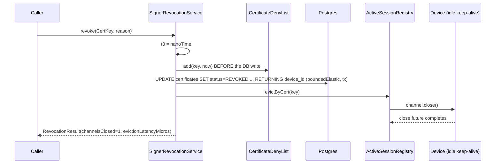
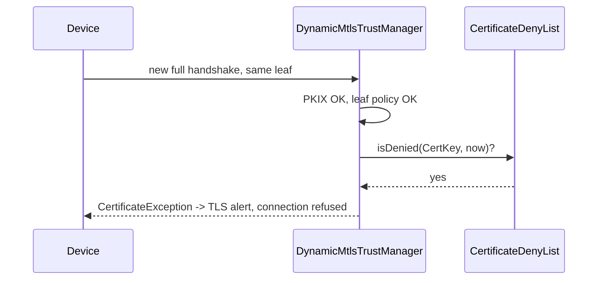
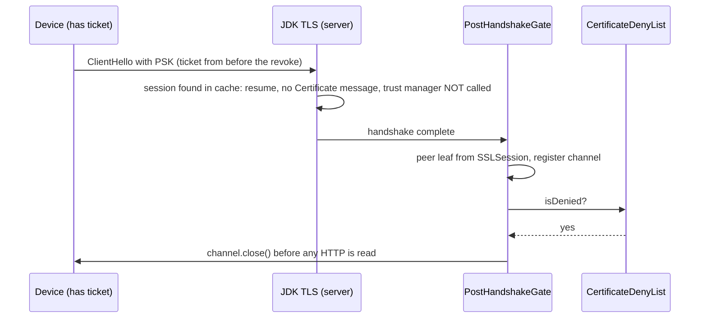
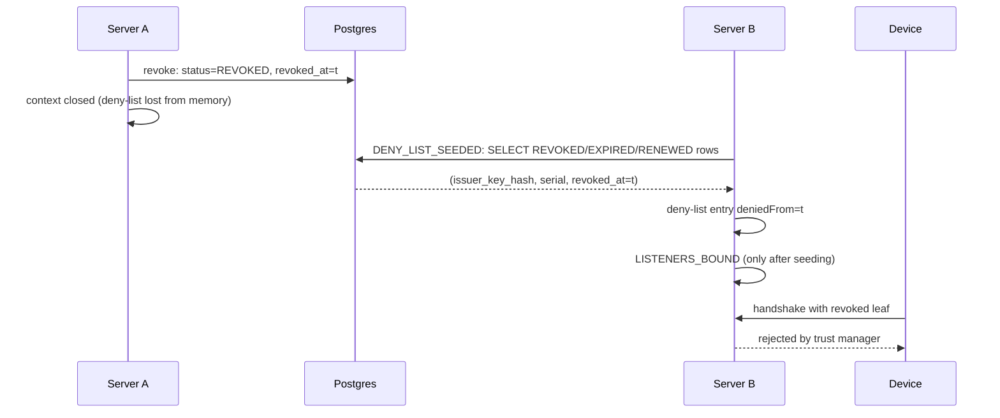

# Phase 2: Listeners, mTLS, deny-list trust, per-request status, live socket eviction

Commit: `7d531f1` (feat(gateway): mtls listeners, deny-list trust manager, cert status filter, live socket eviction).

## 1. What this phase built and why

Phase 2 opens the server to the network, and makes sure a revoked device is cut off at every layer. It implements
spec Section 1 ("Multi-Port Listener Isolation"), Section 2 layer 1 ("Transport Authentication"), and Section 4
("Certificate Lifecycle State Machine" acceptance rules and "Revocation Enforcement Path").

- **Three listeners** (`gateway/ListenerManager.java`), bound only as the last boot step:
  - 8443: TLS 1.3, client certificate required, checked by `DynamicMtlsTrustManager`.
  - 8444: TLS 1.3, no client certificate. Serves the CRLs now; enrollment later.
  - 8445: plain HTTP, always on 127.0.0.1. Serves `/api/v1/admin/boot-status` now; the dashboard later.
- **Port enforcement** (`gateway/PortEnforcementWebFilter.java`): each port serves only its own paths; anything else
  is 404 with an empty body.
- **An in-memory deny-list** (`pki/trust/CertificateDenyList.java`) seeded from the database at boot and refreshed
  every 30 seconds.
- **A trust manager** (`pki/trust/DynamicMtlsTrustManager.java`) that validates the client leaf against the current
  hierarchy and the deny-list, without any I/O.
- **A post-handshake gate** (`gateway/PostHandshakeGate.java`) that re-checks the deny-list after every handshake,
  including resumed ones where the trust manager is not called.
- **A per-request status check** (`gateway/CertStatusResolver.java`) that reads the `certificates` row on every
  request to the mTLS port, with no cache.
- **Live socket eviction** (`session/ActiveSessionRegistry.java`, `signer/SignerRevocationService.java`): revoking a
  certificate closes its open connections.
- **Routes**: `GET /api/v1/telemetry/ping` (8443), `GET /api/v1/pki/intermediate-crl.pem` and `root-crl.pem` (8444),
  `GET /api/v1/admin/boot-status` (8445).
- **Two new boot steps**: `DENY_LIST_SEEDED`, then `LISTENERS_BOUND` (always last).

Deviations from the spec (the brief calls these plan issues 23 to 25; issue 23 is the no-cache rule; I describe each
by content because the plan document is not in this repository):

| Spec says | Code does | Why |
| :--- | :--- | :--- |
| `CertStatusResolver` cache entries expire after 5 seconds (Section 4, Revocation Enforcement Path) | No cache at all (plan issue 23) | A 5-second cache means a revoked certificate can still send for up to 5 seconds on a live connection. The DB lookup is one primary-key read |
| The trust manager rejects any certificate not in an accepted status (Section 4) | The trust manager rejects certificates on an in-memory deny-list; unknown certificates pass the handshake and are stopped per request | The handshake runs on a Netty event loop and must not do JDBC. An allow-list cache cannot know about a certificate issued a millisecond ago; a deny-list can (section 2) |
| Backstop poller every 3 seconds for `revoked_at`; Redis pub/sub between gateways | 30-second union refresh; single process, no Redis | One gateway process today. Revocations made through `SignerRevocationService` hit the deny-list instantly; the refresh catches revocations made elsewhere (another process, direct SQL), and the per-request check catches them on the next request regardless |
| Port 8443 "session resumption disabled" (Sections 1, 2) | The JDK still resumes TLS 1.3 sessions (observed, section 9); the post-handshake gate makes resumption harmless for revoked certificates | We could not make the JDK stop resuming with supported settings; the gate is the guarantee |
| CRL "republished on each revocation" (Section 4) | A new CRL is generated and KMS-signed on every GET | Simplest correct behaviour for now. It is a cost and abuse problem on an unauthenticated port; see section 5 |

## 2. Concept primers

### What mutual TLS adds over normal TLS

In normal TLS (a browser visiting a bank), only the server proves who it is: it sends a certificate and proves it
holds the matching private key. The client stays anonymous at the TLS level and logs in later with a password or
token.

In mutual TLS (mTLS), the server also asks the client for a certificate, and the client must prove it holds the
matching private key. The result: before a single HTTP byte is read, the server knows which device is on the other
end of this TCP connection, and that the device holds its key. That is spec Section 2 layer 1.

### The TLS 1.3 handshake, and where the client certificate goes

```
Client                                              Server (port 8443)
ClientHello (key share, supported versions)  ---->
                                             <----  ServerHello (key share)
                                                    {EncryptedExtensions}
                                                    {CertificateRequest}      <- "send me a cert issued by:" (getAcceptedIssuers)
                                                    {Certificate}             <- gateway leaf + Server TLS CA
                                                    {CertificateVerify}       <- signature proving the gateway holds its key
                                                    {Finished}
{Certificate}            <- device leaf (+ anything else the client chooses to send)
{CertificateVerify}      <- signature proving the device holds its key
{Finished}                                   ---->  server checks the client Certificate HERE (trust manager)
                                             <----  alert (if rejected), or application data / NewSessionTicket
```

`{...}` means encrypted. Two details matter:

1. The server's trust manager runs when the client's Certificate message arrives, which is after the client has sent
   its Finished. So the client believes the handshake succeeded and only learns of the rejection when the server's
   alert arrives. In practice, a rejected client sees the error on its first read, not in its handshake call. You can
   see this with `openssl s_client </dev/null`: it prints "Verify return code: 0 (ok)" and exits before the alert
   arrives (section 7).
2. After the handshake, a TLS 1.3 server may send a NewSessionTicket, which lets the client resume later (below).

### What a trust manager is and when the JDK calls it

In Java's TLS stack (JSSE), a trust manager is the object that decides whether a peer's certificate chain is
acceptable. The JDK calls `checkClientTrusted(chain, authType, engine)` on the server when it receives the client's
Certificate message in a full handshake. If the method throws `CertificateException`, the handshake is aborted with an
alert. The JDK also calls `getAcceptedIssuers()` to fill the CertificateRequest with the issuer names the server
wants.

The JDK does **not** call it on a resumed handshake (no Certificate message is sent then). It does not call it again
for later requests on the same connection either: one connection, one check.

Ours (`DynamicMtlsTrustManager`) does, in order: take only `chain[0]`; PKIX-validate `[leaf, current Device
Intermediate]` against the current Root with revocation checking off; check leaf CA:FALSE, digitalSignature, EKU
clientAuth, and AKI == current Device Intermediate SKI; check the deny-list. It reads `TrustAnchors` on every call,
so a hierarchy rebuild takes effect for the next handshake without restarting the listener.

### Session resumption and tickets, and why they threaten revocation

A full handshake costs public-key operations on both sides. Resumption skips them: after a full handshake, the server
gives the client a ticket (NewSessionTicket). Next time, the client presents the ticket as a pre-shared key (PSK), and
both sides derive keys from the earlier session. No certificates are sent, so no trust manager runs.

There are two ticket styles. A **stateless** ticket contains the whole session state, encrypted with a server key; the
server keeps nothing. A **stateful** ticket is just an ID that points into the server's session cache.

The threat: a device connects, gets a ticket, is revoked, then reconnects by resuming. The handshake-time check never
runs, so a revoked device could get a working TLS connection. Our answer is the post-handshake gate: after every
handshake, full or resumed, it reads the peer certificate from the session and checks the deny-list.

### Why an allow-list cache fails for freshly issued certificates, and a deny-list does not

The trust manager cannot query the database (next primer). So it needs an in-memory answer to "is this certificate
OK?". Two designs:

- **Allow-list**: keep the set of certificates that are ACTIVE, refreshed from the DB every N seconds. A device that
  enrolls and connects within those N seconds is not in the set yet, so its first connection fails. Enrollment returns
  a certificate and the device connects immediately, so this breaks the normal path.
- **Deny-list**: keep the set of certificates that are revoked, expired, or superseded. A brand-new certificate is not
  on it, so it passes the handshake immediately. The per-request DB check then confirms it is really ACTIVE.

The deny-list can miss a revocation for at most one refresh interval if the revocation happened in another process.
That gap is closed by the per-request check, which reads the DB on every request.
`MtlsListenerIT.newlyIssuedLeafConnectsImmediately` proves the fresh-cert case with no sleep.

### What the Netty event loop is and why blocking it is fatal

Reactor Netty serves many connections with a few threads (the event loop, here named `reactor-http-nio-N`). Each
thread runs short, non-blocking callbacks for many connections in turn: bytes arrived, decrypt, parse, hand to a
handler, write. If one callback blocks (a JDBC call waiting 50 ms for Postgres, a KMS call waiting on HTTP), every
other connection on that thread stalls for those 50 ms, including their TLS handshakes. Under load this cascades into
timeouts everywhere.

So: the trust manager and the post-handshake gate use only in-memory data (the deny-list and `TrustAnchors`), and the
per-request DB read in `CertStatusResolver` and the CRL generation run on `Schedulers.boundedElastic()`, a thread pool
meant for blocking work.

### What a Channel is and how closing it evicts a client

A Netty `Channel` is the server's handle on one TCP connection. HTTP/1.1 keep-alive means a client can send many
requests over one connection, possibly for hours. Revoking a certificate in the database does nothing to a connection
that is already open and idle.

`ActiveSessionRegistry` remembers which channels belong to which certificate (keyed by `CertKey` = issuer key hash +
serial). `evictByCert(key)` calls `channel.close()` on each, which sends a TLS close and a TCP FIN. The client's next
read returns end-of-stream; the device must reconnect, and the reconnect handshake fails because the certificate is
now on the deny-list.

### Why a wrong port returns 404 rather than 403

403 means "this exists, but you may not use it". If the public port answered `/api/v1/telemetry/ping` with 403, a
scanner would learn that the route exists on this server and is worth attacking on another port. 404 with an empty
body says nothing. Every port answers unknown and wrong-port paths the same way.

## 3. How it works in our code

### Boot and bind

```mermaid
sequenceDiagram
    participant B as BootSequence
    participant R as HierarchyReconciler
    participant G as GatewayTlsMaterial
    participant T as TrustAnchors
    participant D as CertificateDenyList
    participant L as ListenerManager
    B->>R: reconcile()
    B->>G: issue() gateway key + leaf
    B->>T: reload() Root + Device Intermediate
    B->>D: seedFromDb() (REVOKED, EXPIRED, RENEWED rows)
    B->>D: startPeriodicRefresh() every 30 s on boundedElastic
    B->>L: bindAll()
    L->>L: build one HttpHandler (WebHttpHandlerBuilder)
    L->>L: bind 8443 (TLS 1.3, REQUIRE), 8444 (TLS 1.3), 8445 (HTTP, 127.0.0.1)
    Note over B: each step publishes BootStepCompleted; LISTENERS_BOUND is last
```

With `vitalsshield.boot.enabled=false` the `BootSequence` bean does not exist, so `bindAll()` is never called and no
port opens (`MtlsListenerIT.bootDisabledBindsNothing`). `spring.main.keep-alive: true` keeps the JVM running after
boot; Netty's threads are daemon threads and would not.

### Successful mTLS connect and ping

```mermaid
sequenceDiagram
    participant C as Device
    participant N as Netty event loop
    participant TM as DynamicMtlsTrustManager
    participant PG as PostHandshakeGate
    participant PE as PortEnforcementWebFilter
    participant SR as CertStatusResolver
    participant DB as Postgres
    C->>N: TLS 1.3 handshake with device leaf
    N->>TM: checkClientTrusted(chain)
    TM->>TM: PKIX [leaf, current int] -> current root; leaf policy; deny-list
    N->>PG: handshake complete
    PG->>PG: register channel under CertKey, then check deny-list
    C->>N: GET /api/v1/telemetry/ping
    N->>PE: local port 8443, path allowed
    PE->>SR: next filter
    SR->>SR: deny-list fast check
    SR->>DB: SELECT status, not_before, not_after (boundedElastic)
    DB-->>SR: ACTIVE, within validity
    SR->>SR: put ResolvedCert in exchange attributes
    SR-->>C: 200 {serial, issuer_key_hash, device_id, status}
```

### Revoke with live eviction



If the DB write fails, the deny-list entry stays and the error propagates: this process keeps refusing the
certificate even though the database does not yet say REVOKED. Failing closed is the point of the order.

### Reconnect after revoke



### Resumption attempt after revoke



This is what `ResumptionIT` observed (section 7): "Reused", no HTTP response, `postHandshakeRejectsDelta=1`.

### Server restart reseeding the deny-list



Because seeding happens before binding, there is no window after a restart where a revoked certificate can complete a
handshake (`MtlsListenerIT.denyListSurvivesRestart`).

## 4. Data model

### `certificates` columns

| Column | Read by | Written by |
| :--- | :--- | :--- |
| `issuer_key_hash`, `serial_number` | everything (the `CertKey`) | (enrollment, later) |
| `status` | `JdbcDenySource` (REVOKED, EXPIRED, RENEWED), `CertStatusResolver` | `SignerRevocationService` (REVOKED) |
| `revoked_at` | deny-list `deniedFrom` for REVOKED (EPOCH if NULL) | `SignerRevocationService` (same instant as the deny-list entry) |
| `revocation_reason` | (CRL, Phase 1) | `SignerRevocationService` |
| `grace_expires_at` | deny-list `deniedFrom` for RENEWED; resolver accepts RENEWED only before it | (switchover, later) |
| `not_before`, `not_after` | resolver validity window; deny-source filter `not_after > now() - 1 day` | |
| `device_id` | resolver, returned by ping; returned by the revoke UPDATE | |

### In-memory structures

| Structure | Shape | Notes |
| :--- | :--- | :--- |
| `CertificateDenyList` | `ConcurrentHashMap<CertKey, Entry(deniedFrom, reason)>` | `add` keeps the earliest `deniedFrom`. Never removes. `isDenied(key, now)` is `now >= deniedFrom`, so a RENEWED certificate stays usable until its grace ends |
| `ActiveSessionRegistry` | `ConcurrentHashMap<CertKey, Set<Channel>>` | each channel removes itself on `closeFuture()` |
| `SignerRevocationService.recent` | last 50 `RevocationResult` | for Phase 5 metrics |
| `BootStatusTracker` | list of (step, completedAt) | served by `/api/v1/admin/boot-status` |

`CertKey` normalizes both parts the Phase 1 way: lowercase hex, serial without leading zeros, so `"00FF0A"` and
`"ff0a"` are the same key.

## 5. Security reasoning

### What each layer stops

| Layer | Runs | Stops |
| :--- | :--- | :--- |
| **Handshake** (`DynamicMtlsTrustManager`) | once per full handshake, on the event loop | no certificate; certificates not issued by the current Device Intermediate (including old-hierarchy leaves with the same issuer DN); expired or not-yet-valid; CA:TRUE leaves; wrong EKU or KU; deny-listed certificates. Also TLS 1.2 and below (protocol setting) |
| **Post-handshake gate** (`PostHandshakeGate`) | once per handshake, full or resumed | deny-listed certificates that got in by resuming a session issued before the revoke |
| **Per-request** (`CertStatusResolver`) | every request on 8443 | certificates unknown to the DB; status changes the deny-list has not seen (another process, direct SQL); expiry during a long keep-alive connection; RENEWED past grace |

Eviction then removes the connection itself, so a revoked device does not even keep an idle socket.

The AKI check (leaf AKI must equal the current Device Intermediate's SKI) is a VitalsShield policy layered on top of
RFC 5280 path validation. It is not an RFC 5280 requirement. RFC 5280 uses AKI only as a hint for finding the issuer.
We require it because old and new hierarchies share DNs, and because it gives a clear, fast rejection reason before
the signature check.

Other properties:

- The client's own intermediates are ignored. Only `chain[0]` is used and the server supplies the intermediate, so a
  client cannot smuggle in its own CA (`DynamicMtlsTrustManagerTest.clientSuppliedForgedIntermediateIsIgnored`).
- `getAcceptedIssuers` lists only the current Device Intermediate, so the server never advertises old or unrelated CAs.
- All listeners bind 127.0.0.1 by default; the admin listener always does.
- TLS 1.3 only, JDK provider: one protocol version and one implementation to reason about.

### What this phase does NOT defend against

- **A stolen, unrevoked device key.** Whoever holds the leaf private key is the device until someone revokes it.
  Detection (clone collision, sequence traps) comes in later phases.
- **Anything on the loopback interface.** The admin port has no authentication yet. Any local process can read boot
  status. WebAuthn for the admin plane comes later.
- **Resumed connections and proof of possession.** On a resumed handshake the client proves it knows the resumption
  secret from an earlier full handshake, not that it holds the certificate key right now. Spec Section 2 says layer 1
  proves key possession "on every TCP connection"; with the JDK still resuming, that is true for full handshakes only.
  The gate still enforces revocation, and the session lifetime is 1 second.
- **Revocation from another process within 30 seconds, at handshake time.** The new connection completes the
  handshake (deny-list not yet refreshed) but the per-request check returns 403 REVOKED. No request is served.
- **CRL endpoint abuse.** Every GET of a CRL increments the CRL number and makes a KMS Sign call, on an unauthenticated
  port. A caching or rate-limit layer is needed before this is exposed beyond localhost.
- **Gateway TLS key in memory**, as in Phase 1.

## 6. Design decisions

| Decision | Alternatives | Why the alternative lost |
| :--- | :--- | :--- |
| **Deny-list in the handshake path** | Allow-list cache; DB query in the trust manager | Allow-list rejects certificates issued since the last refresh. A DB query blocks the event loop |
| **Deny before commit** | Write the DB first, then update memory | If the DB write fails after the deny-list update, the process still refuses the certificate (fail closed). The other order fails open |
| **No per-request cache** (plan issue 23) | 5-second cache, as the spec says | A cache makes revocation lag on live connections. One indexed primary-key read per request is cheap at our scale. `dbStatusChangeVisibleToNextRequestOnSameConnection` proves no caching |
| **Loopback binding by default; admin always loopback** | Bind 0.0.0.0 | Nothing in this phase needs remote access. The admin plane has no authentication yet, so it must never be reachable from outside |
| **JDK `SslProvider`** | OpenSSL via netty-tcnative | One TLS implementation; our `X509ExtendedTrustManager` is called exactly as JSSE documents; no native library. The cost is the JDK's resumption behaviour (section 9) |
| **TLS 1.3 only** | Also allow TLS 1.2 | TLS 1.3 encrypts the client certificate in the handshake (TLS 1.2 sends it in clear), removes renegotiation, and has one handshake shape. All our clients are ours |
| **One shared HttpHandler for three servers** | One Spring context or handler per port | One set of controllers and filters; port separation is enforced in one place (`PortEnforcementWebFilter`) that is unit-tested for every route on every port |
| **404 on the wrong port** | 403 | 403 confirms the route exists |
| **Probe restart behind `--restart`** | Always restart | A restart wipes every LocalStack key, so the next boot rebuilds the hierarchy and revokes every device. That must not happen by accident |
| **Gate attached with `doOnChannelInit`** | `doOnConnection` | `doOnConnection` fires for every HTTP request on a keep-alive connection, which re-ran the gate per request (section 9) |
| **Gate registers the channel before checking the deny-list** | Check first, then register | If a revoke runs between "check" and "register", the channel would be missed by eviction. Registering first means either eviction sees it or the gate's check sees the deny entry |
| **`revoked_at` = the same instant as the deny-list entry** | `now()` in SQL | After a restart, the reseeded entry has exactly the same `deniedFrom` |

## 7. Verify it yourself

All output below was produced on 2026-11-13 against the running stack.

**1. Unit tests with Docker stopped.** Look for zero failures. Per-class counts from
`./gradlew test --rerun-tasks` after `docker compose stop`:

```
   5 CanonicalBytesTest PASSED
  13 CanonicalEncodingsTest PASSED
   7 CertificateDenyListTest PASSED
   9 CertificateProfileTest PASSED
  14 CrlReasonMappingTest PASSED
  12 DynamicMtlsTrustManagerTest PASSED
   2 NoNettyNioClientTest PASSED
  18 PortEnforcementWebFilterTest PASSED
   1 BUILD SUCCESSFUL in 3s
```

Note: `docker compose stop` and `up` restart LocalStack, which wipes its KMS keys; the next boot rebuilds the hierarchy.

**2. Integration tests.** `./gradlew integrationTest --rerun-tasks`: 40 passed, `BUILD SUCCESSFUL in 26s`. The Phase 2
ones:

```
MtlsListenerIT > bootStepsInOrder() PASSED
MtlsListenerIT > bootDisabledBindsNothing() PASSED
MtlsListenerIT > allListenersOnLoopback() PASSED
MtlsListenerIT > noClientCertFailsHandshake() PASSED
MtlsListenerIT > tls12Refused() PASSED
MtlsListenerIT > validLeafPings() PASSED
MtlsListenerIT > newlyIssuedLeafConnectsImmediately() PASSED
MtlsListenerIT > unknownCertPassesHandshakeButGets403() PASSED
MtlsListenerIT > revokedLeafRejectedOnImmediateReconnect() PASSED
MtlsListenerIT > revokeClosesLiveKeepAliveSocket() PASSED
MtlsListenerIT > perRequest403WhenEvictionDisabled() PASSED
MtlsListenerIT > dbStatusChangeVisibleToNextRequestOnSameConnection() PASSED
MtlsListenerIT > wrongPortReturns404() PASSED
MtlsListenerIT > crlsServedOnPublicPort() PASSED
MtlsListenerIT > denyListSurvivesRestart() PASSED
MtlsListenerIT > oldHierarchyLeafRejected() PASSED
ResumptionIT > resumedSessionNeverReaches200AfterRevoke() PASSED
```

**3. Eviction latency** (from `build/mtls-out/eviction-latency.txt` and the test's stdout, first full run). Look for a
value far below 500,000 microseconds. This is from the `revoke()` call to all close futures completing:

```
EVICTION run 0: evictionLatencyMicros=5416
EVICTION run 1: evictionLatencyMicros=1340
EVICTION run 2: evictionLatencyMicros=2064
EVICTION run 3: evictionLatencyMicros=3837
EVICTION run 4: evictionLatencyMicros=2306
MAX_EVICTION_LATENCY_MICROS=5416
```

The second full run reported `MAX_EVICTION_LATENCY_MICROS=3299`.

**4. Resumption result** (`build/mtls-out/resumption-result.txt`). Look at `resume=Reused` (the JDK resumed) and
`http=null` with `postHandshakeRejectsDelta=1` (the gate closed it):

```
RESUMPTION_BASELINE first=New tickets=1 http=200 | resume=Reused tickets=1 http=200
RESUMPTION_AFTER_REVOKE first=New tickets=1 http=200 | resume=Reused http=null postHandshakeRejectsDelta=1
RESUMPTION_RESULT defense=POST_HANDSHAKE_GATE (session resumed, then closed)
```

The ticket in the resumed session, from `s_client` output: 32 bytes, lifetime hint 1 second:

```
    TLS session ticket lifetime hint: 1 (seconds)
    TLS session ticket:
    0000 - 74 ee 64 53 2c 14 a0 b2-85 4c 63 85 45 8a 57 d2   t.dS,....Lc.E.W.
    0010 - 52 9b bb 68 b0 09 cd 5d-8e d3 3c 9a 4c ac ee a3   R..h...]..<.L...
```

**5. Probe without restart.** Look for `skipped` and an unchanged `StartedAt`:

```
$ docker compose ps (before)
SERVICE      STATUS
localstack   Up 25 minutes (healthy)
postgres     Up 34 minutes (healthy)
localstack StartedAt=2026-11-13T23:25:52.700212715Z

$ scripts/kms-probe.sh
CREATE=ok SIGN=ok SURVIVES_RESTART=skipped

$ docker compose ps (after)
SERVICE      STATUS
localstack   Up 25 minutes (healthy)
postgres     Up 34 minutes (healthy)
localstack StartedAt=2026-11-13T23:25:52.700212715Z
UNCHANGED: LocalStack was not restarted
```

**6. Against a running `bootRun`** (`./gradlew :server:bootRun --args='--spring.profiles.active=local'`), with
`OPENSSL=$(brew --prefix openssl@3)/bin/openssl`:

Listeners: look for exactly 127.0.0.1 on all three ports.

```
$ lsof -nP -iTCP -sTCP:LISTEN | grep java | grep -E ":844[345]"
java      36237 atharva  152u  IPv6 0xeeed79e59aa064ef      0t0  TCP 127.0.0.1:8443 (LISTEN)
java      36237 atharva  153u  IPv6 0x8255ec623510da24      0t0  TCP 127.0.0.1:8444 (LISTEN)
java      36237 atharva  154u  IPv6 0x8483c4bfb8e92627      0t0  TCP 127.0.0.1:8445 (LISTEN)
```

Public port TLS: look for TLSv1.3, a three-level chain (gateway, Server TLS CA, Root), and return code 0.

```
$ $OPENSSL s_client -connect 127.0.0.1:8444 -servername localhost -CAfile var/trust/root-ca.pem -verify_return_error </dev/null 2>&1 | grep -E "Protocol|Verify return code|depth"
depth=2 O=VitalsShield, CN=VitalsShield Root CA
depth=1 O=VitalsShield, CN=VitalsShield Server TLS CA G1
depth=0 O=VitalsShield, CN=VitalsShield Gateway
Protocol: TLSv1.3
Verify return code: 0 (ok)
```

CRL over HTTPS: look for the Device Intermediate as issuer and a nextUpdate 24 hours out.

```
$ curl -s --cacert var/trust/root-ca.pem https://localhost:8444/api/v1/pki/intermediate-crl.pem | $OPENSSL crl -noout -issuer -nextupdate
issuer=O=VitalsShield, CN=VitalsShield Issuing CA G1
nextUpdate=Nov 14 23:50:50 2026 GMT
```

Wrong port: look for 404.

```
$ curl -s -o /dev/null -w "%{http_code}\n" --cacert var/trust/root-ca.pem https://localhost:8444/api/v1/telemetry/ping
404
```

mTLS port without a client certificate, exactly as the criterion is written. Note it shows no failure:

```
$ $OPENSSL s_client -connect 127.0.0.1:8443 -servername localhost -CAfile var/trust/root-ca.pem </dev/null 2>&1 | tail -5
No ALPN negotiated
Early data was not sent
Verify return code: 0 (ok)
---
DONE
```

`</dev/null` makes s_client exit as soon as its side of the handshake is done, before the server's alert arrives (TLS
1.3 primer). Keeping stdin open for a second shows the rejection. Look for `alert certificate required` (alert 116):

```
$ sleep 1 | $OPENSSL s_client -connect 127.0.0.1:8443 -servername localhost -CAfile var/trust/root-ca.pem 2>&1 | grep -iE "alert|error|errno|Verify return|DONE"
verify return:1
verify return:1
verify return:1
Verify return code: 0 (ok)
807F3B0202000000:error:0A00045C:SSL routines:ssl3_read_bytes:tlsv13 alert certificate required:ssl/record/rec_layer_s3.c:918:SSL alert number 116
807F3B0202000000:error:0A000197:SSL routines:SSL_shutdown:shutdown while in init:ssl/ssl_lib.c:2804:
```

Boot status: look for all five steps, in order.

```
$ curl -s http://127.0.0.1:8445/api/v1/admin/boot-status
{"steps":[{"step":"RECONCILED","completed_at":"2026-11-13T23:50:34.090610Z"},{"step":"GATEWAY_TLS_ISSUED","completed_at":"2026-11-13T23:50:34.151933Z"},{"step":"TRUST_ANCHORS_LOADED","completed_at":"2026-11-13T23:50:34.153846Z"},{"step":"DENY_LIST_SEEDED","completed_at":"2026-11-13T23:50:34.159899Z"},{"step":"LISTENERS_BOUND","completed_at":"2026-11-13T23:50:34.463700Z"}]}
```

**7. Ctrl-C** (SIGINT to the server JVM). Look for all three listeners disposed and the pool shut down:

```
INFO c.v.server.gateway.ListenerManager       : Listener mtls disposed
INFO c.v.server.gateway.ListenerManager       : Listener public disposed
INFO c.v.server.gateway.ListenerManager       : Listener admin disposed
INFO com.zaxxer.hikari.HikariDataSource       : HikariPool-1 - Shutdown initiated...
INFO com.zaxxer.hikari.HikariDataSource       : HikariPool-1 - Shutdown completed.
```

Gradle then prints `BUILD FAILED` with "finished with non-zero exit value 130": 130 is the normal exit code for a
process stopped by SIGINT.

## 8. How the tests prove it

| Test | Property proved |
| :--- | :--- |
| `PortEnforcementWebFilterTest` | every route passes on its own port and gets an empty 404 on the other two and on an unknown port; unlisted paths 404 everywhere |
| `CertificateDenyListTest` | absent means not denied; denied exactly from `deniedFrom`; earliest wins; seed maps REVOKED/EXPIRED/RENEWED correctly; refresh never removes; key normalization |
| `DynamicMtlsTrustManagerTest` | valid leaf passes; same-DN different CA fails; expired and not-yet-valid fail; serverAuth-only EKU fails; CA:TRUE fails; deny-listed fails; future `deniedFrom` passes then fails when the clock reaches it; client-sent forged intermediate is ignored; accepted issuers = current Device Intermediate only; anchors re-read on every call |
| `MtlsListenerIT.bootStepsInOrder` | five boot steps in the specified order |
| `MtlsListenerIT.bootDisabledBindsNothing` | with boot disabled, all three configured ports refuse TCP connections |
| `MtlsListenerIT.allListenersOnLoopback` | all bound addresses are 127.0.0.1 on the configured ports |
| `MtlsListenerIT.noClientCertFailsHandshake`, `tls12Refused` | no cert, or TLS 1.2, never gets HTTP |
| `MtlsListenerIT.validLeafPings`, `newlyIssuedLeafConnectsImmediately` | an enrolled leaf works immediately and ping echoes its serial, issuer hash, device, status |
| `MtlsListenerIT.unknownCertPassesHandshakeButGets403` | deny-list semantics at the handshake; DB is authoritative per request (reason UNKNOWN) |
| `MtlsListenerIT.revokedLeafRejectedOnImmediateReconnect` | the deny-list is updated synchronously by revoke; no sleep needed |
| `MtlsListenerIT.revokeClosesLiveKeepAliveSocket` | an idle keep-alive connection is closed within 500 ms; `channelsClosed == 1`; live count drops by 1; latency recorded |
| `MtlsListenerIT.perRequest403WhenEvictionDisabled` | with eviction off, the next request on the same connection is refused with REVOKED |
| `MtlsListenerIT.dbStatusChangeVisibleToNextRequestOnSameConnection` | no per-request cache: a direct SQL status change is seen by the very next request |
| `MtlsListenerIT.wrongPortReturns404` | ping on 8444, CRL on 8443, boot-status on both TLS ports: all empty 404 |
| `MtlsListenerIT.crlsServedOnPublicPort` | both CRLs are served over TLS and verify against the issuer found by the CRL's AKI in `ca_issuers` |
| `MtlsListenerIT.denyListSurvivesRestart` | revocation persists through a restart because seeding precedes binding |
| `MtlsListenerIT.oldHierarchyLeafRejected` | after a rebuild, a leaf whose issuer DN matches the new intermediate is still rejected |
| `ResumptionIT` | a session resumed after revoke never gets HTTP 200, and records which layer stopped it |
| Phase 1 `BootSequenceIT` (updated) | five steps; boot re-run after rebuild re-binds listeners with the new gateway leaf |

## 9. Gotchas hit during this phase

- **The JDK still resumes TLS 1.3 sessions.** With `jdk.tls.server.enableSessionTicketExtension=false` (set in
  `main()` and in every Gradle test JVM), `sessionCacheSize(1)` and `sessionTimeout(1)`, the JDK server still sent one
  NewSessionTicket per connection and accepted it: the baseline in `ResumptionIT` shows `resume=Reused http=200`. The
  ticket was 32 bytes with a 1-second lifetime hint, which looks like a stateful session ID into the cache rather than
  a stateless encrypted ticket, so the property appears to have taken effect but does not stop stateful resumption. (I
  did not run a comparison with the property set to true, so "stateless tickets are off" is an inference from the
  ticket size.) Both cache settings use 0 to mean "no limit" in the JDK, which is why they are 1, not 0. I stopped
  there, as the brief allowed: the post-handshake gate closed the resumed session after revoke.
- **`doOnConnection` fires per HTTP request.** The first version attached the post-handshake gate in Reactor Netty's
  `doOnConnection`. On a keep-alive connection that callback ran again for the second request, re-ran the deny-list
  check, and closed the socket instead of letting `CertStatusResolver` answer 403, and it added another close listener
  each time. `perRequest403WhenEvictionDisabled` caught it. Fixed with `doOnChannelInit`, which runs once per TCP
  connection after Reactor Netty has installed the SslHandler.
- **The JVM exited right after binding.** Reactor Netty's event loop threads are daemon threads, so `bootRun` started,
  bound all three ports, and exited ("Listener ... disposed", `BUILD SUCCESSFUL in 2s`). Fixed with
  `spring.main.keep-alive: true`.
- **A rejected TLS 1.3 client looks successful at first.** The client finishes its handshake before the server checks
  its certificate. `openssl s_client </dev/null` prints "Verify return code: 0 (ok)" and `DONE` against the mTLS port
  without a certificate; the alert only shows if the client waits to read. `MtlsTestClient` therefore always sends a
  request before deciding the outcome.
- **`/**` matches the bare prefix.** Spring's `PathPattern` `/api/v1/admin/**` also matches `/api/v1/admin`. Allowed on
  its own port; the unit test's expectation was wrong and was corrected.
- **A stale build.** One integration run failed with `ClassNotFoundException: com.vitalsshield.server.pki.ReconcileResult`
  although the class file was present; `./gradlew :server:clean` fixed it. The cause was not identified (an IDE
  compiling into the same build directory is a guess).
- **`docker compose stop` wipes LocalStack keys.** Exit criterion 1 stops the stack, and restarting LocalStack has the
  same effect as `kms-probe.sh --restart`. Expect a REBUILT on the next boot after it.

## 10. Judge Q&A

**Q: TLS session resumption skips certificate validation. How do you stop a revoked device from resuming?**
A: The post-handshake gate. After every handshake, full or resumed, it reads the peer certificate from the SSLSession
and checks the in-memory deny-list; if denied, it closes the channel before any HTTP is read. We observed the JDK
resuming even with stateless tickets disabled, and `ResumptionIT` shows the resumed post-revoke session closed by the
gate with no HTTP response. The per-request DB check behind it would return 403 anyway.

**Q: Why not check certificate status in the trust manager?**
A: The trust manager runs on a Netty event loop during the handshake; a JDBC call there would stall every connection on
that thread. So it uses only memory. An allow-list in memory would reject devices enrolled since the last refresh, so
we use a deny-list: new certificates pass the handshake, and `CertStatusResolver` checks the real DB status on every
request, without a cache.

**Q: How quickly does revocation take effect on a connection that is already open?**
A: Immediately. `SignerRevocationService` adds the deny-list entry, commits the DB update, then closes every channel
registered for that certificate. Across five measured revocations the slowest took 5,416 microseconds from the call to
the socket being closed; the client saw end-of-stream within the 500 ms budget each time. With eviction turned off, the
next request on that connection is refused with 403 REVOKED.

**Q: You reject a leaf whose AKI does not match your intermediate's SKI. Is that RFC 5280?**
A: No. RFC 5280 path validation is signatures, validity, name chaining, Basic Constraints, key usage, and policies; AKI
is a hint for finding the issuer. The AKI equality check is our own policy on top of PKIX validation. We need it
because a hierarchy rebuild creates a new intermediate with the same DN, and we want issuer identity by key, never by
name. The PKIX signature check would also reject such a leaf; the AKI check gives a clearer, earlier reason.

**Q: Do relying parties check your CRLs, and is that your revocation mechanism?**
A: The CRLs are now served at the URLs in the certificates' CRL Distribution Points (8444) and verify against the
issuer found by AKI. They are the published record for third parties. Our own enforcement does not wait for CRLs: the
handshake deny-list, the post-handshake gate, the per-request DB check, and socket eviction act within milliseconds.
One open issue: every CRL GET currently re-signs through KMS, so the endpoint needs caching before wider exposure.
