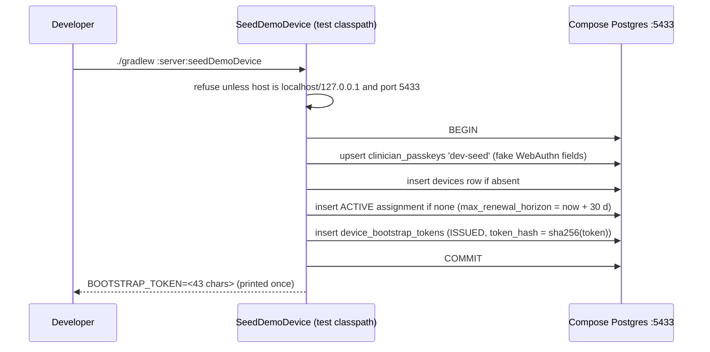
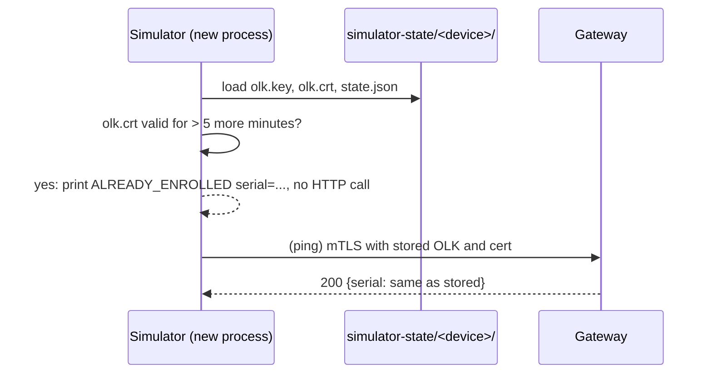
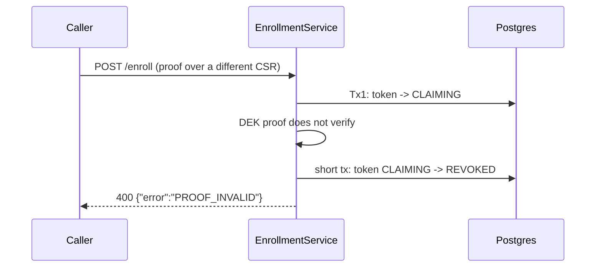

# Phase 3: Protocol A enrollment, dev seed tool, simulator enroll and persistence

Commit: `adb62df` (feat(enrollment): protocol a with dek proof and kms registry anchor; simulator enroll and
persistence).

## 1. What this phase built and why

Before Phase 3 a device certificate could only be created by a test. Phase 3 gives a wearable a real way to get one:
Protocol A, spec Section 4 ("Protocol A: WebAuthn-Anchored Bootstrap Enrollment"), using canonical encodings 3 and 4
from spec Section 3 and the rule that the CA ignores CSR attributes (Section 3, profile table preamble).

- **`POST /api/v1/devices/enroll`** on the public port 8444 (`enrollment/EnrollmentController`,
  `EnrollmentService`). A device presents a single-use bootstrap token, its long-lived Device Enrollment Key (DEK),
  a CSR for a fresh Operational Leaf Key (OLK), and a DEK signature binding them together. It receives a 12-hour
  leaf certificate for the OLK.
- **A KMS registry anchor**: the server signs the device's DEK with KMS Key #4 (REGISTRY_ANCHOR) and stores the
  signature in `devices.dek_registry_kms_sig`. `DekAnchorVerifier` can re-check it later; nothing calls it yet
  (Phase 5 dashboard, Protocol C).
- **Crypto helpers** in `crypto-common`: `EcKeys` (P-256 only), `CsrFactory` (PKCS#10 create and verify),
  `DerSignatures` (DER ECDSA sign and strict verify).
- **A dev seed tool** (`./gradlew :server:seedDemoDevice`, DECISIONS #32) that stands in for the clinician's WebAuthn
  provisioning until Phase 6.
  Changed in Phase 6: in webauthn mode (the default) the tool registers a software passkey (`var/devseed/passkey.key`,
  KMS-anchored) and issues tokens through the real provisioning code, and Protocol A now re-verifies the stored
  WebAuthn approval before any KMS call (DECISIONS #57). The fake-field path remains for `--auth bearer`.
- **The simulator** (`simulator` module): enroll, persist keys and state like a wearable's flash, survive restarts
  without re-enrolling, and ping over mTLS.

Deviations and clarifications, all in `docs/DECISIONS.md`: #31 (first-time device rule), #32 (seed tool), #33 (DER
outside JWS), #34 (token failure semantics), #35 (thumbprint format), #36 (simulator URLs), #37 (alert 46, a Phase 2
follow-up done in this phase).

## 2. Concept primers

### What a CSR is and what its self-signature proves

A CSR (Certificate Signing Request, PKCS#10) is a small signed document a key holder sends to a CA. It contains the
public key, a requested subject name, optionally requested extensions, and a signature made with the matching private
key over all of that.

The signature proves one thing: whoever made the CSR holds the private key for the public key inside it. This is
called **proof of possession**. Without it, an attacker could ask the CA to certify someone else's public key under
the attacker's name. `CsrFactory.parseAndVerify` checks that the key is EC P-256, the signature algorithm is
ecdsa-with-SHA256, and the signature verifies. A CSR with one flipped byte fails (`CsrFactoryTest.tamperedCsrFails`).

### Why the CA ignores CSR attributes

Everything in a CSR except the public key and the signature is a request written by the requester. If the CA copied
it, a device could ask for `CN=another-device`, a DNS SAN of a server it wants to impersonate, or `CA:TRUE`. Our CA
uses the CSR only for the public key and proof of possession, and builds every other field from server-side data:
`CN=<device_id>` from the validated request, the URN SAN, our fixed extensions (spec Section 3).
`EnrollmentIT.csrAttributesIgnored` sends a CSR with `CN=evil-device`, a DNS SAN `attacker.example`, and a
BasicConstraints CA:TRUE extension request; the issued certificate has `CN=dev_attrs`, only the URN SAN, and CA:FALSE.

### The two device keys: DEK and OLK

| | DEK (Device Enrollment Key) | OLK (Operational Leaf Key) |
| :--- | :--- | :--- |
| Lifetime | long: survives reboots and state resets; replaced only by a factory wipe and re-provisioning | short: a new one at every enrollment (and, later, every renewal) |
| Used for | proving identity at enrollment (and Protocol C re-enrollment later) | mTLS and, from Phase 4, signing telemetry (JWS) |
| Certified? | no; the server records its public key, anchored by KMS Key #4 | yes; the 12-hour leaf certificate |
| Stored | simulator `keys/dek.key` ("key partition") | simulator `state/olk.key` ("state partition") |

Why two: the key used every few seconds on the network is the one most likely to leak, so it should expire quickly
and be replaceable without a clinician. The DEK is used rarely, so it can live longer and serve as the device's
stable identity for recovery. Separating them limits what a leaked OLK gives an attacker: 12 hours of transport, not a
way to re-enroll.

### What the DEK proof binds, and why each field is there

The device signs, with the DEK, `DekEnrollmentProofBytes` (spec Section 3, encoding 3):

```
uint32_be(len(device_id)) || utf8(device_id) || sha256(bootstrap_token_ascii) || sha256(olk_csr_der)
```

- `device_id`: the proof is for this device only; it cannot be replayed for another device ID.
- `sha256(bootstrap_token)`: the proof is for this one enrollment attempt (this token), not a reusable "I am a DEK"
  statement.
- `sha256(olk_csr_der)`: the DEK vouches for this exact CSR, so the OLK being certified is the one the DEK holder
  chose. An attacker who intercepts the request cannot swap in their own CSR (`badDekProofRevokesToken`).

Together with the CSR's own signature, the server learns: the caller holds the DEK, holds the OLK, and the DEK holder
asked for this OLK to be certified for this device under this token. The server also rejects a DEK equal to the OLK
(`dekEqualsOlkRejected`), which would collapse the two-key design.

### What a bootstrap token is, and why it is single use and stored hashed

A bootstrap token is a one-time secret that authorizes one enrollment of one device. In the full design a clinician
creates it with a WebAuthn-approved action (Phase 6); for now the seed tool creates it. It is 32 random bytes
(base64url, 43 characters), valid for an hour by default.

- **Single use**: after a successful enrollment its row is CONSUMED, so a stolen token is useless once used, and a
  replay gets 401 (`tokenSingleUse`).
- **Stored hashed**: the database holds only `token_hash` = SHA-256 of the token. Someone who can read the database
  cannot enroll with what they read. The token is high-entropy, so a plain hash (no salt or slow hash) is enough.
- **No oracle**: unknown, wrong-device, expired, consumed, and revoked tokens all get the same 401 body
  `{"error":"INVALID_BOOTSTRAP"}` (`invalidTokensLookIdentical`), so a caller cannot learn which tokens exist.

### What the KMS registry anchor proves, and what it does not

At enrollment the server signs `DekAnchorBytes` (spec Section 3, encoding 4) with KMS Key #4:

```
uint32_be(len(device_id)) || utf8(device_id) || sha256(dek_spki_der) || int64_be(provisioned_at_epoch_ms)
```

and stores the DER signature in `devices.dek_registry_kms_sig`.

It proves: the triple (device, DEK public key, provisioning time) was written by a process that could call KMS Sign
on Key #4. Someone who can only run SQL and later replaces `dek_spki_der_b64` with their own key cannot produce a
matching signature (`dekAnchorDetectsTamper`). That matters because Protocol C (later) lets a DEK re-enroll a device,
so a swapped DEK would be a takeover.

It does not prove: that the device is genuine hardware, that the DEK is protected, or that the enrollment was
legitimate. Whoever compromises the enrollment path itself can get a valid anchor (spec Section 2 layer 3).

### Why boot_epoch exists and why the server assigns it

Telemetry (Phase 4) is ordered by `(boot_epoch, sequence_number)`. A wearable counts sequence numbers up from 0 and
persists them. If a device is wiped and re-provisioned, its counter starts at 0 again. If the epoch stayed the same,
new batches would look like replays of old ones, or old captured batches could pass as new.

So each re-provisioning moves the device to a new epoch, and the server, not the device, decides it: a device that
could choose its own epoch could pick a value that makes old sequence numbers valid again. The rule (DECISIONS #31):
a device with no prior certificates row keeps its stored epoch (1); any other device gets stored + 1, and the replay
window (`last_sequence_num`, `replay_bitmap`) restarts at 0. We could not use `provisioned_at` to detect "first time",
because a hierarchy rebuild clears it. Exit criterion 5 shows epoch 1, then 2 after a factory wipe and re-enroll.

### DER vs raw R||S signatures, and where each is used

An ECDSA signature is two numbers, r and s. DER writes them as an ASN.1 SEQUENCE of two INTEGERs (about 70 to 72
bytes, variable). Raw R||S writes each as exactly 32 bytes, concatenated (64 bytes).

In VitalsShield (DECISIONS #33): every signature outside JWS is DER, which is what X.509, KMS, and Java's
`SHA256withECDSA` produce: the DEK proof, the KMS registry anchor, certificate and CRL signatures. Only JWS `ES256`
(Phase 4) uses R||S, because RFC 7518 requires it. `DerSignatures.verify` accepts only strict DER: a 64-byte R||S
value, a BER variant, or trailing bytes are rejected (`DerSignaturesTest`), so one signature has exactly one valid
encoding.

### x5t#S256

`x5t#S256` is a JWS header parameter (RFC 7515): the base64url-encoded SHA-256 of the signer's certificate DER, without
padding, 43 characters. It names which certificate signed a JWS. We store exactly that value in
`certificates.cert_thumbprint_s256` (DECISIONS #35), so Phase 4 can look up the certificate for a JWS by an indexed
string compare. Example from this phase: `15z5qYcCWSbjSe7Q6fo22f4s6lUvKABdLv0S40y97fQ`.

### Two short transactions instead of one long one

Enrollment needs two KMS calls (Sign for the anchor, Sign for the certificate), each a network round trip. If the
whole flow ran in one transaction, the token row lock (and later the device row lock) would be held across those
calls: a slow KMS would stall every other request touching those rows, and a crash mid-call would leave locks until
timeout. So:

1. **Tx 1 (claim)**: `SELECT ... FOR UPDATE` the token, mark it CLAIMING, check the device and assignment, commit.
   Milliseconds.
2. **No transaction**: verify proofs, KMS sign, issue the certificate.
3. **Tx 2 (activate)**: lock the device row, supersede old certificates, update the device, insert the certificate,
   mark the token CONSUMED, commit. Milliseconds.

CLAIMING is the lock that lasts across step 2: a second request with the same token finds no ISSUED row and gets 401
(`concurrentEnrollSameToken`: exactly one 201, one 401, one certificate row). If the process dies in step 2, the token
would stay CLAIMING forever, so a CLAIMING token older than 2 minutes can be claimed again (`staleClaimingReclaimed`).
Tx 2 also requires the token to still be CLAIMING when it consumes it, so a stale reclaim cannot produce two
certificates.

## 3. How it works in our code

### Seed



`DevSeeder` holds the SQL; the CLI and the integration tests both call it (no duplicated SQL).

### First enrollment

```mermaid
sequenceDiagram
    participant W as Simulator
    participant E as EnrollmentService (boundedElastic)
    participant DB as Postgres
    participant K as KMS
    W->>W: DEK from keys/ (create if absent); fresh OLK; CSR; DEK proof (DER)
    W->>E: POST /enroll {device_id, token, dek_spki, olk_csr, dek_proof}
    E->>E: validate shape and size caps
    E->>DB: Tx1: token FOR UPDATE (ISSUED or stale CLAIMING) -> CLAIMING; device; ACTIVE assignment
    E->>E: parse DEK (P-256); verify CSR (OLK possession); DEK != OLK; verify DEK proof
    E->>K: Sign DIGEST sha256(DekAnchorBytes) with REGISTRY_ANCHOR
    E->>K: Sign leaf TBS with DEVICE_INTERMEDIATE (via CertificateIssuer)
    E->>DB: Tx2: lock device; supersede prior certs; dek_*, epoch, counters; insert cert; token CONSUMED
    E-->>W: 201 {new_cert_pem, assigned_boot_epoch, current_assignment_id, assignment_active_from}
    W->>W: atomically write state/olk.key, olk.crt, state.json (seq 0)
```

### Restart without re-enrollment



This is spec Section 4 "Wearable Persistence": a reboot reconnects with its stored key and certificate.

### Re-provision after factory wipe

```mermaid
sequenceDiagram
    participant W as Simulator
    participant E as EnrollmentService
    participant D as Deny-list
    participant DB as Postgres
    participant R as ActiveSessionRegistry
    participant Old as Old keep-alive socket
    W->>W: factory-wipe (keys/ and state/ deleted)
    W->>E: POST /enroll with a new token, new DEK, new OLK
    E->>DB: Tx2 begins: device FOR UPDATE; prior non-revoked certs
    E->>D: add each prior CertKey (before commit)
    E->>DB: prior certs REVOKED (SUPERSEDED_BY_REPROVISION); boot_epoch = old + 1; counters 0
    E->>DB: insert new ACTIVE cert; token CONSUMED; COMMIT
    E->>R: evictByCert(prior keys)
    R->>Old: channel.close()
    E->>E: CRL republication (coalesced)
    E-->>W: 201, assigned_boot_epoch = 2
```

`reprovisionRevokesPriorEvictsAndBumpsEpoch` keeps the old connection open through this and sees it closed; a new
handshake with the old certificate is then refused.

### A failed proof burns the token



A failed proof means someone holds the token but not the matching keys, so the token is treated as exposed and cannot
be retried (DECISIONS #34). A transient KMS failure is different: the token goes back to ISSUED and the caller gets
503 with `Retry-After: 5` (`kmsFailureReturnsToken`).

Changed in Phase 4: Retry-After is now a random integer from 3 to 8 seconds. Tx 1 also reserves the leaf serial in
`issued_serials`, and every failure path voids it (and stores an already-signed leaf as REVOKED); an activation that
finds its token or serial taken returns 409 ENROLLMENT_SUPERSEDED (DECISIONS #38).

## 4. Data model

### `device_bootstrap_tokens`

| Column | Meaning |
| :--- | :--- |
| `token_id` | UUID primary key |
| `device_id` | the only device this token can enroll |
| `token_hash` | lowercase hex SHA-256 of the token's ASCII bytes; the token itself is never stored |
| `status` | ISSUED, CLAIMING (in use), CONSUMED (success), REVOKED (burned or device decommissioned); EXPIRED exists but expiry is checked by `expires_at` |
| `issued_by_clinician`, `webauthn_*` | the clinician's approval; seed rows hold `dev-seed-clinician` and `DEV-SEED-NOT-WEBAUTHN` |
| `expires_at` | claims after this fail with the same 401 |
| `claimed_at` | when CLAIMING began; older than 2 minutes means reclaimable |
| `consumed_at` | when the enrollment committed |

### `devices` (columns Phase 3 writes)

| Column | Set to |
| :--- | :--- |
| `dek_spki_der_b64` | base64 of the DEK SubjectPublicKeyInfo DER |
| `dek_spki_sha256` | lowercase hex SHA-256 of that DER |
| `dek_registry_kms_sig` | base64 DER signature by KMS Key #4 over DekAnchorBytes |
| `provisioned_at` | enrollment time, millisecond precision (it is inside the signed bytes, so it must round-trip exactly) |
| `trust_state` | ACTIVE |
| `boot_epoch` | DECISIONS #31 rule |
| `last_sequence_num`, `replay_bitmap` | 0: the replay window restarts with the new epoch |
| `epoch_resync_allowed` | FALSE |

### `certificates` (row inserted)

`issuer_key_hash` (Device Intermediate SKI hex), `serial_number`, `device_id`, `cert_thumbprint_s256`
(base64url SHA-256 of DER, DECISIONS #35), `cert_pem`, `not_before`, `not_after`, `status` ACTIVE. Prior rows for the
device get `status` REVOKED, `revocation_reason` SUPERSEDED_BY_REPROVISION, `revoked_at` = the deny-list instant.

### `patient_device_assignments`

Enrollment requires exactly one ACTIVE row for the device (409 DEVICE_UNASSIGNED otherwise, token returned) and
returns its `assignment_id` and `active_from`. The seed tool creates one with `max_renewal_horizon` = now + 30 days.

### `clinician_passkeys`, and why the dev-seed row is fake

The token's `webauthn_cred_id_b64` has a foreign key to this table, so the seed tool must insert a row. It is
deliberately unusable: `public_key_cose_der_b64` = `DEV-SEED-NOT-WEBAUTHN` and `passkey_registry_kms_sig` =
`DEV-SEED-NOT-A-SIGNATURE`. These are not valid COSE keys or signatures, so no future verification code can mistake
them for real ones, and anyone reading the table sees immediately that WebAuthn was not used (DECISIONS #32).

## 5. Security reasoning

What Protocol A stops:

- **A stolen token without the device's keys.** The attacker can make a request, but a request needs a DEK proof over
  that token and a valid CSR. If they generate their own keys, they get a certificate for their own OLK, bound to a DEK
  they choose. That is why the token must be secret and single use. If they intercept a real request and change any
  field, the proof fails and the token is burned (fail closed).
- **CSR attribute injection.** Subject, SANs, and extensions in the CSR are ignored.
- **Token replay.** Single use (CONSUMED), and a burned token (REVOKED) cannot be retried.
- **Concurrent claims.** `FOR UPDATE` plus the CLAIMING state allow exactly one enrollment per token.
- **Token enumeration.** One identical 401 for every invalid-token case.
- **Stale credentials after re-provisioning.** Prior certificates are deny-listed before commit, revoked in the DB,
  their live sockets closed, and the CRL republished.
- **DEK swap by SQL.** `DekAnchorVerifier` detects it.

What it does NOT stop:

- **A rooted device signing with its real keys.** If the firmware is compromised, it holds the real DEK and OLK and
  can enroll and send whatever it likes. Protocol A proves key possession, not honest behaviour.
- **The dev seed tool standing in for WebAuthn.** Until Phase 6, anyone who can run Gradle against the local database
  can mint tokens. The tool refuses any database other than `localhost:5433` and is never an HTTP endpoint, but the
  clinician approval that the spec puts in front of every token does not exist yet.
- **The DEK as a software key.** Without a secure element (spec Section 2 layer 4), the DEK is a file
  (`keys/dek.key`, mode 600). Anyone who copies it can later re-enroll as the device through Protocol C.
- **Token theft before use.** A token sent to the wrong party, used first, gives them the enrollment.
- **Gateway compromise.** In this build the enrollment endpoint and the KMS signer run in one process; the spec's
  separate Signer service is not built.

## 6. Design decisions

| Decision | Alternatives | Why the alternative lost |
| :--- | :--- | :--- |
| **First-time device = no prior certificates row** (DECISIONS #31) | Use `provisioned_at IS NULL` | A hierarchy rebuild clears `provisioned_at`, so a long-lived device would look new and keep its epoch, letting old sequence numbers collide |
| **Dev seed tool from the test classpath, local DB only, never HTTP** (DECISIONS #32) | A seed HTTP endpoint; seed SQL in Flyway | An endpoint that mints tokens is a backdoor; a migration would put fake WebAuthn rows into every environment |
| **DER everywhere except JWS** (DECISIONS #33) | R||S for the DEK proof too | DER is what KMS, X.509, and JCA produce; mixing formats is where verification bugs come from. JWS is the one place a standard forces R||S |
| **Proof failure burns the token; transient failure returns it; stale CLAIMING reclaimable after 2 min** (DECISIONS #34) | Always return the token; never reclaim | A bad proof means the token is in the wrong hands, so retries must not be allowed. A KMS blip is not the device's fault, so it must be able to retry. A crash must not strand a token forever |
| **Thumbprint = base64url SHA-256 of DER** (DECISIONS #35) | Hex SHA-256 | It is the exact `x5t#S256` string, so Phase 4 looks up the certificate for a JWS with no conversion |
| **Simulator uses 127.0.0.1 with hostname verification on** (DECISIONS #36) | `localhost`; disabling verification | `localhost` can resolve to `::1` while we bind 127.0.0.1; the gateway leaf has an IP SAN, so verification works and stays on |
| **Revocation cause chain kept even though the JDK sends 46** (DECISIONS #37) | Remove it | Harmless; documents intent; a different provider could use it |
| **Two short transactions with KMS in between** | One transaction | Locks held across network calls |
| **Deny-list before Tx 2 commits** | After commit | Same fail-closed rule as Phase 2: if the commit fails, the old certificates are still blocked in this process |
| **Simulator files written temp-then-ATOMIC_MOVE** | Write in place | A crash mid-write would leave a half-written key or state file; a wearable must never boot with a corrupt state partition |

## 7. Verify it yourself

All output below is from 2026-11-13, with the Compose stack and `bootRun` running.

**1. Unit tests, no Docker.** Look for zero failures and an unchanged LocalStack start time.

```
== 1  (localstack StartedAt=2026-11-13T23:51:39.815052583Z)
   1 BUILD SUCCESSFUL in 4s
   3 BootEpochRuleTest PASSED
   5 CanonicalBytesTest PASSED
  13 CanonicalEncodingsTest PASSED
   7 CertificateDenyListTest PASSED
   9 CertificateProfileTest PASSED
  14 CrlReasonMappingTest PASSED
   5 CsrFactoryTest PASSED
   5 DerSignaturesTest PASSED
  12 DynamicMtlsTrustManagerTest PASSED
   6 EcKeysTest PASSED
  27 EnrollmentRequestValidatorTest PASSED
   2 NoNettyNioClientTest PASSED
  18 PortEnforcementWebFilterTest PASSED
   6 SeedDemoDeviceTest PASSED
   7 SimulatorStateStoreTest PASSED
localstack StartedAt after=2026-11-13T23:51:39.815052583Z
```

**2. Integration tests.** 62 passed, `BUILD SUCCESSFUL in 38s`. Per class:

```
   3 BootSequenceIT
  16 EnrollmentIT
   4 KmsSignerIT
   2 KmsSmokeIT
  19 MtlsListenerIT
   4 PkiOpensslIT
   4 ReconciliationIT
   1 ResumptionIT
   5 SchemaMigrationIT
   3 SimulatorEnrollIT
   1 SpringContextFlywayIT
```

**3. A revoked certificate's alert.** Using the first certificate after it was superseded (step 5 below). Look for
alert 46: the JDK server does not send 44 (section 9, DECISIONS #37).

```
$ sleep 1 | $OPENSSL s_client -connect 127.0.0.1:8443 -servername localhost -cert revoked.pem -key revoked.key -CAfile var/trust/root-ca.pem 2>&1 | grep -iE "alert|Verify return code"
Verify return code: 0 (ok)
807F3B0202000000:error:0A000416:SSL routines:ssl3_read_bytes:ssl/tls alert certificate unknown:ssl/record/rec_layer_s3.c:918:SSL alert number 46
```

**4. Manual end to end.** Look for `boot_epoch=1`, ping 200 with the same serial, `ALREADY_ENROLLED` on the second
run, the thumbprint as 43 base64url characters, the URN SAN only, critical clientAuth EKU, and `-rw-------` keys.

```
$ ./gradlew :server:seedDemoDevice
BOOTSTRAP_TOKEN=<redacted-bootstrap-token>

$ ./gradlew :simulator:run --args="enroll --device-id dev_wearable_019 --token <token>"
ENROLLED serial=33fb8956eec9cbd7662c6c2b76551af2417d8330 boot_epoch=1 not_after=2026-11-14T12:26:15Z

$ ./gradlew :simulator:run --args="ping --device-id dev_wearable_019"
200 {"serial":"33fb8956eec9cbd7662c6c2b76551af2417d8330","issuer_key_hash":"202a13ac01255ae0355ca9a09adf59b651156eccce17f7e5a1efe54cf27dc0bd","device_id":"dev_wearable_019","status":"ACTIVE"}

$ ./gradlew :simulator:run --args="enroll --device-id dev_wearable_019 --token <token>"   (again)
ALREADY_ENROLLED serial=33fb8956eec9cbd7662c6c2b76551af2417d8330

$ psql -c "select device_id, trust_state, boot_epoch, left(dek_registry_kms_sig,16) from devices"
    device_id     | trust_state | boot_epoch |       left
------------------+-------------+------------+------------------
 dev_wearable_019 | ACTIVE      |          1 | MEQCIAVR41M+e34a
(1 row)

$ psql -c "select status, left(serial_number,12), cert_thumbprint_s256, not_after from certificates where device_id='dev_wearable_019'"
 status |     left     |            cert_thumbprint_s256             |       not_after
--------+--------------+---------------------------------------------+------------------------
 ACTIVE | 33fb8956eec9 | 15z5qYcCWSbjSe7Q6fo22f4s6lUvKABdLv0S40y97fQ | 2026-11-14 12:26:15+00
(1 row)

$ $OPENSSL x509 -in simulator-state/dev_wearable_019/state/olk.crt -noout -subject -ext subjectAltName,extendedKeyUsage
subject=O=VitalsShield Devices, CN=dev_wearable_019
X509v3 Extended Key Usage: critical
    TLS Web Client Authentication
X509v3 Subject Alternative Name:
    URI:urn:vitalsshield:device:dev_wearable_019

$ ls -l simulator-state/dev_wearable_019/keys simulator-state/dev_wearable_019/state
simulator-state/dev_wearable_019/keys:
total 8
-rw-------@ 1 atharva  staff  148 Nov 13 19:27 dek.key

simulator-state/dev_wearable_019/state:
total 24
-rw-------@ 1 atharva  staff  944 Nov 13 19:27 olk.crt
-rw-------@ 1 atharva  staff  148 Nov 13 19:27 olk.key
-rw-------@ 1 atharva  staff  221 Nov 13 19:27 state.json
```

`MEQCIA...` is base64 of `30 44 02 20 ...`: a DER SEQUENCE with two INTEGERs, the KMS anchor signature. The server log
had exactly one `Enrolled dev_wearable_019` line after the second enroll command, confirming no HTTP call was made.

**5. Re-provision.** Look for `boot_epoch=2`, the first serial REVOKED with SUPERSEDED_BY_REPROVISION, and counters 0.

```
$ ./gradlew :simulator:run --args="factory-wipe --device-id dev_wearable_019"
FACTORY_WIPED simulator-state/dev_wearable_019
$ ./gradlew :server:seedDemoDevice
BOOTSTRAP_TOKEN=<redacted-bootstrap-token>
$ ./gradlew :simulator:run --args="enroll --device-id dev_wearable_019 --token <token>"
ENROLLED serial=3b633bc0a43d4aa3e79fb5497dd974c458239dd0 boot_epoch=2 not_after=2026-11-14T12:26:44Z
$ psql -c "select status, left(serial_number,12), revocation_reason, not_after from certificates where device_id='dev_wearable_019' order by not_before"
 status  |     left     |     revocation_reason     |       not_after
---------+--------------+---------------------------+------------------------
 REVOKED | 33fb8956eec9 | SUPERSEDED_BY_REPROVISION | 2026-11-14 12:26:15+00
 ACTIVE  | 3b633bc0a43d |                           | 2026-11-14 12:26:44+00
(2 rows)

$ psql -c "select device_id, trust_state, boot_epoch, last_sequence_num, replay_bitmap from devices"
    device_id     | trust_state | boot_epoch | last_sequence_num | replay_bitmap
------------------+-------------+------------+-------------------+---------------
 dev_wearable_019 | ACTIVE      |          2 |                 0 |             0
(1 row)

$ ./gradlew :simulator:run --args="ping --device-id dev_wearable_019"
200 {"serial":"3b633bc0a43d4aa3e79fb5497dd974c458239dd0","issuer_key_hash":"202a13ac01255ae0355ca9a09adf59b651156eccce17f7e5a1efe54cf27dc0bd","device_id":"dev_wearable_019","status":"ACTIVE"}
```

## 8. How the tests prove it

| Test | Property proved |
| :--- | :--- |
| `CsrFactoryTest` | CSR round trip; a tampered CSR fails; RSA and P-384 CSRs rejected; garbage rejected |
| `DerSignaturesTest` | DER round trip; tampered message and wrong key fail; raw 64-byte R||S and trailing bytes rejected |
| `EcKeysTest` | PKCS#8 PEM and SPKI round trips; P-384, RSA, garbage rejected |
| `EnrollmentRequestValidatorTest` | every field required and a string; device ID pattern; base64 decodable and non-empty; size caps at and over the limit; ASCII token |
| `BootEpochRuleTest` | no prior cert keeps the epoch; a prior cert adds 1; counters reset |
| `SeedDemoDeviceTest` | only `localhost:5433` and `127.0.0.1:5433` PostgreSQL URLs are accepted |
| `SimulatorStateStoreTest` | atomic writes leave no temp files; key files `rw-------`; reset keeps the DEK; wipe removes both; round trip; sequence persisted; reloaded DEK has the same public key |
| `EnrollmentIT.happyPathEnrolls` | 201; CN, URN SAN only, AKI = current intermediate SKI, 12 h; ACTIVE row with x5t#S256 thumbprint; device ACTIVE with dek_* and epoch 1; token CONSUMED; anchor verifies |
| `EnrollmentIT.dekAnchorDetectsTamper` | a SQL change to the DEK fails the KMS anchor check |
| `EnrollmentIT.enrolledCertPingsImmediately` | mTLS works right after enrollment, no sleep |
| `EnrollmentIT.tokenSingleUse` | a second use is 401 |
| `EnrollmentIT.concurrentEnrollSameToken` | exactly one 201, one 401, one certificate row |
| `EnrollmentIT.invalidTokensLookIdentical` | unknown, other-device, expired, consumed: byte-identical 401 bodies; an unrelated token is untouched |
| `EnrollmentIT.badDekProofRevokesToken`, `badCsrSignatureRevokesToken`, `dekEqualsOlkRejected` | 400 PROOF_INVALID, token REVOKED, no certificate |
| `EnrollmentIT.csrAttributesIgnored` | requested CN, DNS SAN, and CA:TRUE do not appear in the certificate |
| `EnrollmentIT.noAssignment409` | 409, token back to ISSUED, no certificate |
| `EnrollmentIT.decommissionedRejected` | 403, token REVOKED |
| `EnrollmentIT.reprovisionRevokesPriorEvictsAndBumpsEpoch` | old cert REVOKED (SUPERSEDED_BY_REPROVISION), its live socket closed, its handshake refused, epoch 2, counters 0, new DEK, new anchor verifies |
| `EnrollmentIT.kmsFailureReturnsToken` | injected KMS failure: 503 with Retry-After, token ISSUED, no certificate; the same token then succeeds |
| `EnrollmentIT.staleClaimingReclaimed`, `freshClaimingNotReclaimed` | CLAIMING older than 2 minutes can be claimed; a fresh CLAIMING cannot |
| `SimulatorEnrollIT.enrollPersistAndPing` | CLI enroll prints the expected line; state persisted; ping returns the same serial |
| `SimulatorEnrollIT.restartDoesNotReenroll` | a new simulator instance prints ALREADY_ENROLLED and the server's enroll request count does not change |
| `SimulatorEnrollIT.resetStateKeepsDek` | reset-state keeps `dek.key` byte for byte and removes the state partition |
| `DynamicMtlsTrustManagerTest.denyListedLeafFails`, `expiredLeafFails` (extended) | the CertificateException cause is a CertPathValidatorException with reason REVOKED or EXPIRED |

## 9. Gotchas hit during this phase

- **The JDK server always sends alert 46.** The plan was to get alert 44 (certificate_revoked) or 45
  (certificate_expired) by giving the trust manager's exception a `CertPathValidatorException` cause. The alert
  stayed 46. Reading `sun.security.ssl.CertificateMessage` in the JDK 21.0.13 sources: `checkClientCerts` (server
  side, both TLS 1.2 and TLS 1.3 paths) always calls `fatal(Alert.CERTIFICATE_UNKNOWN, ce)`; the cause-to-alert
  mapping (`getCertificateAlert`) is only used in `checkServerCerts`, when a client validates a server. The cause chain
  stays (DECISIONS #37); see also the "Changed in Phase 3" note in the Phase 2 file.
- **A Java annotation cannot hold `"x".repeat(65)`.** `@ValueSource` needs compile-time constants; the 65-character
  device ID in `EnrollmentRequestValidatorTest` is spelled out.
- **A source file changed under the build.** During the manual run, `KmsConfig.java` was being edited in the IDE, and
  two compiles a second apart saw different half-typed import lines. The run stopped until the edit was finished; the
  file ended up unchanged from the last commit.
- **`Files.createTempFile` is owner-only on POSIX.** All simulator files, not just keys, come out `rw-------`, because
  the temp file the atomic write starts from is created that way. That is stricter than needed and harmless.

## 10. Judge Q&A

**Q: The CSR says CN=whatever. How do you stop a device from asking for someone else's identity?**
A: The CA ignores everything in the CSR except the public key and its self-signature (spec Section 3). The subject is
built from the validated `device_id`, the only SAN is `urn:vitalsshield:device:<device_id>`, and extensions are our
fixed profile. `csrAttributesIgnored` sends `CN=evil-device`, a DNS SAN, and a CA:TRUE request; the certificate has
none of them.

**Q: What does the DEK proof add on top of the CSR signature?**
A: The CSR signature proves possession of the OLK. The DEK signature over `device_id || sha256(token) ||
sha256(csr)` proves possession of the DEK and binds it to this device, this token, and this exact CSR. Change any one
and the proof fails, and a failed proof burns the token, so an interceptor gets one try and loses it.

**Q: What does the KMS signature on the DEK protect against?**
A: Someone who can write to the database but cannot call KMS Sign on Key #4 swapping a device's DEK for their own.
`DekAnchorVerifier` recomputes `device_id || sha256(dek_spki) || provisioned_at_ms` from the row and verifies the
stored signature with Key #4's public key; a swapped DEK fails. It does not prove the device or its key is genuine.

**Q: Why does a re-provisioned device get a new boot epoch, and who decides it?**
A: Telemetry is ordered by `(boot_epoch, sequence_number)`. A wiped device restarts its counter at 0, so without a new
epoch its new batches would collide with old ones and old captured batches could pass as new. The server assigns the
epoch: a device with any prior certificate gets stored + 1 and its replay window resets (DECISIONS #31). Letting the
device choose would let it reopen old sequence space.

**Q: What happens to the old credentials when a device is re-provisioned?**
A: In the activation transaction, every prior non-revoked certificate is added to the in-memory deny-list before
commit, then marked REVOKED with SUPERSEDED_BY_REPROVISION. After commit, any live connection using it is closed and
the CRL is republished. A new handshake with the old certificate is refused (alert 46).
