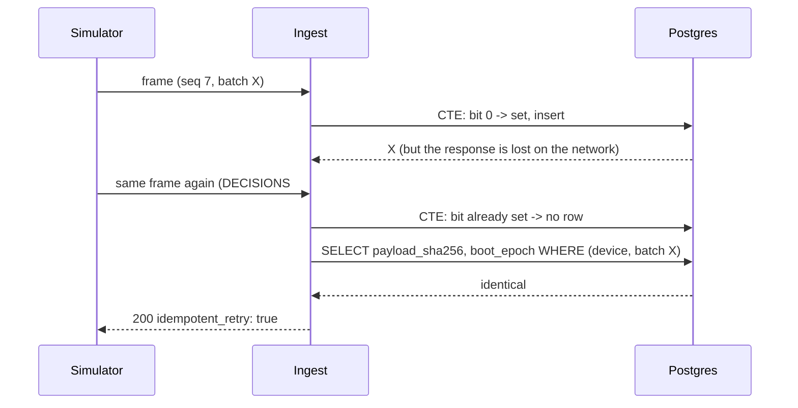

# Phase 4: The thin spine (JWS ingest, replay window, quarantine, serial ledger)

Commit: `0c302cd` (feat(spine): jws telemetry ingest, replay window, quarantine; serial reservation ledger).

## 1. What this phase built and why

Phase 4 connects the pieces into one working path: a device streams signed vitals, the server proves where each batch
came from and rejects replays, and an operator can cut a compromised device off and clean its recent data. It follows
spec Section 2 (layers 2 and 6), Section 4 ("Non-Destructive Anomaly Response", "Revocation Enforcement Path",
"Degraded-Mode Behavior"), Section 5 (envelope and CTE), and Section 6 ("Dual-Timestamp Quarantine and Scoped Alert
Retraction").

- **JWS telemetry ingest**, `POST /api/v1/telemetry/ingest` on 8443 (`telemetry/TelemetryIngestService`). Each batch
  is a compact JWS signed by the device's OLK. The server checks that the signature key is the TLS client certificate,
  verifies it, parses the payload strictly, and stores it with the spec's single-CTE replay window, unchanged.
- **Quarantine**, `POST /api/v1/admin/devices/{id}/quarantine` on 8445 (`quarantine/QuarantineService`): revoke every
  certificate, close every socket, then run the spec's dual-timestamp sanitize statement.
- **Admin auth** (DECISIONS #41): a boot-generated setup code in `var/admin/setup-code` is the bearer token for the
  admin API until WebAuthn.
- **The serial reservation ledger** (DECISIONS #38): a new `issued_serials` table (migration V2) so every device
  serial the CA signs is either recorded or revocable.
- **Simulator streaming mode**: `simulator run` sends one signed batch per second over a persistent mTLS connection.
- **First e2e and drill tests**: `SpineE2E`, `TelemetryPerRequest403E2E`, `LocalStackRestartDrill`.

Deviations, all in `docs/DECISIONS.md`: #38 and #39 (ledger, gateway leaves outside it), #40 (sequence starts at 1),
#41 (setup code), #42 (lock before sanitize), #43 (JWS header policy), #44 (simulator retries the same frame), #45
(quarantine revokes tokens), #46 (Phase 4 classification only).

## 2. Concept primers

### JWS compact serialization, field by field

A JWS (JSON Web Signature, RFC 7515) in compact form is three base64url strings joined by dots:

```
eyJhbGciOiJFUzI1NiIsInR5cCI6... . eyJiYXRjaF9pZCI6ImI3ZjljMmQw... . MEUCIQDx...(64 bytes)
         header                              payload                       signature
```

- **Header**: JSON describing how it was signed. Ours: `{"alg":"ES256","typ":"vitalsshield.telemetry+jws",
  "x5t#S256":"<cert thumbprint>"}`.
- **Payload**: the bytes that were signed. Ours is the spec Section 5 JSON (batch_id, device_id, assignment_id,
  boot_epoch, sequence_number, measured_at, transmitted_at, firmware_hash, metrics).
- **Signature**: over the ASCII string `base64url(header) + "." + base64url(payload)`.

base64url is base64 with `-` and `_` instead of `+` and `/`, and no `=` padding, so the result is safe in URLs and
headers. Because the header is inside the signed input, nobody can change `alg` or `x5t#S256` without breaking the
signature. We store the whole compact string in `telemetry_records.jws_compact`, so any batch can be re-verified years
later from the database alone.

### ES256, and why its signature is raw R||S

ES256 means ECDSA on P-256 with SHA-256. An ECDSA signature is two 32-byte numbers, r and s. JWS (RFC 7518 section 3.4)
requires them as 64 bytes: r left-padded to 32 bytes, then s left-padded to 32 bytes ("R||S"). X.509, KMS, and Java's
`Signature` produce DER instead: `30 len 02 len r 02 len s`, about 70 to 72 bytes, with variable lengths.

JWS is the only place R||S appears (DECISIONS #33). Nimbus `ECDSASigner` produces it; `TelemetryJws.parseAndVerify`
rejects any signature that is not exactly 64 bytes (`SIG_LENGTH`) before verification, so a DER signature pasted into
a JWS fails clearly (`JwsPolicyTest.derSignatureInJwsRejected`).

### Why the verification key comes from the TLS certificate, never from the JWS header

JWS lets a header name its own key: `jwk` (embed a key), `jku` (fetch keys from a URL), `x5c` (embed a certificate
chain), `x5u` (fetch one). A verifier that trusts those lets the attacker choose the key: sign anything with your own
key, put your public key in `jwk`, and it "verifies". A second classic attack is algorithm confusion: change `alg` to
`none` (no signature) or to `HS256` (an HMAC, where a verifier may use the public key bytes as the HMAC secret).

Our policy (DECISIONS #43): the header may contain exactly `alg`, `typ`, and `x5t#S256`. `alg` must be `ES256`, `typ`
must be `vitalsshield.telemetry+jws`, and every other parameter (including `jwk`, `jku`, `x5c`, `x5u`, `crit`, `kid`)
is rejected. The verification key is always the public key of the TLS client certificate on this connection, which the
handshake already validated. `JwsPolicyTest` covers each case.

### x5t#S256 binding

`x5t#S256` is base64url(SHA-256(certificate DER)), 43 characters. The ingest checks three values are identical: the
thumbprint of the TLS client certificate, the `x5t#S256` in the JWS header, and `certificates.cert_thumbprint_s256` for
the row the per-request filter accepted (DECISIONS #35). Together they say "this batch was signed by the key of the
certificate this connection authenticated with, and that certificate is the one we have on record". A JWS signed by
one device and sent over another device's connection fails (`x5tOfAnotherCertIsCertMismatch`: 401 JWS_CERT_MISMATCH).

### Origin authentication versus data truthfulness

A valid JWS proves the batch was signed with that device's OLK and has not changed since (spec Section 2 layer 2). It
does not prove the numbers are true. A rooted device, or anyone who extracts the OLK, can sign a heart rate of 70 while
the patient's is 140. The signature tells you which key produced the lie. Plausibility bounds
(`TelemetryClassifier`) catch impossible values; they cannot catch plausible lies.

### The 64-bit sliding replay window, with bit shifts

Each device row stores `last_sequence_num` (the newest sequence number accepted in this boot epoch) and
`replay_bitmap`, a 64-bit integer where bit k means "sequence `last - k` has been accepted". A new sequence is accepted
if it is newer than `last`, or if it is at most 63 behind and its bit is 0.

Worked example (from `ReplayWindowModelTest.outOfOrderWithin64`):

| Arrives | Rule | last | bitmap (binary) | Meaning |
| :--- | :--- | :--- | :--- | :--- |
| 10 | newer by 10 | 10 | `1` | bit0 = 10 |
| 7 | 3 behind, bit3 is 0: set it (`bitmap \| 1<<3`) | 10 | `1001` | bit0 = 10, bit3 = 7 |
| 7 | 3 behind, bit3 is 1 | 10 | `1001` | duplicate, rejected |
| 12 | newer by 2: shift left 2, set bit0 (`(bitmap << 2) \| 1`) | 12 | `100101` | bit0 = 12, bit2 = 10, bit5 = 7 |
| 76 | newer by 64 or more: start over (`bitmap = 1`) | 76 | `1` | everything older is out of the window |
| 12 | 64 behind | 76 | `1` | too old, rejected |

This tolerates network reordering (batches that arrive a little late) while rejecting any batch seen before and any
batch too old to judge.

### Why one CTE statement makes the window update and the insert atomic

The spec's statement is `WITH window_update AS (UPDATE devices ... RETURNING ...) INSERT INTO telemetry_records ...
SELECT ... FROM window_update`. A CTE (common table expression) with an UPDATE is a sub-statement of the INSERT: one
SQL statement, one implicit transaction. If the window does not accept the sequence, `window_update` returns no rows,
the SELECT produces nothing, and nothing is inserted. If it does, both the bit and the row commit together. There is no
moment where the bit is set but the row is missing, or the reverse, even if the server crashes.

### How Postgres row locks serialize concurrent duplicates

`UPDATE devices ... WHERE device_id = :id` locks that row until commit. When 20 requests with the same frame arrive at
once, the first locks the row, sets the bit, inserts, and commits. The other 19 wait on the lock. In READ COMMITTED,
when a waiting UPDATE gets the lock it re-checks its WHERE clause against the newly committed row version, finds the
bit set, and updates nothing. So exactly one row is stored and no statement hits a unique-key error (SQLSTATE 23505),
which would abort its transaction. `ConcurrentDuplicateIT` checks both: one row, and no "23505" or "duplicate key"
in the application or Postgres logs.

### Idempotent retries versus replays

A device that did not receive the response re-sends the same frame: same `batch_id`, same bytes. That is a retry, and
it must succeed so the device can move on. A different frame reusing a sequence number is a replay (or a bug) and must
fail. When the CTE stores nothing, the server looks up `(device_id, batch_id)`: same `payload_sha256` and `boot_epoch`
means 200 `idempotent_retry: true`; a different payload under that batch_id is 409 `BATCH_ID_REUSED`; otherwise the
device row tells it which 409 (`DEVICE_NOT_ACTIVE` 403, `BOOT_EPOCH_MISMATCH`, `SEQUENCE_TOO_OLD`,
`DUPLICATE_SEQUENCE_REPLAY`).

### Dual-timestamp quarantine

Every row has two times: `measured_at` (device clock, when the vitals were taken) and `ingested_at` (server clock, when
it arrived). A compromised device can lie about `measured_at`. If quarantine cleaned only by `measured_at`, an attacker
could backdate forged batches outside the window. If it cleaned only by `ingested_at`, batches it buffered offline and
uploaded late would be missed. So the sanitize statement selects rows where either time is inside the lookback window
(spec Section 6).

### Baseline lineage and scoped alert retraction

A patient's assignment holds a resting baseline (means and SDs) built from specific batches (`calibration_batch_ids`)
and versioned (`baseline_version`). Drift alerts record the `baseline_version` they were computed against; acute alerts
record the batches that triggered them (`triggering_batch_ids`). When quarantine taints batches:

- a baseline that used any tainted batch is reset to CALIBRATING with version + 1;
- an alert triggered by a tainted batch is retracted;
- a drift alert computed against the tainted baseline version is retracted;
- everything else (older acute alerts, drift alerts on earlier versions, security alerts) stays.

This keeps the clinician's queue clean without deleting valid alerts (spec Section 1, "Lineage-Tracked Alert
Retraction").

### The READ COMMITTED snapshot rule behind DECISIONS #42

In Postgres READ COMMITTED, each statement sees the data committed before that statement started. Two transactions in
flight:

- an ingest: `UPDATE devices ... WHERE trust_state = 'ACTIVE' ...` then insert;
- the quarantine: sanitize statement that marks recent rows QUARANTINED.

If the sanitize statement started first, an ingest that committed a moment later would leave an ACCEPTED row the
sanitize never saw. So quarantine first takes `SELECT ... FROM devices ... FOR UPDATE` and sets `trust_state =
'QUARANTINED'`, then runs the sanitize as a separate, later statement in the same transaction. Every ingest either
committed before the lock (its row is visible to the later sanitize statement, which starts after the lock) or waits on
the lock and then fails the `trust_state = 'ACTIVE'` check once the quarantine commits. `ConcurrentQuarantineIngestIT`
proves it with 8 threads, 5 times: zero ACCEPTED rows left.

### A serial reservation ledger, and why a CRL only needs serials

A CRL lists serial numbers, not certificates. A relying party checks "is this certificate's serial on its issuer's
CRL?". So to revoke a certificate you only need its serial, even if you lost the certificate itself.

The risk without a ledger: the server asks KMS to sign a leaf, then crashes (or loses a race) before storing it. The
signed certificate may already be on its way to a device, but the database has no row, so nothing can revoke it.

The ledger (DECISIONS #38): the serial is reserved in `issued_serials` (RESERVED) in the claim transaction, before any
KMS call. Activation marks it RECORDED. Any path that does not activate marks it VOIDED (and stores the leaf as REVOKED
if it is in hand). A sweep at boot and on every stale reclaim voids RESERVED serials older than 2 minutes. VOIDED serials
go on the CRL (reason superseded) and the deny-list. Invariant: no certificates row lacks a ledger row, and no ledger
row stays RESERVED.

## 3. How it works in our code

### Stream and ingest

```mermaid
sequenceDiagram
    participant S as Simulator (run)
    participant G as Gateway 8443
    participant R as CertStatusResolver
    participant I as TelemetryIngestService
    participant DB as Postgres
    S->>S: incrementSequence() persisted first (write-ahead)
    S->>S: payload JSON, sign ES256 with OLK, header x5t#S256
    S->>G: POST /api/v1/telemetry/ingest (application/jose), keep-alive
    G->>R: certificates row: ACTIVE, in validity -> ResolvedCert
    R->>I: (boundedElastic)
    I->>I: TLS leaf thumbprint == stored == header x5t#S256
    I->>I: verify with TLS leaf public key; strict payload; device_id matches
    I->>DB: ACTIVE assignment id == payload assignment_id?
    I->>I: classify: REJECTED_IMPLAUSIBLE / SIGNAL_DEGRADED / ACCEPTED
    I->>DB: spec Section 5 CTE (one autocommit statement)
    DB-->>I: batch_id
    I-->>S: 200 {accepted, batch_id, trust_state, idempotent_retry:false}
```

### Idempotent retry



### Concurrent duplicate

```mermaid
sequenceDiagram
    participant A as Request A
    participant B as Request B
    participant DB as devices row
    A->>DB: UPDATE (locks row), bit clear -> set, INSERT
    B->>DB: UPDATE waits on A's row lock
    A->>DB: COMMIT
    DB-->>B: lock granted; WHERE re-checked: bit now set -> 0 rows
    B->>B: no row -> classify (same batch: idempotent; new batch: DUPLICATE_SEQUENCE_REPLAY)
```

### Quarantine (revoke, evict, lock, sanitize)

```mermaid
sequenceDiagram
    participant O as Operator (Bearer setup code)
    participant Q as QuarantineService
    participant R as SignerRevocationService
    participant D as Deny-list
    participant A as ActiveSessionRegistry
    participant DB as Postgres
    O->>Q: POST /admin/devices/{id}/quarantine {lookback_minutes, reason}
    Q->>DB: state is ACTIVE or REAUTH_REQUIRED?
    Q->>R: revokeAllForDevice(id, KEY_COMPROMISE)
    R->>D: add every live cert (same instant)
    R->>DB: tx: UPDATE certificates SET REVOKED
    R->>A: evict all channels, wait for close futures
    Q->>DB: BEGIN; SELECT devices FOR UPDATE; re-check state
    Q->>DB: UPDATE devices: QUARANTINED, DEK NULL
    Q->>DB: UPDATE tokens ISSUED/CLAIMING -> REVOKED
    Q->>DB: spec Section 6 sanitize CTE (+counts), separate statement
    Q->>DB: COMMIT
    Q->>Q: CRL republication (coalesced)
    Q-->>O: 200 {certs_revoked, channels_closed, latency, batches, baselines, alerts}
```

Changed in Phase 5: `revokeAllForDevice` now takes the quarantine's request-receipt time `t0` and measures the
latency once, after every close future completes. The same number goes into the quarantine response and into each
per-certificate entry of the revocation log that the dashboard shows, so the two can no longer differ.

### The quarantine/ingest race, blocked

```mermaid
sequenceDiagram
    participant I as In-flight ingest
    participant Q as Quarantine tx
    participant DB as devices row
    Q->>DB: SELECT ... FOR UPDATE (holds the lock)
    I->>DB: CTE UPDATE devices WHERE trust_state='ACTIVE' (waits)
    Q->>DB: trust_state = QUARANTINED; sanitize; COMMIT
    DB-->>I: lock granted; re-check: trust_state is QUARANTINED -> 0 rows
    I-->>I: no row; device not ACTIVE -> 403 DEVICE_NOT_ACTIVE
```

### The enrollment race loser being voided

```mermaid
sequenceDiagram
    participant A as Enrollment A (slow)
    participant B as Enrollment B (same token)
    participant DB as Postgres
    participant K as KMS
    A->>DB: Tx1: token CLAIMING; reserve serial SA (RESERVED)
    A->>K: sign leaf with SA
    Note over A: paused (> 2 min, or a test latch)
    B->>DB: Tx1: token is stale CLAIMING -> reclaim; sweep; reserve SB
    B->>K: sign leaf with SB
    B->>DB: Tx2: token CLAIMING ok, SB RESERVED -> RECORDED; cert ACTIVE; token CONSUMED
    A->>DB: Tx2: token is CONSUMED -> abort (rollback)
    A->>DB: short tx: SA VOIDED; leaf stored REVOKED (REPLACED_BEFORE_USE); deny-listed
    A-->>A: 409 ENROLLMENT_SUPERSEDED; CRL republished with SA (superseded)
```

### Boot sweep after a crash

```mermaid
sequenceDiagram
    participant E as Enrollment
    participant DB as Postgres
    participant B as BootSequence (next start)
    E->>DB: Tx1: reserve serial S (RESERVED)
    E->>E: KMS signs; process dies (nothing else persisted)
    B->>DB: RECONCILED
    B->>DB: SERIALS_SWEPT: RESERVED older than 2 min -> VOIDED
    B->>B: DENY_LIST_SEEDED (includes VOIDED serials)
    B->>B: CRLS_PUBLISHED (lists S, reason superseded)
    B->>B: ADMIN_CODE_ISSUED, LISTENERS_BOUND
```

## 4. Data model

### `issued_serials` (V2)

| Column | Meaning |
| :--- | :--- |
| `issuer_key_hash`, `serial_number` | primary key; the same pair as `certificates` |
| `device_id` | who the serial was reserved for |
| `reserved_at` | when Tx 1 reserved it; the sweep voids RESERVED rows older than 2 minutes |
| `status` | RESERVED (signing may be in progress), RECORDED (certificate row exists), VOIDED (never activated) |
| `voided_at` | revocation date for the CRL and deny-list |

The V2 backfill inserted a RECORDED row for every certificate that existed before the migration.

### `telemetry_records`

| Column | Meaning |
| :--- | :--- |
| `batch_id`, `device_id` | primary key; a retry reuses batch_id |
| `boot_epoch`, `sequence_number` | unique per device; the replay window key |
| `assignment_id` | the patient assignment the device was on |
| `issuer_key_hash`, `serial_number` | the certificate that signed it (resolves to `certificates`) |
| `measured_at` (device clock), `transmitted_at` (device clock), `ingested_at` (server clock) | the dual timestamps |
| `heart_rate_bpm` ... `motion_g_rms`, `perfusion_index` | metrics (the payload calls it `signal_perfusion_index`) |
| `firmware_hash_meta`, `payload_sha256`, `jws_compact` | provenance: the exact signed bytes and their hash |
| `trust_state` | ACCEPTED, SIGNAL_DEGRADED, REJECTED_IMPLAUSIBLE, QUARANTINED |

### `devices` window columns

`last_sequence_num`, `replay_bitmap` (the window), `last_ingested_at`, `boot_epoch`, `trust_state` (ingest requires
ACTIVE), `quarantine_reason`.

### `clinical_alerts`

`alert_type`, `alert_status` (ACTIVE, ACKNOWLEDGED, RETRACTED_BY_QUARANTINE, RESOLVED), `triggering_batch_ids`,
`baseline_version` (required for drift alerts, NULL for others: the Phase 0 CHECK constraint), `retracted_at`. No code
creates alerts yet (Phase 7); `QuarantineIT` inserts them directly.

### `patient_device_assignments` baseline columns

`baseline_state` (CALIBRATING or LOCKED), `baseline_version`, `calibration_batch_ids`, `ref_hr_mean/sd`,
`ref_hrv_mean/sd`, `ref_spo2_mean/sd`.

## 5. Security reasoning

Defended in this phase:

- **Replay and reordering.** The 64-bit window accepts each sequence once per epoch; idempotent retries are recognised
  by batch and payload hash. `ReplayWindowPropertyIT` compares 2000 random operations with a model.
- **Forged JWS.** Signature must verify with the TLS leaf's key; tampered payloads and wrong keys fail.
- **Header attacks.** `alg` none/HS256/ES384, embedded `jwk`, `jku`, `x5c`, `x5u`, `crit` all rejected.
- **Cross-device injection.** device_id must match the TLS certificate, and the JWS must be signed by that certificate.
- **Post-quarantine pollution.** Lock-then-sanitize ordering; no ACCEPTED row survives a concurrent quarantine.
- **Untracked serials.** Every device serial is reserved before signing; lost or abandoned ones are VOIDED, on the CRL
  and the deny-list.
- **Admin abuse from the network.** The admin port is loopback-only and needs the setup code.

Not defended:

- **A rooted device signing false values.** Origin authentication only.
- **Gateway leaves without a CRL** (DECISIONS #39). The gateway's TLS leaves are not in the ledger and the Server TLS CA
  publishes no CRL. Each lives 24 h and its key never leaves memory.
- **The setup code as the only admin authentication** until Phase 6. Anyone who can read `var/admin/setup-code` (mode
  600, same user) can quarantine devices.
- **Clinical meaning.** Classification is plausibility and perfusion only (DECISIONS #46).

## 6. Design decisions

| Decision | Alternatives | Why the alternative lost |
| :--- | :--- | :--- |
| Serial reserved in Tx 1, before KMS (#38) | Record only after activation | A crash between sign and record leaves a valid certificate nobody can revoke |
| Gateway leaves outside the ledger (#39) | Track them too | Their keys never leave JVM memory and they last 24 h; a Server TLS CA CRL is Designed |
| Sequences start at 1 (#40) | Allow 0 | Enrollment resets `last_sequence_num` to 0; seq 0 would be "0 behind" the reset value, an ambiguous first frame |
| Setup code as admin bearer (#41) | No auth until Phase 6; a static password in config | Quarantine is destructive; a fresh random code per boot in a 600 file is the smallest real gate |
| Lock and flip state before sanitize (#42) | Sanitize first, or in one statement | READ COMMITTED snapshot: a concurrent ingest could commit an ACCEPTED row the sanitize never saw |
| Strict JWS header allow-list (#43) | Reject only known-bad parameters | An allow-list of three fields closes every header trick, including ones not yet invented |
| Simulator retries the same frame (#44) | A flash ring buffer | The ring buffer is Designed; retrying one frame is enough to exercise idempotency |
| Quarantine revokes outstanding tokens (#45) | Leave them | A compromised device with a pending token could re-enroll immediately |
| Phase 4 classification only (#46) | Build the clinical engine now | Out of scope; the CTE and storage do not depend on it |
| Spec CTEs verbatim, typed parameter binding | Add casts to the SQL | The spec text is the reviewed artifact; `Types.OTHER` for the enum and a typed `timestamptz` for `:quarantineTs` keep it byte-identical |
| Admin code issued as its own boot step `ADMIN_CODE_ISSUED` | Fold into DENY_LIST_SEEDED | Clearer in boot-status; it is not part of the deny-list |

## 7. Verify it yourself

All output below is from 2026-11-13.

**1. Unit tests, Docker unreachable** (216 tests, 20 classes; LocalStack `StartedAt` unchanged):

```
   3 BootEpochRuleTest PASSED          18 JwsPolicyTest PASSED
   5 CanonicalBytesTest PASSED          2 NoNettyNioClientTest PASSED
  13 CanonicalEncodingsTest PASSED     18 PortEnforcementWebFilterTest PASSED
   7 CertificateDenyListTest PASSED     7 ReplayWindowModelTest PASSED
   9 CertificateProfileTest PASSED      6 SeedDemoDeviceTest PASSED
  14 CrlReasonMappingTest PASSED        2 SerialReservationRulesTest PASSED
   5 CsrFactoryTest PASSED              7 SimulatorStateStoreTest PASSED
   5 DerSignaturesTest PASSED          11 TelemetryClassifierTest PASSED
  12 DynamicMtlsTrustManagerTest PASSED 18 TelemetryPayloadValidatorTest PASSED
   6 EcKeysTest PASSED
  27 EnrollmentRequestValidatorTest PASSED
```

**2. Integration tests**: 91 passed. Property test seed and operation mix (look for matching decisions over 2000
operations):

```
REPLAY_PROPERTY_SEED=994213236667125
REPLAY_PROPERTY_OPS={IN_ORDER=715, OUT_OF_ORDER=505, GAP_64=104, GAP_65=94, RESEND_IDENTICAL=196, DUPLICATE_NEW_BATCH=197, TOO_OLD_64=88, TOO_OLD_65=101} final last=13481 bitmap=f
QRACE run 1: sent=3255 ok=53 quarantined=53 afterCommit=3145 latency_us=6058
QRACE run 2: sent=4084 ok=51 quarantined=51 afterCommit=4005 latency_us=1551
QRACE run 3: sent=4571 ok=49 quarantined=49 afterCommit=4494 latency_us=1711
QRACE run 4: sent=4259 ok=54 quarantined=54 afterCommit=4163 latency_us=1998
QRACE run 5: sent=5030 ok=54 quarantined=54 afterCommit=4950 latency_us=1858
```

In each race run every accepted batch was quarantined (`ok == quarantined`), and the thousands of requests sent after
the commit all got 403 or a connection failure.

**3. e2e**: look for five latencies under 500,000 µs.

```
SPINE_REVOCATION_LATENCY_MICROS=[8535, 4734, 4165, 2947, 3658]
```

**4. Drill** (wipes the Compose KMS keys; the next bootRun rebuilds):

```
DRILL t+ 1634 ms  server started (first boot)
SENT seq=1 batch=cad3a33f status=200 rtt_ms=32
SENT seq=2 batch=ff0678b8 status=200 rtt_ms=8
SENT seq=3 batch=93592f09 status=200 rtt_ms=9
DRILL t+ 1911 ms  1. enrolled and streamed 3 batches
DRILL t+10326 ms  2. docker compose restart localstack, healthy again
DRILL t+10746 ms  3. server restarted
DRILL t+10764 ms  3. REBUILT confirmed; trust file changed; old certificate refused at the handshake
SENT seq=1 batch=1a333932 status=200 rtt_ms=14
DRILL t+10840 ms  4. reset-state, new token, re-enrolled at boot_epoch=2 with the same DEK, 1 batch accepted
```

**5. Manual spine against bootRun.** The boot logged `Hierarchy reconciliation: REBUILT` (the drill had wiped the keys)
and `Admin setup code written to var/admin/setup-code` (mode `-rw-------`). After seed, factory-wipe, and enroll
(`ENROLLED serial=cb611fb8ddc2d0be2daf451ebd80f3904b8e902 boot_epoch=3`), terminal A streamed and terminal B ran:

```
$ curl -s -X POST -H "Authorization: Bearer $(cat var/admin/setup-code)" -H "Content-Type: application/json" -d '{"lookback_minutes":10,"reason":"phase 4 manual"}' http://127.0.0.1:8445/api/v1/admin/devices/dev_wearable_019/quarantine
{"device_id":"dev_wearable_019","certs_revoked":1,"channels_closed":1,"revocation_latency_micros":12741,"batches_quarantined":23,"baselines_reset":0,"alerts_retracted":0}
```

Terminal A's last lines (Gradle then prints its own BUILD FAILED footer because the simulator exits with code 3):

```
SENT seq=20 batch=f792b55b status=200 rtt_ms=9
SENT seq=21 batch=698d71fd status=200 rtt_ms=20
SENT seq=22 batch=82778ea3 status=200 rtt_ms=26
SENT seq=23 batch=2230414a status=200 rtt_ms=25
REJECTED handshake_refused last_ok_seq=23 ms_since_last_ok=1046
```

```
$ psql -c "select trust_state, count(*) from telemetry_records where device_id='dev_wearable_019' group by 1"
 trust_state | count
-------------+-------
 QUARANTINED |    23

$ curl -s --cacert var/trust/root-ca.pem https://127.0.0.1:8444/api/v1/pki/intermediate-crl.pem | $OPENSSL crl -noout -text | grep -i -A4 CB611FB8
    Serial Number: 0CB611FB8DDC2D0BE2DAF451EBD80F3904B8E902
        Revocation Date: Nov 14 01:05:35 2026 GMT
        CRL entry extensions:
            X509v3 CRL Reason Code:
                Key Compromise
```

OpenSSL pads the 39-hex-digit serial with a leading `0`; we store it without leading zeros.

**6. Ledger invariant on the Compose database** (look for 0):

```
 count
-------
     0
```

## 8. How the tests prove it

| Test | Property proved |
| :--- | :--- |
| `JwsPolicyTest` | ES256 only; typ required; jwk, x5c, jku, x5u, crit, kid rejected; x5t must match; DER signature rejected (SIG_LENGTH); tampered payload and wrong key rejected; malformed rejected |
| `TelemetryPayloadValidatorTest` | unknown fields, wrong names, missing fields, nulls, coercion, trailing tokens rejected; seq and epoch >= 1; 5-minute skew; measured_at <= transmitted_at + 1 min; firmware hash format; device mismatch 403 |
| `TelemetryClassifierTest` | every bound: 14/15, 300/301, 39.9/40, 100/100.1, perfusion 0.49/0.5 |
| `ReplayWindowModelTest` | in order, out of order, gap 64 and 65, duplicate, 64 and 65 behind, shift by 63 |
| `ReplayWindowPropertyIT` | 2000 seeded random operations: endpoint decisions and final window equal the model |
| `TelemetryIngestIT` | happy path stored with correct hash and JWS; offline re-verification from the DB; x5t mismatch 401; wrong key 401 SIG_INVALID; other device 403; stale assignment 409 with current id; wrong epoch 409; implausible stored and consumes its sequence; degraded stored |
| `ConcurrentDuplicateIT` | 20 identical frames: 1 row, 1 accepted + 19 idempotent, no 23505 anywhere; same seq different batches: 1 accepted, 19 DUPLICATE; batch reused under a new seq: BATCH_ID_REUSED and the seq is consumed |
| `QuarantineIT` | dual-timestamp selection; REJECTED_IMPLAUSIBLE untouched; baseline reset; only the two tainted alerts retracted; device QUARANTINED, DEK cleared; tokens REVOKED; cert REVOKED KEY_COMPROMISE and on the CRL; repeat 409; no bearer 401; invalid state 409; bad body 400 |
| `ConcurrentQuarantineIngestIT` (x5) | zero ACCEPTED/SIGNAL_DEGRADED rows left; every request after commit is 403 or a connection failure; quarantined count equals accepted count |
| `SerialReservationIT` | race loser 409, VOIDED, stored REVOKED REPLACED_BEFORE_USE, on CRL as superseded, winner RECORDED; crash after sign voided by the boot sweep, on the CRL and deny-list; ledger invariant; V2 backfill covers pre-existing rows |
| `SerialReservationRulesTest` | allocator format; sweep cutoff boundary at exactly 2 minutes |
| `AdminAuthIT` | no or wrong bearer 401 empty; right bearer passes; boot-status open; setup-code file 600 |
| `SpineE2E` (x5) | stream 20, all ACCEPTED; offline re-verify; quarantine closes the live socket; simulator reconnect refused; 20 QUARANTINED; cert REVOKED and on the CRL over 8444; device QUARANTINED with DEK NULL; ledger invariant; latency < 500 ms |
| `TelemetryPerRequest403E2E` | eviction off: ingest on the same connection after revoke is 403, nothing stored |
| `LocalStackRestartDrill` | KMS wipe: REBUILT, trust file changed, old cert refused, DEK survives reset-state, re-enroll at epoch 2, batch accepted |
| `EnrollmentIT` (extended) | ledger invariant holds after every enrollment path in the class |

## 9. Gotchas hit during this phase

- **Jackson's SNAKE_CASE turns `motionGRms` into `motion_grms`**, not the spec's `motion_g_rms`, so the spec's own
  example payload was rejected as an unknown field. Every payload field now has an explicit `@JsonProperty` name.
- **Jackson accepted `"spo2_pct":"98"`** (a string) as a number by default. `MapperFeature.ALLOW_COERCION_OF_SCALARS`
  is disabled.
- **An untyped timestamp parameter broke the spec's quarantine SQL.** The PostgreSQL JDBC driver sends
  `java.sql.Timestamp` without a type, so `:quarantineTs - (:lookbackMinutes * INTERVAL '1 minute')` resolved the
  parameter as an interval and failed with `operator does not exist: timestamp with time zone >= interval`. Binding
  it as `OffsetDateTime` with `Types.TIMESTAMP_WITH_TIMEZONE` fixed it without touching the SQL. The enum parameter
  `:trustState` is bound with `Types.OTHER` for the same reason.
- **Test seed hit the schema's own rule.** The first backfill test inserted two ACTIVE certificates for one device; the
  one-active-cert-per-device index rejected it. The test now inserts one REVOKED and one ACTIVE.
- **Gradle reports the simulator's exit code 3 as BUILD FAILED.** That is the designed "refused" exit; the simulator's
  last line is `REJECTED handshake_refused ...`.
- **`git add -A` swept in `.vscode/settings.json`.** It was removed from the commit before it left the machine, and
  `.vscode/` is now in `.gitignore`.

## 10. Judge Q&A

**Q: How are your serial numbers generated?**
A: `SerialAllocator` draws 20 bytes from the JDK's `SecureRandom` and clears the top bit (`SerialNumbers.random`), so
every serial is positive, encodes in DER as an INTEGER of at most 20 octets (the RFC 5280 limit), and carries 159
random bits, well above the 64 bits the CA/Browser Forum Baseline Requirements set for publicly trusted TLS
certificates. Each serial is reserved in `issued_serials` before KMS signs anything. Serials are never sequential, so
they reveal nothing about how many devices we enroll and cannot be predicted. That matters historically: the 2008 MD5
collision attack (Sotirov, Stevens, and others) produced a rogue CA certificate because the attacked CA's serials and
validity times were predictable, which let the attackers choose the exact bytes the CA would sign. `SerialAllocatorTest`
(added in Phase 5a) draws 10,000 serials from the production constructor and checks the source is `SecureRandom`, all
are positive, each DER INTEGER is at most 20 octets (BouncyCastle `ASN1Integer`), all are unique, no two consecutive
ones differ by 1 and the sequence is not monotonic, the highest set bit is bit 158, and each of the 159 bit positions
is set in 40% to 60% of the samples.

**Q: Is every certificate your CA signed accounted for?**
A: Every device leaf, yes. The serial is reserved in `issued_serials` as RESERVED inside the claim transaction, before
any KMS call, so nothing is ever signed with an unrecorded serial. Activation marks it RECORDED in the same transaction
that inserts the certificate. If activation aborts (the token or serial was taken by someone else), the serial is
VOIDED and the signed leaf is stored as REVOKED with REPLACED_BEFORE_USE and deny-listed. If the process dies after
signing, the sweep at the next boot (and on every stale reclaim) voids RESERVED serials older than 2 minutes. VOIDED
serials go on the intermediate CRL with reason superseded and on the deny-list, so even a certificate we lost is
revocable. The invariant query (no certificate without a ledger row, nothing left RESERVED) returns 0 in the tests and
on the Compose database. The stated limit: gateway TLS leaves from the Server TLS CA are outside the ledger and that CA
publishes no CRL (DECISIONS #39); their keys never leave memory and they last 24 hours.

**Q: Your JWS could carry its own key. How do you stop that?**
A: The header may contain only `alg`, `typ`, and `x5t#S256`; anything else, including `jwk`, `jku`, `x5c`, `x5u`, and
`crit`, is rejected, and `alg` must be ES256. The verification key is always the TLS client certificate's public key,
and the header's `x5t#S256` must equal that certificate's thumbprint and the stored one.

**Q: What stops a captured batch from being replayed?**
A: The 64-bit sliding window on `(device, boot_epoch, sequence_number)`, updated in the same SQL statement as the
insert. Each sequence is accepted once; anything more than 63 behind the newest is rejected; an identical re-send gets
200 as an idempotent retry without a second row. A seeded property test runs 2000 random operations against a model.

**Q: If a device is compromised, how fast is it cut off, and what happens to its data?**
A: Quarantine deny-lists and revokes every certificate, closes every socket (measured 3 to 13 ms end to end in the e2e
runs), and then, under a row lock, marks the device QUARANTINED, clears its DEK, revokes its tokens, and quarantines
every batch whose `ingested_at` or `measured_at` is inside the lookback window. Baselines built from those batches are
reset and only the alerts derived from them are retracted. Nothing is deleted.

**Q: Does a valid signature mean the vitals are real?**
A: No. It proves origin and integrity: the batch was signed by that device's OLK and has not changed. A rooted device
can sign false values. Plausibility bounds catch impossible values, and Phase 7's clinical engine will look for
anomalies, but a signature cannot prove truth.
