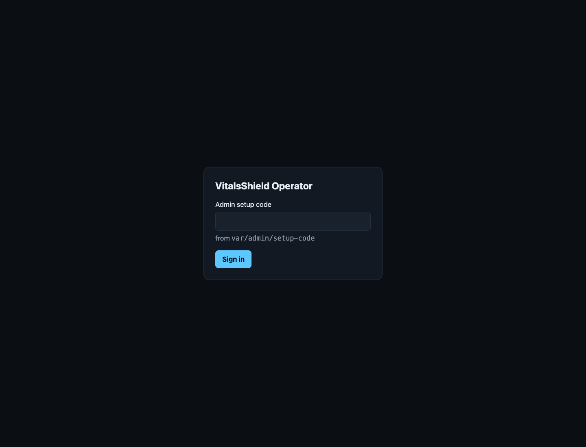
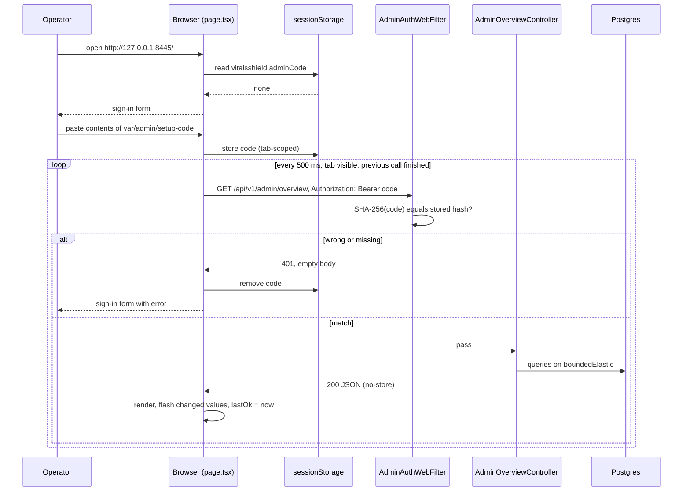
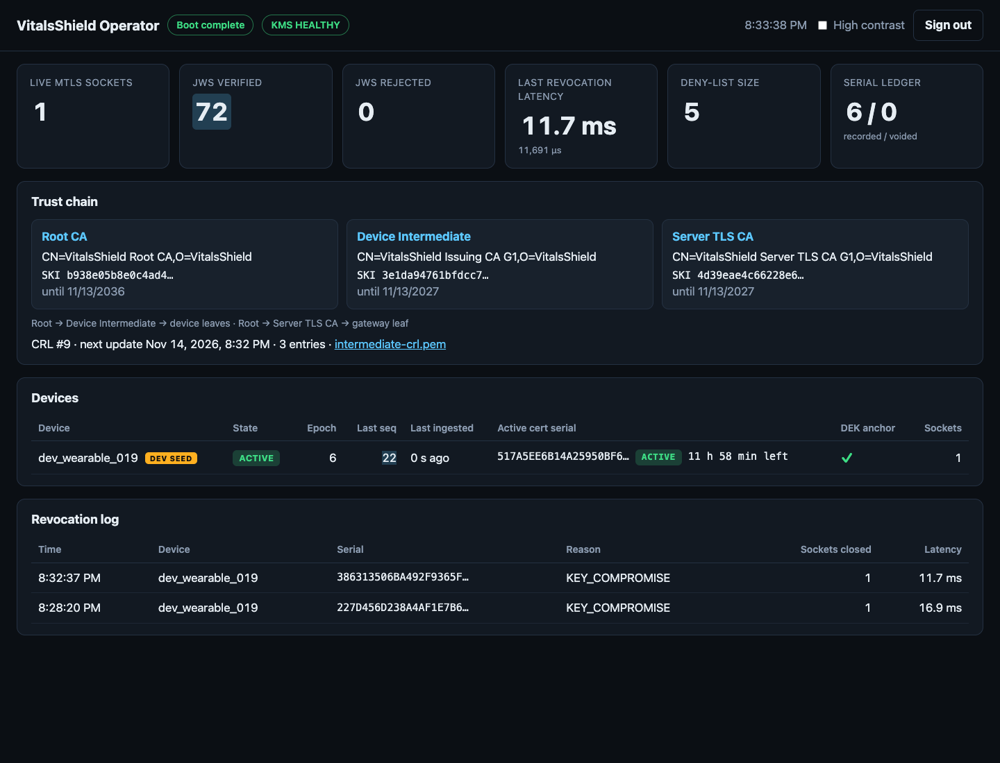
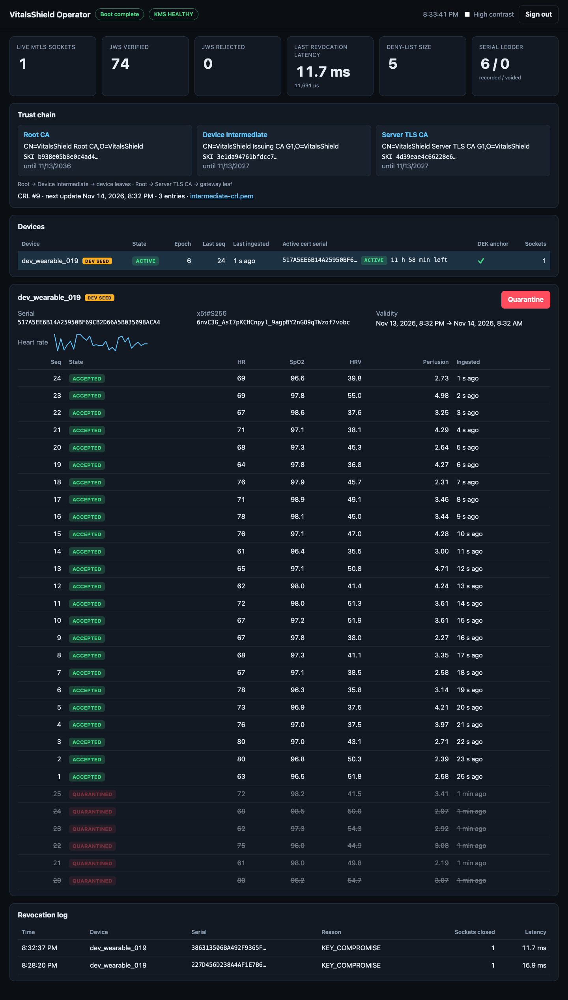
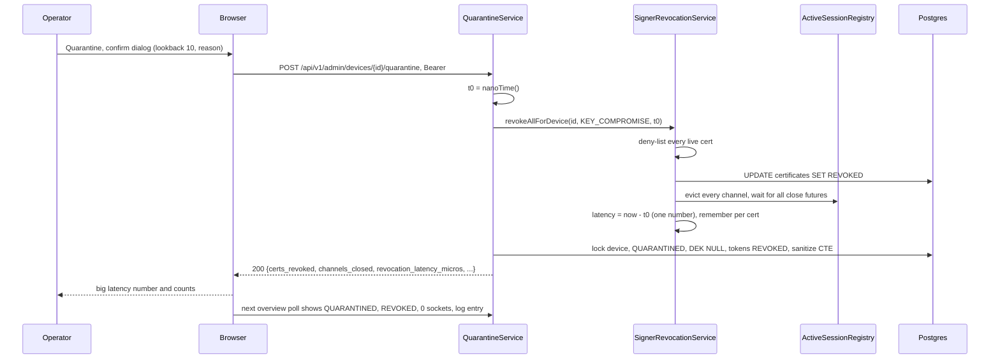
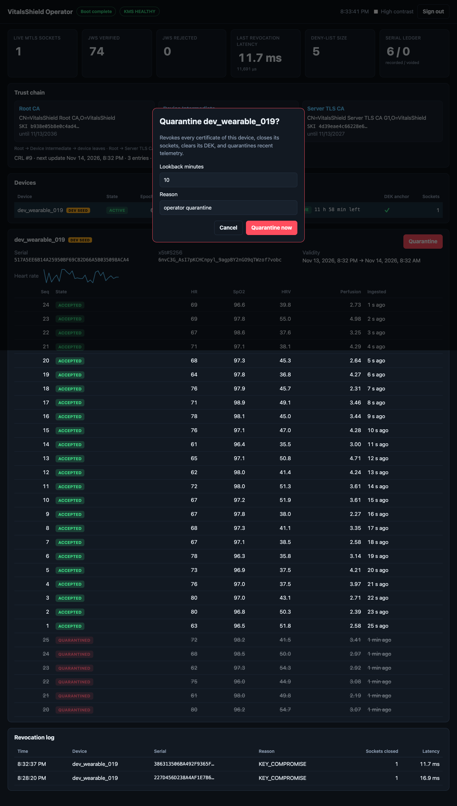
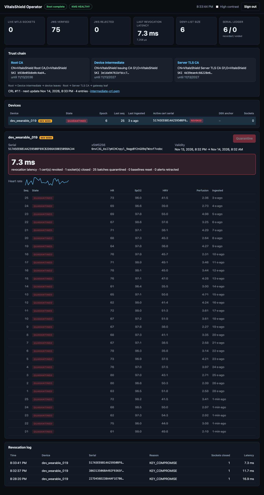
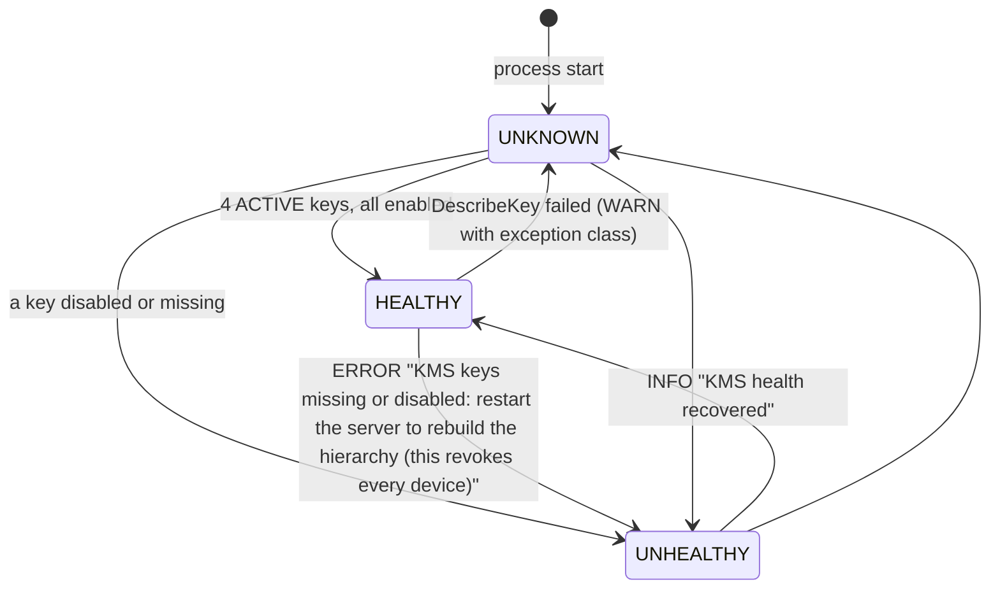

# Phase 5: Operator dashboard (overview API, KMS health monitor, Next.js on the admin port)

Commit: `41c77b1` (feat(dashboard): operator overview api, kms health monitor, next.js dashboard on admin port).

## 1. What this phase built and why

Phase 5 gives the operator one screen that shows the state of the PKI and the devices, and one button that acts on
it: quarantine. It follows spec Section 8 (operator surface) and Section 3 (KMS as the root of trust). Everything is
on the admin port (8445, plain HTTP, bound to 127.0.0.1). 8443 and 8444 return 404 for every dashboard path.

- **`GET /api/v1/admin/overview`** (`admin/AdminOverviewController`, `admin/AdminOverviewService`): one JSON document
  with boot steps, KMS key health, the three CA certificates and the intermediate CRL, live sessions, deny-list size,
  JWS counters, the serial ledger, the last 20 revocations and quarantines, and one row per device. Read-only.
- **`GET /api/v1/admin/devices/{id}/telemetry?limit=30`**: the device's newest telemetry rows (limit capped to
  1..200). Read-only.
- **`KmsHealthMonitor`** (DECISIONS #49): calls `DescribeKey` on the four ACTIVE keys at boot and every 30 seconds.
  It reports HEALTHY, UNHEALTHY, or UNKNOWN and logs an alarm. It never rebuilds anything.
- **`SerialDisplayFormat`** (DECISIONS #50): serials shown the way OpenSSL prints them. Storage is unchanged.
- **Static dashboard serving** (`admin/DashboardRoutes`, DECISIONS #47): a WebFlux `RouterFunction` serves the Next.js
  export from `vitalsshield.dashboard.dir` (default `dashboard/out`), with path traversal checks and a per-file CSP.
- **Security headers** (`admin/AdminSecurityHeadersWebFilter`): `nosniff`, `DENY`, `no-referrer`, a strict CSP on
  every admin response, and `Cache-Control: no-store` on `/api/`.
- **The dashboard** (`dashboard/`): Next.js 16, App Router, TypeScript, `output: "export"`. One client page: sign-in
  with the setup code, header pills, a KMS banner, tiles, the trust chain, the devices table, the selected device with
  a heart-rate sparkline and its telemetry, the quarantine button with a confirm dialog, and the revocation log.
  Changed in Phase 6: in webauthn mode the page is opened at `http://localhost:8445`, signs in with a passkey (HttpOnly
  session cookie instead of the code in sessionStorage), quarantines through a Touch ID step-up, and adds provisioning,
  restore, and audit panels; the setup-code screen remains in bearer mode.
  Changed in Phase 7: active and retracted alert tiles, a baseline card and activity, z-score, and "unevaluated"
  columns for the selected device, a clinical alerts panel with Acknowledge and Resolve, and an amber
  NEEDS ATTENTION chip (DECISIONS #77).

Small backend changes to feed the overview: `RevocationResult` now carries device, reason, and time;
`revokeAllForDevice` measures latency once from the quarantine's `t0`; `CrlService.SignedCrl` carries its entry
count; `ActiveSessionRegistry.liveCountsByKey()`; `IssuedSerialLedger.invariantViolations()` and `countsByStatus()`
(the test helper `LedgerInvariant` now uses the same SQL); a `CERT_MISMATCH` rejection counter.

Deviations, all in `docs/DECISIONS.md`: #47 (static export, setup code in sessionStorage), #48 (polling, not SSE),
#49 (health monitor never rebuilds), #50 (display format), #51 (DEV SEED badge), #52 (CSP script hashes instead of
`'unsafe-inline'`).



## 2. Concept primers

### Static export versus server-side rendering

Next.js can run as a Node server that renders pages per request (SSR), or it can write plain files at build time
(`output: "export"`). We use the export. `npm run build` produces `dashboard/out/`: `index.html`, a `_next/static/`
folder of JavaScript and CSS with content hashes in their names, and `icon.svg`. Nothing in `out/` runs on a server.
The Java server reads the files from disk and sends them as they are; the browser then runs the JavaScript, which
calls the admin API.

Why it matters here: there is no second server process, no Node runtime on the admin port, and no server code that
could see the setup code. The only code that handles admin data on the server side is the Java code that already
had to be reviewed. The cost is that the page is fully client-rendered: the HTML ships empty and fills in after the
first API call.

### Same origin, and why there is no CORS

An origin is scheme + host + port. `http://127.0.0.1:8445` is one origin. The dashboard's HTML and its API calls both
come from that origin, so the browser treats every `fetch("/api/v1/admin/overview")` as same-origin and never sends a
CORS preflight. The server sends no `Access-Control-Allow-Origin` header at all, so a page from any other origin
(another port included) cannot read admin responses. In development, `next dev` runs on port 3000 and proxies
`/api/*` to 8445 with a rewrite, so the browser still sees one origin there too.

### EventSource cannot send a bearer token

Server-Sent Events (`EventSource`) would push updates instead of polling. The browser API takes only a URL and a
`withCredentials` flag; it has no way to set an `Authorization` header. The options would be to put the setup code in
the URL (it ends up in logs and history) or to switch to cookies (then CSRF protection is needed). Polling with
`fetch` sends `Authorization: Bearer <code>` on every request and needs neither. DECISIONS #48 records the choice. At
500 ms and a 3 ms server-side query, polling costs little on loopback.

### CSP and the other headers, and the inline script question

Content Security Policy tells the browser which sources a page may load. Ours:

```
default-src 'self'; connect-src 'self'; img-src 'self' data:; style-src 'self' 'unsafe-inline';
script-src 'self' <hashes>; frame-ancestors 'none'; base-uri 'none'; form-action 'self'
```

`script-src 'self'` means only script files from this origin may run, and no inline `<script>` blocks. That is the
main defence against injected script: even if an attacker got markup into the page, an inline script would not run.

The Next.js 16 export puts 3 inline scripts in `index.html` (a small bootstrap, and the React Server Components
payload that hydration reads from `self.__next_f`). With `script-src 'self'` alone the page stays blank. The common
fix is `'unsafe-inline'`, which turns the protection off. CSP has a better option: list the SHA-256 hash of each
allowed inline script, `'sha256-<base64>'`. The browser hashes each inline script it finds and runs it only if the
hash is listed. An injected script has a different hash and is blocked. `DashboardRoutes.cspFor` reads the HTML file,
finds every `<script>` without `src`, hashes its body, and adds the hashes to `script-src` for that file
(DECISIONS #52). `style-src` keeps `'unsafe-inline'` because the brief specified it; inline styles cannot run code.

The other headers: `X-Content-Type-Options: nosniff` stops the browser from guessing a type (a `.txt` file cannot be
run as script); `X-Frame-Options: DENY` and `frame-ancestors 'none'` stop any site from framing the dashboard
(clickjacking on the quarantine button); `Referrer-Policy: no-referrer` keeps URLs out of outgoing requests;
`Cache-Control: no-store` on `/api/` keeps admin JSON out of the browser cache; HTML gets `no-cache` so a rebuild is
picked up on the next load.

### Path traversal

A static file server maps a URL path to a file path. If it just joins them, `GET /../../.env` or its encoded form
`/..%2f..%2f.env` walks out of the directory. `DashboardRoutes.resolve` does five things in order: percent-decode the
path; refuse NUL bytes, backslashes, and paths not starting with `/`; resolve it under the real path of the directory
and `normalize()` (which collapses `..`); refuse anything that no longer starts with the directory; and after picking
the final file, take its real path again (following symlinks) and check once more. Any refusal is an empty 404, the
same answer as a file that does not exist, so a probe learns nothing.

### KMS key health, and why there is no runtime rebuild

Every CA signature is made by KMS. If a key is deleted or disabled, the CA can no longer sign certificates or CRLs.
Phase 1's `HierarchyReconciler` handles a missing key only at boot, and in the `local` profile only, by rebuilding the
whole hierarchy. A rebuild creates a new Root, so every existing device certificate stops chaining and every device
must re-enroll.

The monitor detects the problem while running but does not fix it (DECISIONS #49). An automatic rebuild in a live
process would revoke every device without anyone deciding to, and a transient network error would look the same as a
deleted key. So the monitor separates three states: HEALTHY (all four ACTIVE keys described and enabled), UNHEALTHY
(KMS answered and a key is disabled, scheduled for deletion, or missing), and UNKNOWN (the call itself failed, for
example a timeout). Only UNHEALTHY raises the red banner and the ERROR log line. Recovery is a deliberate restart.

### Serial display format

We store serials as lowercase hex from `BigInteger.toString(16)`, which drops leading zeros and can have an odd
number of digits. OpenSSL prints serials as whole bytes in uppercase: `openssl x509 -serial` gives
`serial=386313506BA492F9365F70A7B6AE0C40846BCE08`. If the dashboard showed the stored form, an operator comparing a
serial with `openssl crl -text` output could think they differ. `SerialDisplayFormat.toOpenSslHex` uppercases and adds
one leading `0` if the length is odd. The overview sends both `serial` and `serial_display`.

## 3. How it works in our code

### Sign-in and the poll loop



Details from `dashboard/app/page.tsx`:

- The code is kept in `sessionStorage` (cleared when the tab closes), read through `useSyncExternalStore` in
  `storage.ts`, so the first render on the server-side prerender sees "unknown" and renders nothing instead of a
  flash of the sign-in form.
- Each poll checks `document.visibilityState` and an in-flight ref. A hidden tab makes no calls; a slow response is
  never overlapped by the next tick.
- The selected device's telemetry is polled the same way every 1 s.
- If no successful overview has arrived for more than 3 s, the header shows a stale marker.
- Relative times ("3 s ago", "11 h 58 min left") use the server's `server_time` plus elapsed local time, so a wrong
  laptop clock cannot shift them.



Clicking a device row opens its panel: the full serial in OpenSSL form, the `x5t#S256` thumbprint, the validity
window, a heart-rate sparkline, and the 30 newest telemetry rows. The list spans boot epochs, so in the screenshot the
struck-through QUARANTINED rows at the bottom are from the previous enrollment's quarantine, below the current
epoch's ACCEPTED rows.



### The quarantine button path



The button is the only state-changing call the dashboard makes. It reuses the Phase 4 endpoint unchanged; no new
admin endpoint writes anything.





### KMS health transitions



`BootSequence` runs `checkNow()` right after `RECONCILED` and then `start()`, a `Flux.interval(30 s)` on
`boundedElastic` (the KMS SDK call blocks, so it must not run on a Netty thread). The boot step list is unchanged:
the check is not a boot step. Logs are written only on transitions, not on every tick.

### Static serving next to the API

`DashboardRoutes` matches `GET` and `HEAD` for any path that does not start with `/api/`, so a controller always wins
for API paths. `PortEnforcementWebFilter` passes non-API paths only on the admin port; 8443 and 8444 answer them with
an empty 404. `/` maps to `index.html`, a directory to its `index.html`, and an extensionless path to `<path>.html`
(Next.js `trailingSlash` layout). File reads run on `boundedElastic`. If the directory is missing, `/` returns 200
with `dashboard not built: run npm run build in dashboard/` and the server keeps running; everything else is 404.

## 4. Data model

No migrations. The overview reads existing tables: `certificates`, `ca_certificates` via `CaIssuerRepository`,
`kms_keys`, `devices`, `patient_device_assignments`, `bootstrap_tokens` (for the dev-seed badge: the latest token's
`issued_by_clinician = 'dev-seed-clinician'`), `issued_serials`, and `telemetry_records`. Counters (JWS verified,
rejected by reason, accepted, idempotent retries, 409 codes), live sessions, deny-list size, and the last 50
revocations are in memory.

Top-level overview fields: `server_time`, `boot_steps`, `kms {state, healthy, checked_at, keys[]}`,
`ca {root, device_intermediate, server_tls_ca}` (each `subject`, `ski_hex`, `not_after`; the intermediate also
`crl_number`, `crl_next_update`, `crl_entries`), `sessions {live_count, by_device}`, `deny_list_size`,
`telemetry {jws_verified, jws_rejected, accepted, idempotent_retries, conflicts}`,
`ledger {recorded, voided, reserved, invariant_violations}`, `revocations[]`, `quarantines[]`, `devices[]`. Each device
row has `trust_state`, `boot_epoch`, `last_sequence_num`, `last_ingested_at`, `dev_seed`, `dek_anchor_verified`,
`assignment`, `active_cert {serial, serial_display, x5t, not_before, not_after, status}`, and `live_sockets`.

`active_cert` is the newest certificate with ACTIVE ones first, and it carries its status, so a quarantined device
still shows its now-REVOKED serial instead of nothing. `dek_anchor_verified` re-checks the KMS registry anchor
signature over the stored DEK; the result is cached 30 s per device so a 500 ms poll does not call KMS each time. It is
`null` when the device has no DEK (after quarantine), shown as a dash.

## 5. Security reasoning

- **Loopback only.** 8445 binds to 127.0.0.1. Nothing on the network can reach the dashboard or the API.
- **Bearer on every call.** The page never gets data without the setup code; a 401 wipes the stored code and returns
  to sign-in. The server compares SHA-256 of the presented code with the in-memory hash and never logs the code.
- **sessionStorage, not localStorage.** The code dies with the tab. Until WebAuthn (Phase 6) this is the smallest
  exposure that still survives a reload. Anything that can run script in the page could read it, which is why the
  CSP forbids every script that is not a same-origin file or a listed hash.
- **No inline script without a hash, no framing, no sniffing, no caching of admin JSON.** See the primer above.
- **No CORS headers.** Other origins cannot read admin responses.
- **Read-only by construction.** The two new endpoints are GETs that run SELECTs. The only write the dashboard can
  trigger is the existing quarantine, behind a confirm dialog that names what it does.
- **The monitor cannot make things worse.** It never deletes, disables, creates, or rebuilds; its only output is
  state, a banner, and a log line.
- **Traversal-safe file serving**, with a real-path check after symlinks, tested with encoded and raw `..` paths.

## 6. Design decisions

| Decision | Alternatives | Why the alternative lost |
| :--- | :--- | :--- |
| Static export served by the Java server (#47) | `next start` as a second process; SSR | A second server on the admin port, and server code that would handle the setup code |
| Code in sessionStorage (#47) | localStorage; cookie | localStorage persists after the tab closes; a cookie needs CSRF protection |
| Poll every 500 ms (#48) | SSE; WebSocket | EventSource cannot send `Authorization`; a WebSocket is more code for the same loopback data |
| Health monitor reports, never rebuilds (#49) | Rebuild on detection | A runtime rebuild revokes every device without a decision, and a timeout looks like a lost key |
| OpenSSL serial display (#50) | Show stored hex | Operators compare with `openssl` output; odd-length lowercase looks like a different serial |
| DEV SEED badge (#51) | No marker | Seeded devices skip the clinician step; they must be visible as such |
| CSP script hashes (#52) | `'unsafe-inline'`; nonces | `'unsafe-inline'` disables the protection; nonces need per-request HTML rewriting of a static file |
| Hashes computed at serve time, cached per file and mtime | Generate at build time | One of the three hashes changes on every build; serve time cannot go stale |
| HEAD served like GET | GET only | `curl -I` hit the 404 path and showed the base CSP without hashes |
| One latency measurement inside `revokeAllForDevice` | Measure in quarantine and per cert | Two clocks gave 7175 us and 7356 us for one event |
| `active_cert` = newest cert, ACTIVE first, with status | Only ACTIVE certs | After quarantine the row would lose the serial the operator just revoked |

## 7. Verify it yourself

All output below is from 2026-11-13, after the final build.

Start the stack and server, then build the dashboard:

```
docker compose up -d
./gradlew :server:bootRun --args='--spring.profiles.active=local'
cd dashboard && npm ci && npm run typecheck && npm run lint && npm run build
```

`npm run build` ends with:

```
Route (app)
┌ ○ /
├ ○ /_not-found
└ ○ /icon.svg

○  (Static)  prerendered as static content
```

The dashboard is served on 8445 and not on 8444:

```
$ curl -s -o /dev/null -w "%{http_code}\n" http://127.0.0.1:8445/
200
$ curl -sk -o /dev/null -w "%{http_code}\n" https://127.0.0.1:8444/
404
$ curl -s -o /dev/null -w "%{http_code}\n" --path-as-is "http://127.0.0.1:8445/..%2f..%2fbuild.gradle"
404
```

8443 requires a client certificate, so `curl` without one fails the handshake; `DashboardServingIT` checks the 404
there with a device certificate.

Headers on the HTML (three inline-script hashes in `script-src`, no `'unsafe-inline'` for scripts):

```
$ curl -sI http://127.0.0.1:8445/ | grep -iE "^(content-security-policy|x-content-type-options|x-frame-options|referrer-policy|cache-control)"
X-Content-Type-Options: nosniff
X-Frame-Options: DENY
Referrer-Policy: no-referrer
Content-Security-Policy: default-src 'self'; connect-src 'self'; img-src 'self' data:; style-src 'self' 'unsafe-inline'; script-src 'self' 'sha256-k+a8cMvD4Dot3YzYdfhPn34ru1upIApf284+Y9y5SRU=' 'sha256-OBTN3RiyCV4Bq7dFqZ5a2pAXjnCcCYeTJMO2I/LYKeo=' 'sha256-7Ezi7f4n3FqW27hSGRfqGxt0iwIu9oeOENEJ7yO53tY='; frame-ancestors 'none'; base-uri 'none'; form-action 'self'
Cache-Control: no-cache
```

The overview, and its cache header:

```
$ curl -sI -X GET -H "Authorization: Bearer $(cat var/admin/setup-code)" http://127.0.0.1:8445/api/v1/admin/overview | grep -i cache-control
Cache-Control: no-store
$ curl -s -H "Authorization: Bearer $(cat var/admin/setup-code)" http://127.0.0.1:8445/api/v1/admin/overview | jq -c '{kms: .kms.state, live: .sessions.live_count, devices: (.devices|length), crl: .ca.device_intermediate.crl_number, ledger: .ledger}'
{"kms":"HEALTHY","live":0,"devices":1,"crl":12,"ledger":{"invariant_violations":0,"voided":0,"reserved":0,"recorded":6}}
```

Response time, 20 sequential calls with `curl -w "%{time_total}"` on loopback:

```
min=7.3 ms median=8.2 ms max=12.7 ms
```

`AdminOverviewIT.overviewIsFastWithTenDevices` measures the service call itself with 10 devices:
`OVERVIEW_MS min=2 median=3 max=3`.

Full manual run with the UI. Seed, wipe, enroll, and stream:

```
$ ./gradlew :server:seedDemoDevice
$ ./gradlew :simulator:run --args="factory-wipe --device-id dev_wearable_019"
FACTORY_WIPED simulator-state/dev_wearable_019
$ ./gradlew :simulator:run --args="enroll --device-id dev_wearable_019 --token <token>"
ENROLLED serial=517a5ee6b14a25950bf69cb2d66a5b035098aca4 boot_epoch=6 not_after=2026-11-14T13:32:15Z
$ ./gradlew :simulator:run --args="run --device-id dev_wearable_019"
```

Open `http://127.0.0.1:8445/`, paste the setup code. Observed (read from the page by a headless Chrome script):

- Header: `Boot complete`, `KMS HEALTHY`.
- Device row: `dev_wearable_019 DEV SEED ACTIVE 6 22 0 s ago 517A5EE6B14A25950BF6… ACTIVE 11 h 58 min left ✓ 1`
  (state, epoch, last sequence, last ingest, serial in OpenSSL form, cert status and time left, DEK anchor verified,
  1 live socket).
- Clicking the row showed 30 telemetry rows and the sparkline.
- Quarantine, lookback 10, confirm. The result panel: `7.3 ms` and `revocation latency · 1 cert(s) revoked · 1
  socket(s) closed · 25 batches quarantined · 0 baselines reset · 0 alerts retracted`.
- On the next poll: live sockets 0, row `dev_wearable_019 DEV SEED QUARANTINED 6 25 3 s ago 517A5EE6B14A25950BF6…
  REVOKED – 0`, every telemetry row struck through with a QUARANTINED badge, a new top entry in the revocation log
  with `KEY_COMPROMISE`, 1 socket closed, and the same latency.
- No CSP violations, no console errors, no uncaught exceptions.

The simulator's last line, about one second after its last accepted batch:

```
REJECTED handshake_refused last_ok_seq=25 ms_since_last_ok=1021
```

(Gradle then prints BUILD FAILED; exit code 3 is the designed "refused" exit, see Phase 4.)

## 8. How the tests prove it

| Test | Property proved |
| :--- | :--- |
| `SerialDisplayFormatTest` (3) | odd length gets one leading 0; even length is only uppercased; a first byte above 7f is not padded |
| `KmsHealthMonitorTest` (5) | all enabled is HEALTHY (ARN suffix is the last 12 characters); one missing is UNHEALTHY; a network error is UNKNOWN, not missing; recovery back to HEALTHY; fewer than 4 ACTIVE keys is UNHEALTHY |
| `PortEnforcementWebFilterTest` (23) | unlisted API paths 404 on every port; dashboard paths pass only on the admin port |
| `AdminOverviewIT` (10) | bearer required; fresh boot shows the 8 boot steps in order, KMS HEALTHY with 4 keys, three CAs, the CRL fields, 0 ledger violations; a live socket appears and the displayed serial equals `openssl`'s; ingests and bad signatures are counted by reason; quarantine shows up in the device row, sessions, revocations, and quarantines with one latency; a tampered DEK shows unverified; DEV SEED badge and ledger counts; median under 100 ms with 10 devices; scheduling the registry anchor key for deletion turns the state UNHEALTHY with that key `enabled: false` (runs last) |
| `DashboardServingIT` (7) | index on 8445 with every security header and hashes; HEAD mirrors GET headers; a hashed asset served with its type; dashboard paths 404 on 8443 and 8444; encoded and raw traversal 404; `/api/` still routes to the API; missing directory gives the not-built text and the server stays up |

Exit criteria run on 2026-11-13: unit tier with Docker disabled, 208 tests, 0 failures; integration tier, 108 tests,
0 failures; e2e tier (`SpineE2E`, `TelemetryPerRequest403E2E`) passed with `--rerun-tasks`.

## 9. Gotchas hit during this phase

- **The Next.js export does not run under `script-src 'self'`.** It has 3 inline scripts. Hashing them at serve time
  (DECISIONS #52) kept `'unsafe-inline'` out. One of the three hashes changed between two builds of the same page,
  which is why the hashes are not hard-coded.
- **`curl -sI` returned 404.** The router matched only GET, so HEAD fell through to the 404 path, which has the base
  CSP without hashes. HEAD is now matched too, with a test.
- **Two latency numbers for one quarantine.** The quarantine response said 7356 us and the revocation log said 7175
  us because each measured from its own start. Now one measurement from the quarantine's `t0` feeds both.
- **React lint rules rejected two patterns.** Restoring the code from storage with `setState` inside `useEffect`, and
  calling `Date.now()` during render. Storage now goes through `useSyncExternalStore`, and time comes from a `now`
  state updated by the poll tick.
- **ESLint 9 is deprecated.** The project uses ESLint 10.15.0 with `eslint-config-next` 16.4.6.
- **Time-only dates were misleading.** The CRL "next update" and certificate validity showed only times, so a 12-hour
  certificate read `8:31:03 PM → 8:31:03 AM`. Both now show the date as well.
- **Missing favicon** caused one 404 in the browser console. `app/icon.svg` fixed it.
- **`npm audit` reports 7 moderate advisories**, all in development tooling (`minimatch` under typescript-eslint).
  `npm audit --omit=dev` reports 0. Nothing from that tree ships in `out/`.

## 10. Judge Q&A

**Q: What does the latency number on the dashboard actually measure?**
A: DECISIONS #11: from revoke start to every channel close complete. In code, `QuarantineService` takes
`t0 = System.nanoTime()` when it handles the request and passes it to `SignerRevocationService.revokeAllForDevice`.
That method deny-lists every live certificate, updates the rows in one transaction, asks `ActiveSessionRegistry` to
close every channel of those certificates, and waits until all close futures have completed. Only then it computes
`(nanoTime() - t0) / 1000` once. That single number is returned to the button as `revocation_latency_micros` and
stored on each revocation log entry. It does not include the browser round trip, the sanitize step that runs after,
or CRL republication, which starts after eviction so it cannot add to it. In the run above it was 7.3 ms; the e2e test
requires under 500 ms.

**Q: Why should I trust a web page with a button that revokes certificates?**
A: It is reachable only from the machine itself (127.0.0.1), every call needs the setup code that only the server's
owner can read (file mode 600), the CSP blocks any script that is not one of our files or a listed hash, the page
cannot be framed, and the button needs a confirm. It calls the same quarantine endpoint as `curl` does.

**Q: Your CSP allows inline scripts?**
A: Only three specific ones, by SHA-256 hash, computed from the exact file being served. `'unsafe-inline'` is not in
`script-src`. An injected script has a different hash and the browser refuses it. `style-src` does allow inline
styles, as the brief specified; CSS cannot run code.

**Q: What happens if someone deletes a KMS key while the server runs?**
A: Within 30 seconds the monitor sees the key is not enabled, turns UNHEALTHY, shows a red banner, and logs an ERROR
that says a restart will rebuild the hierarchy and revoke every device. It does nothing else. Signing that needs that
key fails until an operator restarts deliberately. A network error is shown as UNKNOWN, not as a lost key.

**Q: The serial on the dashboard does not match my database. Why?**
A: The database stores `BigInteger.toString(16)`; the dashboard shows the OpenSSL form (uppercase, whole bytes) so it
matches `openssl x509 -serial` and `openssl crl -text`. `AdminOverviewIT` checks the displayed serial against
`openssl x509 -noout -serial` on the same certificate (the check is skipped if no OpenSSL binary is found). The API returns both.

**Q: Why not Server-Sent Events?**
A: `EventSource` cannot send an `Authorization` header. Putting the code in the URL leaks it into logs; cookies need
CSRF defences. Polling at 500 ms with a 3 ms query on loopback is cheap, pauses when the tab is hidden, and never
overlaps (DECISIONS #48).

**Q: Can the dashboard path be used to read files from the server?**
A: The path is decoded, checked for NUL and backslash, resolved under the directory and normalized, checked to still
be inside, and the final file's real path (after symlinks) is checked again. Every failure is an empty 404, the same
as a missing file. `DashboardServingIT.traversalIs404` covers encoded and raw `..`.
