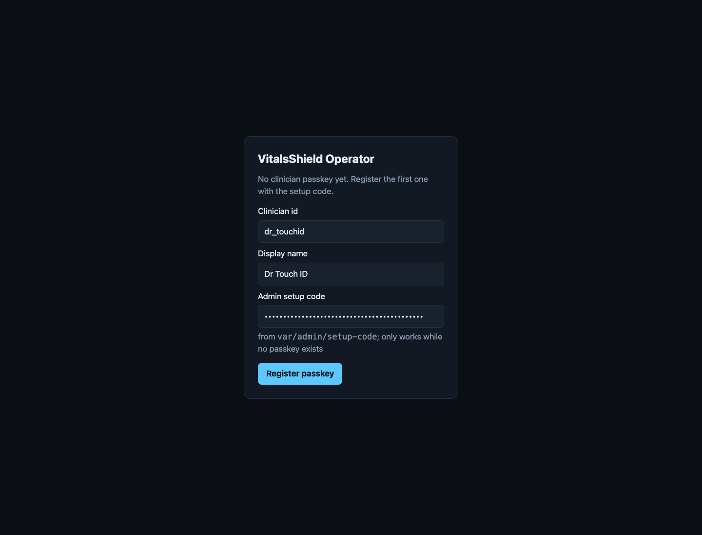
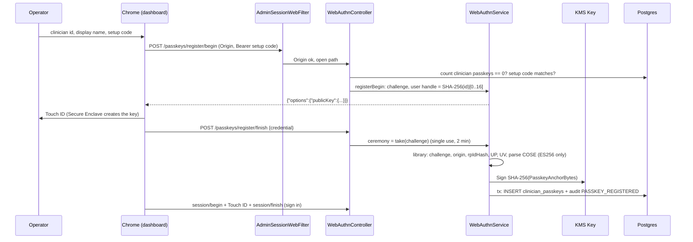
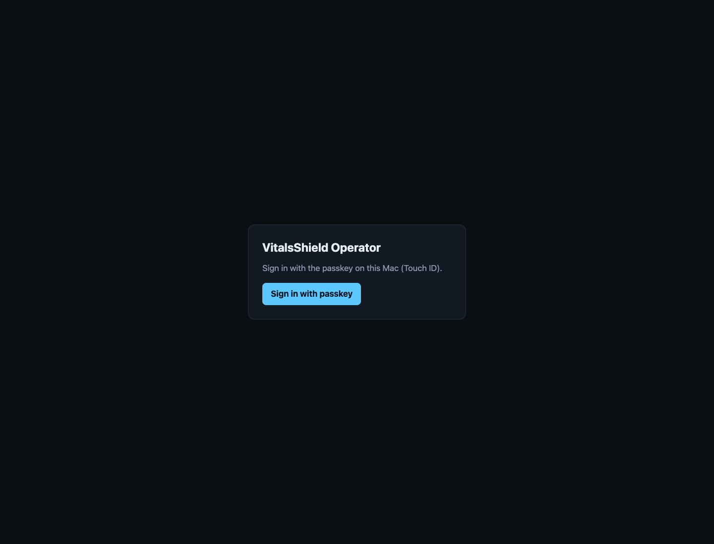
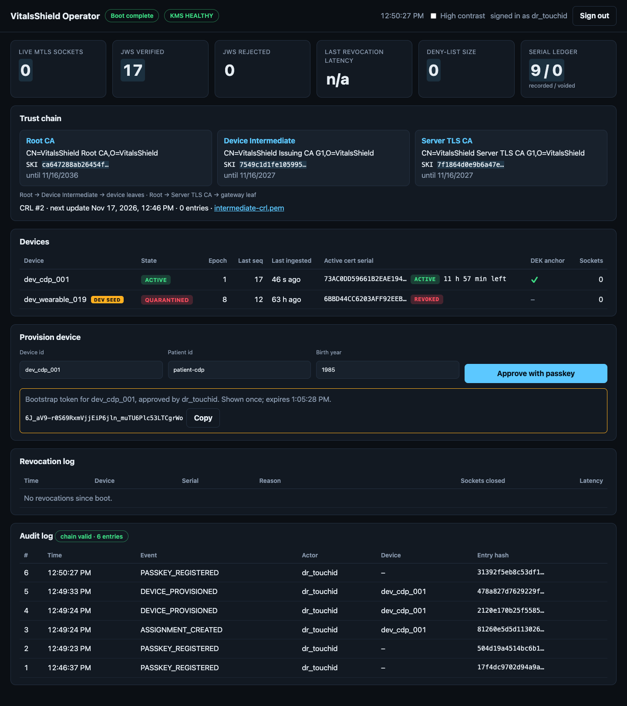
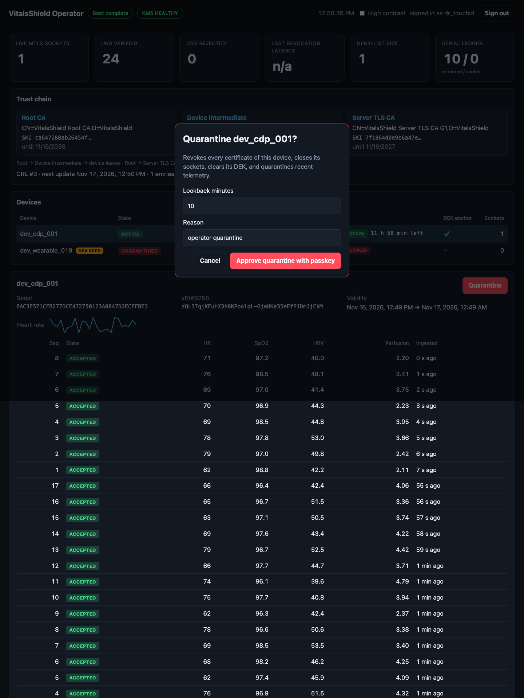
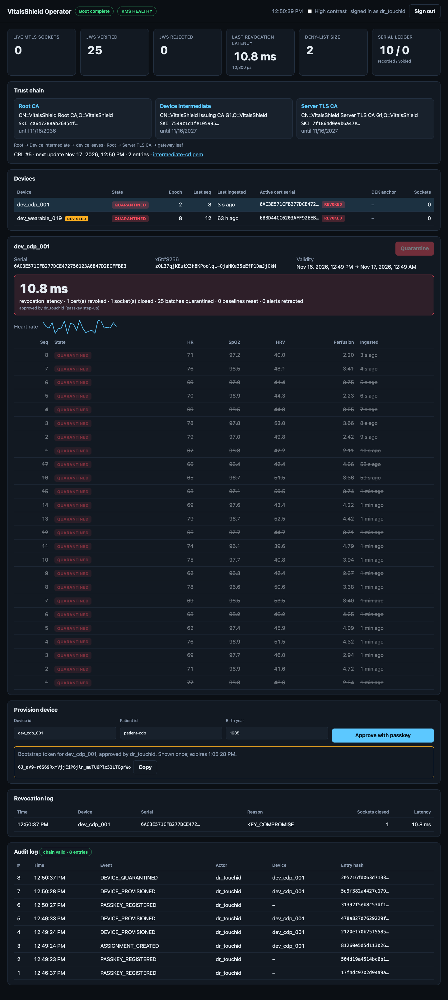

# Phase 6: The WebAuthn admin plane (passkeys, action-bound step-up, KMS-anchored passkey registry)

Commit: `7c2873d` (feat(admin): webauthn passkeys with action-bound step-up, kms-anchored passkey registry).
Manual Touch ID walkthrough: [phase-06-manual-touchid.md](phase-06-manual-touchid.md).

## 1. What this phase built and why

Until Phase 5 the admin plane trusted one secret: the boot setup code in `var/admin/setup-code`. Anyone who could read
that file could quarantine any device, and the spec's provisioning chain (spec Section 2 layer 3: "KMS-Anchored
Clinician Passkey -> Provisioning Assertion -> KMS Key #4 DEK Anchor") was only "Designed" (DECISIONS #3). Phase 6
makes it live:

- **Passkeys for clinicians** (`admin/webauthn/WebAuthnService`, Yubico java-webauthn-server 2.10.1, DECISIONS #54).
  Registration and sign-in ceremonies at `http://localhost:8445`, relying party id `localhost` (DECISIONS #55),
  discoverable credentials, user verification required, attestation "none" (DECISIONS #63).
- **A KMS anchor on every passkey row** (DECISIONS #56). On registration, KMS Key #4 signs spec encoding 1,
  `PasskeyAnchorBytes(cred_id, clinician_id, cose_pub_key)`, stored in `passkey_registry_kms_sig`. Every assertion
  checks that anchor before it checks the assertion.
- **Provisioning with a clinician approval** (DECISIONS #4, #10). The WebAuthn challenge is the 32-byte
  ProvisioningDigest (spec encoding 2) of the device id, the new bootstrap token, and its expiry. The real assertion
  is stored with the token.
- **Protocol A re-verifies that approval** before any KMS signature (spec Section 4 step 3, DECISIONS #57), from the
  token row alone and without the WebAuthn library. A token row written by SQL cannot enroll.
- **Step-up approvals bound to the action** (DECISIONS #58). Quarantine and restore-active each need a fresh passkey
  assertion over SHA-256 of a canonical action encoding (new `quarantineApprovalDigest` and `restoreApprovalDigest`
  in `crypto-common`).
- **Sessions and CSRF defences** (DECISIONS #59): an HttpOnly, SameSite=Strict cookie, and an Origin check on every
  non-GET admin request. The admin listener now binds both `127.0.0.1` and `::1`, and a page request to the IP gets a
  307 to `http://localhost:8445`.
- **The setup code shrinks to one job** (DECISIONS #60): registering the first passkey, while no clinician passkey
  exists.
- **A hash-chained audit log** (DECISIONS #62): `security_audit_log` entries for passkey registration, provisioning,
  assignment create and close, quarantine, and restore, each chained to the previous entry under an advisory lock.
- **The cut path**: `vitalsshield.admin.auth=bearer` keeps the exact Phase 5 behavior.
- **The dashboard** signs in with a passkey, has a first-run registration form, a provisioning panel that shows the
  token once, a step-up quarantine, a Restore button for REAUTH_REQUIRED devices, and an audit panel.
- **The dev seed tool** now registers a software passkey (`var/devseed/passkey.key`) through the same registration
  code and provisions through the same provisioning code, so its tokens pass the same re-verification.

Deviations beyond the brief: DECISIONS #64 (the dev seed passkey does not count toward "zero passkeys"; older
integration tests run in bearer mode) and #65 (ceremony keys, 410 for every dead ceremony, audit timing for
quarantine, no CRL republish on a refused enrollment, byte-exact `webauthn_*` columns).

Changed in Phase 6.1: the dev seed passkey is restricted by a `purpose` column (DECISIONS #66), and the quarantine
audit entry now commits inside the quarantine transaction (DECISIONS #67). See the section at the end.



## 2. Concept primers

### What a passkey is, and where its private key lives

A passkey is a public/private key pair made for one website (one "relying party"). The website stores only the public
key. On a Mac, Chrome hands the work to the operating system: the private key is generated by the Secure Enclave,
the separate security processor that also holds Touch ID data, and the passkey is stored in iCloud Keychain so it
syncs to your other Apple devices, end-to-end encrypted. The private key is never shown to Chrome, to the page, or to
our server. To use it, the operating system asks for Touch ID (or the Mac password), then signs a challenge.

That gives three properties a password lacks. Nothing secret is sent to the server, so a server breach leaks no
reusable credential. The key is bound to one site, so a fake site cannot use it (see "origin binding" below). And
every use needs the person to be present and verified.

### Registration and authentication ceremonies, step by step

WebAuthn calls each exchange a ceremony. Both have the same shape: the server sends options with a fresh random
challenge, the browser asks the authenticator, the server checks the answer.

Registration (`navigator.credentials.create`):

1. Server: options with a challenge, the relying party (`{id: "localhost", name: "VitalsShield"}`), the user
   (`{id: user handle, name: clinician id, displayName}`), allowed algorithms, `residentKey: required`,
   `userVerification: required`, `attestation: none`.
2. Browser: checks the RP id is allowed for this page's origin, builds clientDataJSON (below), asks the authenticator.
3. Authenticator: verifies the user (Touch ID), creates a new key pair, returns authenticatorData containing the new
   credential id and public key, inside an "attestation object".
4. Server: checks the challenge, origin, RP id hash, flags, and parses the public key; stores credential id and public
   key. We also sign the anchor with KMS here.

Authentication (`navigator.credentials.get`):

1. Server: options with a challenge, the RP id, user verification required, and optionally `allowCredentials` (which
   credential ids may answer). Empty means "any passkey you have for this site": usernameless sign-in.
2. Browser and authenticator: verify the user, sign `authenticatorData || SHA-256(clientDataJSON)` with the private
   key.
3. Server: finds the public key by credential id and verifies the signature and every field.

### What the browser adds: clientDataJSON, and why origin binding stops phishing

The page cannot choose what gets signed. The browser builds a small JSON document itself:

```json
{"type":"webauthn.get","challenge":"<base64url of the server's challenge>","origin":"http://localhost:8445","crossOrigin":false}
```

`origin` is the origin of the page that called the API, filled in by the browser, not by page code. The authenticator
signs over its SHA-256. So if a phishing site at `http://localhost-login.example` relays our challenge and gets a
person to touch the sensor, the signed origin is the phishing site's origin, and our server rejects it. Phishing a
password works because the user types the same secret anywhere; a passkey signature carries where it was made.
`type` separates registration (`webauthn.create`) from authentication (`webauthn.get`), so one cannot be replayed as
the other.

### authenticatorData, field by field

Signed by the authenticator, built by the authenticator:

| Bytes | Field | Meaning |
| :--- | :--- | :--- |
| 0..31 | rpIdHash | SHA-256 of the RP id the authenticator used, here SHA-256("localhost") |
| 32 | flags | bit 0 UP (user present), bit 2 UV (user verified, e.g. Touch ID), bits 3/4 backup eligible/backed up, bit 6 AT (attested credential data follows), bit 7 ED (extensions) |
| 33..36 | signCount | big-endian counter (see "signCount 0" below) |
| 37.. | attested credential data | registration only: AAGUID (16 bytes, authenticator model), credential id length (2 bytes), credential id, COSE public key |

UP means someone touched it; UV means the authenticator verified who (biometric or PIN). We require both
(`userVerification: REQUIRED`), so a passkey on an unlocked laptop still needs the finger.

### What exactly is signed in an assertion

```
signature = ECDSA-P256-SHA256( privateKey, authenticatorData || SHA-256(clientDataJSON) )
```

So one signature covers: the RP id (inside authenticatorData), UP and UV, the counter, and through the hash of
clientDataJSON, the type, challenge, and origin. Change any byte and verification fails. This is why
`ProvisioningAssertionVerifier` can re-check an approval later from stored bytes: it needs the exact authenticatorData
bytes, the exact clientDataJSON bytes (not a re-serialized copy), the signature, and the public key. We store all of
them byte for byte (base64url, DECISIONS #65).

### COSE keys and alg -7

The authenticator returns its public key as a COSE_Key (RFC 9052/9053): a CBOR map with small integer labels. For an
ES256 key:

| Label | Name | Value |
| :--- | :--- | :--- |
| 1 | kty | 2 (EC2, an elliptic curve key with x and y) |
| 3 | alg | -7 (ES256: ECDSA with P-256 and SHA-256) |
| -1 | crv | 1 (P-256) |
| -2 | x | 32 bytes |
| -3 | y | 32 bytes |

`-7` is just the IANA COSE number for ES256 (RS256 is -257, EdDSA -8). `CoseKeys.es256PublicKey` reads exactly this
map with a small CBOR reader and converts it to a Java `ECPublicKey`; anything else is refused. Registration also
refuses non-ES256 keys, so every stored passkey can be re-verified by Protocol A. Apple passkeys are ES256.

### RP ID rules, and why an IP address cannot be one

The RP id names the site a passkey belongs to. The browser only allows an RP id that is the page's host or a parent
domain of it ("registrable domain suffix"), and it must be a domain, not an IP address: the WebAuthn spec defines RP
ids as valid domain strings, and IP addresses have no domain hierarchy to check against. `localhost` is special: it
is a valid RP id, and browsers treat `http://localhost` as a secure context even without TLS, which WebAuthn requires.
So the admin plane must be reached as `http://localhost:8445`, never `http://127.0.0.1:8445`. That is why the server
redirects page requests addressed to `127.0.0.1` or `::1` (DECISIONS #55), and why it now also listens on `::1`:
`localhost` can resolve to `::1` before `127.0.0.1`.

### Attestation, and why we use "none"

Attestation is the authenticator proving what model it is: a signature by a manufacturer key over the new credential,
checked against a vendor root (the FIDO Metadata Service). A bank might require a certified hardware key. We ask for
`none` (DECISIONS #63): Apple's synced passkeys do not provide attestation to websites anyway, and our trust in a new
passkey comes from who registered it (the setup code holder for the first one, a signed-in clinician after that), not
from its hardware model. Attestation verification stays "Designed".

### Discoverable credentials

A discoverable credential (formerly "resident key") is stored on the authenticator together with the user handle, so
the authenticator can list it without the server naming it first. That allows usernameless sign-in: our sign-in
options have an empty `allowCredentials`, the person picks their passkey from Chrome's sheet, and the response carries
the user handle, from which the server finds the clinician. We require it (`residentKey: required`). The user handle
is the first 16 bytes of SHA-256(clinician_id): deterministic, no new column, and it reveals no name.

### Why synced passkeys report signCount 0

The counter was designed for single hardware keys: each use increments it, and if the server ever sees a value that is
not higher than the stored one, two copies of the key exist (a clone). A passkey synced through iCloud lives on
several devices at once, which cannot share one counter, so Apple always reports 0. Our rule (DECISIONS #61,
`CounterRule`): 0 is always accepted; a non-zero value must be strictly greater than the stored value, else the
assertion is rejected and logged as a possible clone. The library's own counter check is turned off because it
rejects a 0 after a non-zero value.

### Step-up authentication, and binding an approval to the exact action

A session says "this browser signed in earlier". Step-up means asking for a fresh passkey approval right before a
dangerous action. The weak form signs a random challenge, which proves a person was present at that moment but not
what they meant to approve: a script running in the page could swap the device id between the approval and the
request.

We bind the approval to the action. At `quarantine/begin` the server validates the parameters, stores them with a
16-byte random nonce, and makes the challenge

```
SHA-256( utf8WithLength("vitalsshield.quarantine.v1") || utf8WithLength(device_id)
         || uint32_be(lookback_minutes) || utf8WithLength(reason) || nonce16 )
```

`quarantine/finish` accepts only `{ceremony_id, credential}`. It runs the Phase 4 quarantine with the stored
parameters, never parameters from the finish request. What the clinician's finger signed is that exact device,
lookback, and reason, once. A different digest (other lookback, other device) fails the challenge check; a second
finish of the same ceremony is 410; another clinician's session cannot finish it (403). The nonce makes each approval
unique even for identical parameters. Restore uses `vitalsshield.restore-active.v1` with the device id and a nonce.

### Why the bearer must stop working after the first passkey

The setup code is a file on disk, regenerated every boot. It is fine for bootstrapping (someone with shell access to
the server registers the first clinician), but as a permanent credential it would be a password that bypasses every
passkey property: no phishing resistance, no user verification, no per-action approval, and anyone who can read the
file is an administrator. So in webauthn mode it authorizes exactly one call, `passkeys/register/begin` while zero
clinician passkeys exist (DECISIONS #60). After that, adding a passkey needs a signed-in clinician.

### SameSite=Strict and Origin checks as CSRF defences

Cross-site request forgery: a page on another site makes your browser send a request to our server, and the browser
attaches our cookie. Two independent defences:

- `SameSite=Strict` on the session cookie: the browser sends it only on requests that start from our own site. A
  form on `evil.example` posting to `localhost:8445` goes out without the cookie, so it is unauthenticated.
- Every non-GET admin request must carry an `Origin` header equal to an allowed origin (`http://localhost:8445`),
  else 403 (`AdminSessionWebFilter`). Browsers set Origin on cross-site and same-origin POSTs and page scripts
  cannot forge it.

The cookie is also `HttpOnly` (page scripts cannot read it) and `Path=/api/v1/admin`. It has no `Secure` flag because
the admin plane is plain HTTP on loopback (DECISIONS #59).

### How the passkey KMS anchor stops a database-only attacker

Assume an attacker can write to Postgres but cannot call KMS Key #4 (spec Section 2 layer 3). Without the anchor they
could insert a `clinician_passkeys` row with their own public key, or replace a real clinician's key, then sign in or
forge approvals with their own private key: the WebAuthn checks would all pass, because the public key they verify
against is the attacker's. With the anchor, each row carries a KMS signature over
`(credential id, clinician id, SHA-256(COSE key))`. Changing any of the three needs a new KMS signature. The server
verifies the anchor before every assertion (`WebAuthnService.finishAssertion`) and Protocol A verifies it again
before enrolling. `PasskeyAnchorIT` swaps Bob's public key for an attacker's: sign-in fails with
`PASSKEY_ANCHOR_INVALID`.

### How Protocol A re-verifies a provisioning approval offline

"Offline" means: at enrollment time, from stored data only, with no clinician present and no WebAuthn ceremony
state. After the token claim (Tx 1) and before any KMS signature, `ProvisioningAssertionVerifier`:

1. loads the passkey row for `webauthn_cred_id_b64` and verifies its KMS anchor;
2. parses the stored clientDataJSON: `type == "webauthn.get"`, `challenge ==
   base64url(ProvisioningDigest(device_id, presented token, expires_at))`, origin allowed;
3. checks authenticatorData: `rpIdHash == SHA-256("localhost")`, UP and UV set;
4. verifies the ECDSA signature over `authenticatorData || SHA-256(clientDataJSON)` with the anchored COSE key.

The digest is recomputed from the token the device presents, so the stored approval only matches the one token the
clinician approved. Any failure: the token is REVOKED, the reserved serial voided, the device gets 403
`PROVISIONING_UNVERIFIED`, and no KMS Sign call is made.

### A hash-chained audit log

Each `security_audit_log` row stores `prev_entry_hash` and
`entry_hash = hex(SHA-256(prev_hash || canonical_json({event_type, actor_id, payload}) || created_at))`, starting
from 64 zeros. Changing, deleting, or reordering any row breaks every later hash, which `AuditLog.verify` recomputes
on every `GET /api/v1/admin/audit`. Appends take `pg_advisory_xact_lock` so two transactions cannot both read the same
"latest" hash and fork the chain. A database superuser could still rewrite the whole chain consistently; the spec's
answer (sign the head with Key #4 and write it to S3 Object Lock every 60 seconds) stays "Designed".

## 3. How it works in our code

All WebAuthn code is in `server/.../admin/webauthn/`. Ceremony verification, JDBC, and KMS run on `boundedElastic`
(`WebAuthnController.blocking`); KMS is never called inside a transaction (registration signs the anchor, then opens
the insert transaction).

### First registration



### Sign-in

```mermaid
sequenceDiagram
    participant B as Chrome
    participant C as WebAuthnController
    participant W as WebAuthnService
    participant K as KMS Key #4 public key
    participant S as AdminSessionStore
    B->>C: POST /session/begin (Origin)
    C-->>B: options: challenge, empty allowCredentials, UV required
    B->>B: Touch ID, sign authData || SHA-256(clientDataJSON)
    B->>C: POST /session/finish {credential}
    C->>W: take(challenge), load row by credential id
    W->>K: verify passkey anchor FIRST
    W->>W: library checks + CounterRule (0 ok, else strictly greater)
    W->>S: create session (32 random bytes)
    C-->>B: Set-Cookie vs_admin_session=...; HttpOnly; SameSite=Strict; Path=/api/v1/admin
```



### Provisioning with Touch ID, through to device enrollment

```mermaid
sequenceDiagram
    participant U as Clinician
    participant B as Chrome
    participant P as ProvisioningService
    participant DB as Postgres
    participant D as Device (simulator)
    participant E as EnrollmentService (Protocol A)
    participant V as ProvisioningAssertionVerifier
    participant K as KMS
    U->>B: device id, patient id, birth year
    B->>P: provision/begin (session cookie)
    P->>DB: device PROVISIONED + ACTIVE assignment (+ audit ASSIGNMENT_CREATED)
    P->>P: token = 32 random bytes; expires = now + 15 min; challenge = ProvisioningDigest
    P-->>B: ceremony_id + options (allowCredentials = this session's passkey)
    B->>U: Touch ID approves the digest
    B->>P: provision/finish {ceremony_id, credential}
    P->>P: verify assertion (challenge == digest, same clinician)
    P->>DB: tx: INSERT token hash + raw authData, clientDataJSON, signature (+ audit DEVICE_PROVISIONED)
    P-->>B: bootstrap_token, shown once
    U->>D: enroll --token
    D->>E: POST /api/v1/devices/enroll (8444)
    E->>DB: Tx 1: claim token, reserve serial
    E->>V: re-verify the stored approval (anchor, digest, origin, rpIdHash, UP/UV, signature)
    E->>K: DEK anchor (Key #4) and leaf (Key #2)
    E->>DB: Tx 2: activate
    E-->>D: 201 new_cert_pem
```



### Quarantine step-up

```mermaid
sequenceDiagram
    participant U as Clinician
    participant B as Chrome
    participant S as StepUpService
    participant Q as QuarantineService (Phase 4)
    participant A as AuditLog
    U->>B: Quarantine, lookback 10, reason
    B->>S: quarantine/begin {lookback_minutes, reason}
    S->>S: validate (Phase 4 rules), nonce16, challenge = quarantineApprovalDigest
    S-->>B: ceremony_id + options (this session's passkey only)
    B->>U: Touch ID signs that exact digest
    B->>S: quarantine/finish {ceremony_id, credential}
    S->>S: take(ceremony) (410 if used), same clinician (403), verify assertion (401 if other digest)
    S->>Q: quarantine(STORED device, lookback, reason)
    Q-->>S: revoke, evict, sanitize; latency measured from t0
    S->>A: tx: DEVICE_QUARANTINED with assertion SHA-256
    S-->>B: Phase 4 JSON + approved_by
```

Changed in Phase 6.1: the DEVICE_QUARANTINED entry is no longer a separate transaction after Q returns; Q appends it
itself, inside its sanitize transaction, after every row lock (DECISIONS #67).





### An SQL-forged token being rejected

```mermaid
sequenceDiagram
    participant X as DB-only attacker
    participant DB as Postgres
    participant D as Rogue device
    participant E as EnrollmentService
    participant V as ProvisioningAssertionVerifier
    participant K as KMS
    X->>DB: INSERT device, assignment, token (hash of a token X knows; webauthn_* = fake or copied)
    D->>E: enroll with that token
    E->>DB: Tx 1: claim (CLAIMING), reserve serial
    E->>V: verify approval
    V-->>E: fails (bad bytes, or challenge != ProvisioningDigest of THIS token, or anchor invalid)
    E->>DB: token REVOKED, serial VOIDED
    E-->>D: 403 PROVISIONING_UNVERIFIED
    Note over E,K: no KMS Sign call (ProvisioningReverifyIT checks the sign counter)
```

Copying a real approval from another token does not help: its challenge is the digest of the other token, and the
attacker cannot get a clinician's passkey to sign a digest of their own token.

## 4. Data model

### `clinician_passkeys` (V1, now really written)

| Column | Holds |
| :--- | :--- |
| `credential_id_b64` (PK) | credential id, base64url without padding (the same string as the JSON `id`) |
| `clinician_id` | WebAuthn username; the user handle is SHA-256(clinician_id)[0..16] |
| `public_key_cose_der_b64` | the COSE_Key bytes, standard base64 (the spec says "cose_pub_key_der"; it is CBOR, not DER) |
| `passkey_registry_kms_sig` | base64 DER ECDSA signature by KMS Key #4 over SHA-256(PasskeyAnchorBytes) |
| `sign_count` | last accepted counter, never decreases (`CounterRule.next`) |
| `created_at` | registration time |

Rows from Phases 3 to 5 (`dev-seed`, fake fields) remain; they belong to `dev-seed-clinician`, are excluded from the
first-passkey count, and cannot sign in (their anchor does not verify).

Changed in Phase 6.1: V4 adds `purpose` (`CLINICIAN` default, or `DEV_SEED`). The dev seed rows are DEV_SEED; the
first-passkey count and the DEV SEED badge read this column instead of the clinician id.

### `device_bootstrap_tokens` WebAuthn columns

| Column | Holds |
| :--- | :--- |
| `webauthn_cred_id_b64` | the approving credential (FK to `clinician_passkeys`) |
| `webauthn_auth_data` | base64url of the exact authenticatorData bytes |
| `webauthn_client_json` | base64url of the exact clientDataJSON bytes (re-serializing would change the hash) |
| `webauthn_signature` | base64url of the DER signature |
| `issued_by_clinician` | the session's clinician (`dev-seed-clinician` for seeded tokens, so the DEV SEED badge stays) |

`expires_at` is truncated to milliseconds before the digest is computed, because the digest uses `int64_be(ms)` and
Protocol A recomputes it from the stored value.

### `security_audit_log` (V1, now written)

`sequence_id` (order), `event_type`, `actor_id` (clinician), `payload_json` (JSONB: device id, assignment id,
`assertion_sha256` = SHA-256 of authData || clientDataJSON || signature, and action details), `prev_entry_hash`,
`entry_hash`, `created_at` (truncated to microseconds, the timestamptz precision, so the recomputed hash matches),
`s3_anchor_version_id` (unused, "Designed"). Canonical JSON for hashing: keys sorted, no whitespace, values are
strings, integers, booleans, maps; JSONB's own reformatting does not matter because verification re-canonicalizes the
parsed value.

### In memory

- `CeremonyStore` (one per ceremony kind): 2-minute TTL, single use; registration and sign-in keyed by challenge,
  provisioning and step-up by a random `ceremony_id` (DECISIONS #65). Provisioning ceremonies hold the plaintext token
  until finish; it is never written anywhere except as a hash.
- `AdminSessionStore`: session id, clinician, credential id, created and last-seen times; 30 min idle, 8 h absolute.
  A restart signs everyone out.

## 5. Security reasoning

Defended:

- **Phishing.** The browser signs the real origin; the server accepts only `http://localhost:8445` (and the dev proxy
  origin with profile `dashboard-dev`) and RP id hash `SHA-256("localhost")`.
- **Replay.** Every challenge is single use and expires in 2 minutes; a second finish is 410. Protocol A binds the
  stored approval to one token through the digest, and the token itself is single use.
- **CSRF.** SameSite=Strict cookie plus the Origin check; no CORS headers.
- **Parameter swapping.** Step-up challenges are digests of the stored parameters; finish ignores body parameters
  (`StepUpIT.bodyParametersAtFinishAreIgnored`).
- **A DB-only attacker forging passkeys or tokens.** Passkey rows need a Key #4 signature; token rows need a real
  passkey assertion over that token's digest; DEK rows already needed Key #4 (Phase 3).
- **Cloned hardware keys** (non-zero counters) are rejected and logged.
- **A stale or stolen setup code** cannot do anything once a clinician passkey exists.

Not defended, stated plainly:

- **A stolen, unlocked laptop with an active session** can browse the dashboard for up to 30 minutes idle and 8 hours
  total. It cannot quarantine, restore, or provision without Touch ID, because each needs a fresh UV assertion.
- **Attestation is not verified**, so we do not know the authenticator model (DECISIONS #63).
- **Sessions live in memory**: lost on restart (a nuisance, not a hole) and not shared between server instances.
- **The admin plane is plain HTTP on loopback.** Anything on the machine that can read loopback traffic can read the
  cookie. The defence is that 8445 never leaves the host; a real deployment would put TLS in front.
- **Compromise of the server process itself** (or KMS Key #4 credentials) defeats all of this, as spec Section 2
  layer 3 says.
- **The dev seed key file** (`var/devseed/passkey.key`, mode 600) is a working passkey for `dev-seed-clinician`. It is
  dev only and visible as the DEV SEED badge.
  Changed in Phase 6.1: it can no longer sign in or approve anything; it only finishes the seed tool's own
  provisioning, and only in the local profile (DECISIONS #66).

## 6. Design decisions

| Decision | Alternatives | Why the alternative lost |
| :--- | :--- | :--- |
| Yubico java-webauthn-server 2.10.1 (#54) | WebAuthn4J; hand-written verification | Maintained by Yubico, covers attestation formats and extensions; hand-writing registration is where bugs hide (we hand-write only the narrow re-verification, which must not depend on ceremony state) |
| Jackson 2 kept inside the library (#54) | Use Jackson 2 in the app too | Two JSON stacks in app code invites mixing annotations; JSON strings at the boundary are enough |
| RP id "localhost", redirect from 127.0.0.1 (#55) | Serve on 127.0.0.1 | An IP cannot be an RP id; WebAuthn would refuse to run |
| KMS anchor on passkeys (#56) | Trust the table | A DB-only attacker could insert their own passkey |
| Re-verify the approval in Protocol A (#57) | Trust that provisioning verified it | The token row would again be forgeable by SQL; the spec puts the check in the Signer |
| Action-bound challenges with stored params (#58) | Random challenge; params at finish | A random challenge proves presence, not intent; params at finish can be swapped |
| Cookie session, SameSite=Strict, Origin check (#59) | Bearer token in sessionStorage | A script-readable token is stolen by any XSS; a strict HttpOnly cookie is not |
| Setup code only for the first passkey (#60) | Keep it as a fallback login | A file-based admin password would bypass every passkey property |
| Counter 0 always accepted (#61) | Library default | The library rejects a 0 after a non-zero value; synced passkeys always send 0 |
| Hash-chained audit log under an advisory lock (#62) | Plain log table; app-level lock | Plain rows can be edited silently; an app lock does not cover two processes |
| Attestation none (#63) | Direct attestation | Apple passkeys do not provide it; trust comes from who registers |
| Dev seed passkey not counted (#64) | Count every row | Seeding a demo device would lock out the first real registration |
| 410 for any dead ceremony (#65) | 401 for some | One answer for unknown, used, and expired leaks nothing about which |

## 7. Verify it yourself

Output from 2026-11-16 against `bootRun` (webauthn mode):

```
$ curl -s -o /dev/null -w "%{http_code} %{redirect_url}\n" http://127.0.0.1:8445/
307 http://localhost:8445/
$ curl -s -o /dev/null -w "%{http_code}\n" -g "http://[::1]:8445/api/v1/admin/boot-status"
200
$ curl -s -o /dev/null -w "%{http_code}\n" -X POST -H "Origin: http://evil.example" http://localhost:8445/api/v1/admin/session/begin
403
$ curl -s -o /dev/null -w "%{http_code}\n" -X POST -H "Authorization: Bearer $(cat var/admin/setup-code)" -H "Origin: http://localhost:8445" -H "Content-Type: application/json" -d '{"lookback_minutes":5,"reason":"x"}' http://localhost:8445/api/v1/admin/devices/dev_wearable_019/quarantine
404
$ curl -s http://localhost:8445/api/v1/admin/auth/status
{"mode":"webauthn","passkeys_registered":0,"clinician_id":null}
```

The server log shows the extra IPv6 listener:

```
Listener admin bound on /127.0.0.1:8445
Listener admin-ipv6 bound on /[0:0:0:0:0:0:0:1]:8445
```

The passkey table after a dashboard registration (driven in headless Chrome with a DevTools virtual authenticator;
the Touch ID version is the manual checklist):

```
$ docker compose exec -T postgres psql -U vitalsshield -d vitalsshield -c "SELECT clinician_id, left(credential_id_b64, 16) AS credential_id, left(public_key_cose_der_b64, 16) AS cose_b64, left(passkey_registry_kms_sig, 16) AS kms_anchor_sig, sign_count FROM clinician_passkeys;"
    clinician_id    |  credential_id   |     cose_b64     |  kms_anchor_sig  | sign_count
--------------------+------------------+------------------+------------------+------------
 dev-seed-clinician | dev-seed         | DEV-SEED-NOT-WEB | DEV-SEED-NOT-A-S |          0
 dr_touchid         | zd_hiuZ9CJDPb5jX | pQECAyYgASFYIGlx | MEQCIBmgBbCjiGny |          5
```

`pQECAyYg` decodes to `a5 01 02 03 26 20`: a CBOR map of 5 entries, `1: 2` (EC2), `3: -7` (ES256), `-1: ...`. `MEQC` is
the start of a DER `SEQUENCE` (0x30 0x44): the KMS signature. The virtual authenticator increments its counter (5
after several sign-ins); a real iCloud passkey stays at 0.

The same headless run, from first-run screen to quarantine, reported:

```
"enroll": "ENROLLED serial=6ac3e571cfb277dce472750123a0847d2ecffbe3 boot_epoch=2 not_after=2026-11-17T05:49:28Z",
"result": "10.8 ms revocation latency · 1 cert(s) revoked · 1 socket(s) closed · 25 batches quarantined · 0 baselines reset · 0 alerts retracted approved by dr_touchid (passkey step-up)",
"simExit": 3,
"simTail": ["SENT seq=8 batch=7c8c9b01 status=200 rtt_ms=13", "REJECTED handshake_refused last_ok_seq=8 ms_since_last_ok=1020"],
"auditPanel": "Audit log chain valid · 8 entries",
"console": [], "exceptions": []
```

and the audit rows it wrote:

```
     event_type     |      d      | lb
--------------------+-------------+----
 DEVICE_QUARANTINED | dev_cdp_001 | 10
 DEVICE_PROVISIONED | dev_cdp_001 |
 PASSKEY_REGISTERED |             |
```

The e2e tier, now provisioning and quarantining through a software passkey, printed:

```
SPINE_REVOCATION_LATENCY_MICROS=[6697, 3294, 2640, 2944, 2525]
```

## 8. How the tests prove it

| Test | Property proved |
| :--- | :--- |
| `CanonicalEncodingsTest` (+3) | quarantine and restore approval digests equal Python golden vectors; nonce must be 16 bytes |
| `SessionStoreTest` | 32-byte ids; idle expiry at 30 min; activity keeps it alive until exactly 8 h |
| `CounterRuleTest` | 0 always accepted; equal or lower non-zero rejected; stored value never decreases |
| `CeremonyStoreTest` | single use; expires at 2 minutes; unknown ids empty |
| `CoseKeysTest` | ES256 COSE parses; other algorithms and truncated input refused |
| `NoJackson2ImportsTest` | no main source imports `com.fasterxml.jackson` outside the annotations |
| `WebAuthnFlowsIT` (16) | first registration needs the setup code; second without session 401 even with the code; with session 200; cookie HttpOnly, SameSite=Strict, Path, no Secure; bearer refused elsewhere; wrong origin, wrong RP id, UV unset, UP unset, wrong challenge, counter regression, tampered signature all rejected; counter 0 accepted; replayed challenge 410; expired challenge (injected clock) 410 |
| `PasskeyAnchorIT` | swapping a passkey's public key in SQL: sign-in 401 `PASSKEY_ANCHOR_INVALID`; untouched rows verify; reassigning the clinician fails too |
| `StepUpIT` (7) | quarantine begin/finish succeeds with `approved_by`; an assertion over another digest 401 and nothing quarantined; body params at finish ignored; second finish 410; single-step quarantine 404; another clinician 403; restore only from REAUTH_REQUIRED, sets ACTIVE and epoch_resync_allowed |
| `ProvisioningReverifyIT` (4) | API-provisioned token enrolls; SQL-forged token 403 `PROVISIONING_UNVERIFIED`, REVOKED, KMS sign count unchanged; altered stored clientDataJSON 403; dev seed tokens pass the same check, reuse one passkey, keep `dev-seed-clinician` |
| `CsrfAndCookieIT` | foreign Origin 403, IP origin 403, no Origin 403; 307 to localhost for pages, not for API GETs; answers on `[::1]`; forged cookie 401 |
| `AuthModeFlagIT` | bearer mode: dev seed enroll and single-step bearer quarantine work, Phase 6 routes 404; webauthn mode (second server): bearer refused, single-step 404, first registration with the code works, second does not |
| `AuditChainIT` | 50 concurrent appends: 50 rows, 50 distinct prev hashes, chain valid; one edited payload breaks the chain at exactly that sequence id |
| `SpineE2E`, `TelemetryPerRequest403E2E` | the Phase 4 spine with passkey provisioning and step-up quarantine; latency < 500 ms over 5 runs |
| `MtlsListenerIT` (changed) | four listeners, all loopback; admin on the same port for IPv4 and IPv6 |

## 9. Gotchas hit during this phase

- **The library's JSON methods declare a Jackson 2 exception.** `toCredentialsGetJson()` throws
  `JsonProcessingException`, so javac needed `jackson-core` to compile any call. It is `compileOnly`, and
  `NoJackson2ImportsTest` keeps imports out of app code.
- **The Compose stack was down when this phase started**, so every Spring test failed with `Connection refused` to
  LocalStack. `docker compose up -d` fixed it; the next `bootRun` logged `Hierarchy reconciliation: REBUILT` because a
  restarted LocalStack has no keys (expected in the `local` profile).
- **A forged challenge at sign-in returned 410, not 401.** Sign-in ceremonies are looked up by their challenge, so a
  wrong challenge finds no ceremony. Correct, and the library's equality check is exercised by `StepUpIT` instead.
- **A refused enrollment still made a KMS Sign call.** Voiding the reserved serial triggered a CRL republication. The
  serial was never signed, so the republication is now skipped on that path (DECISIONS #65).
- **The bearer quarantine call got 401 instead of 404** in webauthn mode: the session filter rejected it before
  routing. The filter now answers 404 for the retired single-step path.
- **A static `@BeforeAll` ran before Spring started**, so the listener ports were still null. The setup moved to a
  lazy `@BeforeEach`.
- **The dashboard showed the first-run form after signing out**, because it kept `passkeys_registered: 0` from page
  load. It now re-reads `/auth/status` after sign-in and sign-out. Found by the virtual-authenticator run.
- **Two buttons said "Approve with passkey"** (provisioning and the quarantine dialog), and the automation clicked the
  wrong one. The dialog button is now "Approve quarantine with passkey".

## 10. Judge Q&A

**Q: Your dev seed tool has a passkey on disk. Isn't that a back door?**
A: It would be if it had clinician powers, which is why it does not. The row is marked `purpose = 'DEV_SEED'`, and
the server checks that column before it looks at anything else in an assertion. A DEV_SEED credential is refused for
sign-in and for every step-up (403, nothing changes, not even its signature counter), so it can never get a session,
quarantine, restore, or close an assignment. The only thing it can do is finish a provisioning ceremony that the seed
tool's own code started, and only when the server runs with the `local` profile; outside it, the seed tool refuses to
run and Protocol A refuses any token a DEV_SEED credential approved. Its tokens also carry the DEV SEED badge on the
dashboard. `DevSeedPasskeyIT` checks each refusal and that the database is unchanged afterwards.

**Q: What stops someone with database access from enrolling a rogue device?**
A: Three signatures they cannot make. To enroll, the device needs a token row whose stored WebAuthn approval
verifies: Protocol A recomputes the ProvisioningDigest from the presented token and expiry and checks that the stored
assertion signs exactly that digest, with the right origin, RP id hash, UP and UV, under the passkey's public key.
Making that assertion needs a clinician's private key, which is in a Secure Enclave. Inserting their own passkey row
does not help, because every passkey row needs a KMS Key #4 signature over (credential id, clinician id, key hash),
verified before the assertion. And the DEK anchor written at enrollment is also a Key #4 signature. A forged token gets
403 `PROVISIONING_UNVERIFIED`, is revoked, and causes no KMS Sign call; `ProvisioningReverifyIT` checks the KMS sign
counter.

**Q: What exactly does the clinician approve when they touch the sensor?**
A: A 32-byte challenge that is a hash of the action. For provisioning: SHA-256 of the device id, SHA-256 of the
bootstrap token, and the token's expiry in milliseconds (spec encoding 2). For quarantine: SHA-256 of
"vitalsshield.quarantine.v1", the device id, the lookback minutes, the reason, and a 16-byte server nonce. The browser
adds the origin and the authenticator adds the RP id hash and the user-verified flag, all under one signature. The
server stores the parameters at begin and executes those, so the signature commits to exactly what is executed, once.

**Q: Why passkeys and not a password with TOTP?**
A: A one-time code can be phished in real time: a fake site relays it within its 30-second window. A passkey
signature includes the origin the browser saw, so a relayed signature is rejected. There is also no shared secret on
the server to steal.

**Q: Why does the setup code stop working?**
A: It is a file anyone with shell access can read, so as a standing credential it would be an admin password with
none of the passkey guarantees. It exists to register the first clinician. Once one clinician passkey exists, it is
refused everywhere, including registration; new passkeys need a signed-in clinician.

**Q: Apple passkeys always report a signature counter of 0. Doesn't that disable clone detection?**
A: For synced passkeys, yes, and that is by design: the key is meant to exist on all your Apple devices. We accept 0
and still enforce strictly increasing counters for authenticators that do count (hardware keys), rejecting and logging
a regression. The stronger protection here is that each action needs user verification and is bound to its
parameters.

**Q: What does this not protect against?**
A: An unlocked laptop with a live session can view the dashboard until the session times out (30 minutes idle, 8 hours
total), though it cannot act without Touch ID. We do not verify attestation, so we do not know the authenticator
model. Sessions are in memory. The admin plane is plain HTTP on loopback. And a compromised server process, or
stolen KMS Key #4 credentials, defeats the anchors, as spec Section 2 layer 3 states.

## Changed in Phase 6.1

Commit: `309377e` (fix(admin): restrict dev seed passkey; audit entries atomic with audited actions).

### Why a passkey whose private key is a file must not have clinician powers

Everything that makes a passkey trustworthy comes from where its private key lives. A Touch ID passkey's key is made
inside the Secure Enclave and never leaves it; using it needs the person's finger, every time. The dev seed key is the
opposite: a PKCS#8 file at `var/devseed/passkey.key`. Mode 600 limits it to the server's user account, but anything
running as that user, a backup, or a copied repo directory has it, and using it needs no person at all, since the
"authenticator" is our own test code that sets the UP and UV flags to whatever it likes. So its signatures prove only
"some process could read that file", not "a clinician approved this". In Phase 6 it was a full clinician passkey
(only excluded from the first-passkey count), so anyone with the file could have signed in and quarantined devices.

Phase 6.1 (DECISIONS #66) makes its powers match what it proves. Migration V4 adds `clinician_passkeys.purpose`;
the seed tool registers its key as `DEV_SEED` through a separate method that no HTTP route calls. Every assertion
says what it is for (`WebAuthnService.Use`: SIGN_IN, STEP_UP, PROVISION, SEED_PROVISION), and the very first check
after loading the row is: a DEV_SEED credential is accepted only for SEED_PROVISION, and only if `DevSeedPolicy`
says the `local` profile is active. Because this runs before the anchor, the library, or the counter update, a
refusal leaves the database exactly as it was. Protocol A applies the same rule when it re-verifies a stored
approval, so outside `local` a seeded token cannot enroll even if one exists.

Real output, against Compose and `bootRun` on 2026-11-16 (the token is shortened here):

```
$ ./gradlew :server:seedDemoDevice --args="--device-id dev_precheck_001"
13:07:15.756 [main] INFO com.vitalsshield.server.admin.webauthn.WebAuthnService -- Passkey registered for dev-seed-clinician (credential l2yZgwZq..., anchor signed with KMS Key #4)
BOOTSTRAP_TOKEN=<43 characters>
$ simulator factory-wipe --device-id dev_precheck_001
FACTORY_WIPED simulator-state/dev_precheck_001
$ simulator enroll --device-id dev_precheck_001 --token <token>
ENROLLED serial=977b97683a7182480a90872751e70c92fab66ba boot_epoch=1 not_after=2026-11-17T06:06:17Z
$ psql -c "select purpose, clinician_id, left(credential_id_b64, 12) from clinician_passkeys"
 purpose  |    clinician_id    |     left
----------+--------------------+--------------
 DEV_SEED | dev-seed-clinician | dev-seed
 DEV_SEED | dev-seed-clinician | l2yZgwZqAfZ2
```

The first row is the Phase 3 fake row, marked by V4's one-time backfill; the second is the software passkey the
seed tool just registered. The enrollment proves a software-passkey approval passes Protocol A re-verification.

### The lock ordering rule, and why it prevents deadlocks

A lock makes a transaction wait until another transaction lets go. A deadlock is two transactions that each hold
one lock and wait for the other's:

```
T1: locks devices row D            T2: takes the audit advisory lock
T1: waits for the audit lock  ...  T2: waits for devices row D
    (held by T2)                       (held by T1)
```

Neither can continue, and neither will ever release what it holds, because releasing happens at commit. Postgres
notices the cycle after `deadlock_timeout` (1 s by default) and aborts one of them with SQLSTATE 40P01. Moving the
quarantine audit entry into the quarantine transaction (DECISIONS #67) makes that transaction hold both kinds of lock
at once: row locks on the device, tokens, telemetry, assignments, and alerts, and the audit chain's advisory lock.
That is exactly the setting where a cycle can form.

The rule that prevents it: every transaction that appends to `security_audit_log` takes the advisory lock last,
after all the row locks it will ever need. `AuditLog.append` is always the final statement (quarantine, restore,
provisioning begin and finish, passkey registration, assignment close). Then a transaction that holds the audit lock
never waits for a row lock: it has none left to take. A wait can only go one way, from "waiting for the audit lock"
toward "holds the audit lock and is finishing", and a chain of waits that only ever points toward a finishing
transaction cannot loop back. This is the general principle behind lock ordering: if every transaction acquires
locks in one global order, no cycle is possible.

`QuarantineAuditAtomicityIT.noDeadlockUnderMixedLoad` runs 10 quarantines, 10 provisionings, and 10 assignment
closes at once. Every request returned 200, the chain verified, and `pg_stat_database.deadlocks` did not change. The
whole batch took `MIXED_LOAD_MS=99` in the final run.

`quarantineAndAuditAreAtomic` injects a failure after the sanitize CTE and the audit append, before commit
(`QuarantineHooks`). The device stays ACTIVE with its DEK, its 3 telemetry batches stay ACCEPTED, and there is no
DEVICE_QUARANTINED entry. The certificate stays REVOKED: revocation happens before the transaction and is not undone,
which is the intended fail-closed behavior. The device is cut off even though its data was not sanitized, and the
operator retries.

### Tests added

| Test | Property proved |
| :--- | :--- |
| `DevSeedPasskeyIT.devSeedProvisioningStillWorks` | the seed tool's path still provisions and enrolls; its row is DEV_SEED; it does not count as a clinician passkey; the dashboard shows the DEV SEED badge |
| `DevSeedPasskeyIT.devSeedCannotSignIn` | 403 `DEV_SEED_NOT_ALLOWED`, no cookie, database unchanged |
| `DevSeedPasskeyIT.devSeedCannotApproveQuarantine` | 403 on a real quarantine ceremony, database unchanged |
| `DevSeedPasskeyIT.devSeedCannotApproveRestore` | 403 on a real restore ceremony, database unchanged |
| `DevSeedPasskeyIT.devSeedRefusedOutsideLocalProfile` | the seed tool refuses without `local`; with the policy off, even the seed tool's provisioning finish is 403 and DEV_SEED registration is refused; Protocol A refuses a DEV_SEED-approved token; database unchanged |
| `QuarantineAuditAtomicityIT.quarantineAndAuditAreAtomic` | quarantine effects and audit entry roll back together; revocation stands |
| `QuarantineAuditAtomicityIT.noDeadlockUnderMixedLoad` | 30 concurrent audited actions, all 200, no deadlock, chain valid |

### Gotcha

- **A Phase 3 test started failing on a clock difference.** `EnrollmentIT.noAssignment409` closed an assignment
  with `active_until = NOW()` (the Postgres container's clock) when `active_from` had come from the JVM's clock. The
  Docker VM's clock was a few milliseconds behind the host, so the range was inverted and Postgres refused it
  (`range lower bound must be less than or equal to range upper bound`). The test now uses
  `GREATEST(NOW(), active_from)`, and so does `ProvisioningService.closeAssignment`.

